# Activity Diagram: AD-UC-01 Submit Incident Report (description, photo/video, GPS)

| Field | Value |
| :---- | :---- |
| AD ID | `AD-UC-01` |
| Use case | `UC-01 Submit Incident Report (description, photo/video, GPS)` |
| Feature | `F-01 Incident & Case Reporting` (W0 Table 2) |
| Priority | Must (W4 R1; W1 initial Must; FR-01-01) |
| Primary actor | Citizens & Community Users (ACT-E1) |
| Owner | Owner A (Lê Minh Anh) |
| Lanes | Citizens & Community Users · iHanoi Alert Module (ONE lane). No external lane: classification, routing and the AI Service sit behind the call to UC-08 |
| Inputs (L3-L5) | Context Diagram v3 (ENT-CIT, Flow-03, Flow-04) · Use Case Diagram v3 (Citizens to UC-01; UC-01 includes UC-02 and UC-07) · Sequence: `SD-UC-01` (basic flow and SQ-01 to SQ-19) · Architecture/ADR: ADR-001, ADR-003 · W1 rows FR-01-01, FR-02-01, FR-02-02, FR-02-03 · W4 |
| Trigger | WHEN a citizen submits an incident report with description, photo/video and GPS location |
| Preconditions | The citizen is signed in to iHanoi (identity comes from the core iHanoi platform, EIF Citizen Account Directory) |
| Success end state | The report is stored with status Submitted, a confirmation with alertId and status reaches the citizen, and classification and routing have been started |
| Failure end state(s) | (a) Invalid or incomplete report: nothing stored, the citizen receives a validation error. (b) Duplicate found: no new record is created and the citizen is shown the existing alertId (FR-02-01) |
| FRs covered | `FR-01-01`. Shared, cited as call steps: `FR-02-01` (UC-02), `FR-02-02` (UC-07), `FR-02-03` (UC-08) |
| Business rules applied | BR-03 duplicate rule (flag instead of creating a new record, FR-02-01); BR-09 a new report is saved as Submitted |
| Version / status | v1.1 · Reviewed against the final project files (2026-11-07); peer review by another team pending |
| Author | Manhs |

## 1. Diagram

Notation: plain `flowchart` with one subgraph per lane. Circle = initial, double circle = final, rounded box = action, diamond = decision, dashed box = open question, thin bar = fork / join.

```mermaid
flowchart TB
  subgraph CIT["Citizens & Community Users"]
    start1(( ))
    a1("Submit incident report (description, photo/video, GPS)")
    a2("Receive validation error")
    a3("Receive duplicate notice with existing alertId")
    a4("Receive confirmation (alertId, status)")
  end
  subgraph SYS["iHanoi Alert Module"]
    s1("Validate report content (FR-01-01)")
    d1{"Report valid?"}
    s2("Reject report and save nothing (FR-01-01)")
    s3("Run duplicate check (UC-02) (FR-02-01)")
    d2{"Duplicate found?"}
    s4("Return duplicate notice with existing alertId, create no new record (FR-02-01)")
    s5("Save incident report (FR-01-01)")
    o1[/"Incident Report [Submitted]"/]
    fk1[" "]
    s7("Return confirmation with alertId and status (FR-01-01)")
    s6("Classify and route report (UC-08, which calls UC-07) (FR-02-03)")
    jn1[" "]
    stop1((( )))
    stop2((( )))
    stop3((( )))
  end
  start1 --> a1 --> s1 --> d1
  d1 -->|"[invalid or incomplete]"| s2 --> a2 --> stop2
  d1 -->|"[valid]"| s3 --> d2
  d2 -->|"[duplicate found]"| s4 --> a3 --> stop3
  d2 -->|"[no duplicate]"| s5 --> o1 --> fk1
  fk1 --> s7 --> a4 --> jn1
  fk1 --> s6 --> jn1
  jn1 --> stop1
  classDef bar fill:#333,stroke:#333
  class fk1,jn1 bar
```

Reading notes:

- `stop1` is the success end, `stop2` means "nothing stored" (validation error) and `stop3` means "duplicate: no new record". Final nodes may have several incoming flows.
- The fork after saving lets the confirmation reach the citizen while classification and routing run. FR-01-01 requires only "create the report and return a confirmation". `SD-UC-01` shows the response (SQ-17 to SQ-19) in parallel with SQ-08 to SQ-16, so the citizen does not wait for human review (UC-17).
- UC-02 and UC-08 are call steps, not copies of their flows. UC-08 calls UC-07, so classification runs once. The Use Case Diagram has the includes UC-01 to UC-02 and UC-01 to UC-07 but no line from UC-01 to UC-08; the drawing needs that line.
- The duplicate rule is FR-02-01: a likely duplicate is flagged, no new record is created, and the citizen is shown the existing alertId. There is no confirm or cancel step.
- The first status is Submitted. Setting the first status is not a state change, so no audit entry is written here; audit entries start with the first transition (AD-UC-15).

## 2. Node trace

| Node | Kind | Text | Traces to |
| :---- | :---- | :---- | :---- |
| s1 | Action | Validate report content | FR-01-01 (BE row: "validate submission and persist") |
| d1 | Decision | Report valid? | FR-01-01; field rules in open question 1 |
| s2 | Action | Reject report and save nothing | FR-01-01 |
| s3 | Action (call) | Run duplicate check (UC-02) | FR-02-01 (SQ-04) |
| d2 | Decision | Duplicate found? | FR-02-01 (SQ-04, alt [duplicate found]) |
| s4 | Action | Return duplicate notice with existing alertId, create no new record | FR-02-01 (SQ-05, SQ-06) |
| s5 | Action | Save incident report | FR-01-01 (SQ-07) |
| o1 | Object | Incident Report [Submitted] | FR-01-01-BE; status list in FR-01-02 |
| fk1, jn1 | Fork, join | Confirmation and classification/routing run without required order | FR-01-01 (create and confirm only) |
| s7 | Action | Return confirmation with alertId and status | FR-01-01 (SQ-17 to SQ-19) |
| s6 | Action (call) | Classify and route report (UC-08, which calls UC-07) | FR-02-03, FR-02-02 (SQ-08 to SQ-16) |
| a1 to a4 | Actor actions (citizen lane) | Submit; receive validation error; receive duplicate notice; receive confirmation | UC-01 (SQ-01, SQ-06, SQ-19), no FR ID needed |

## 3. Branches and acceptance tests

Ids and coordinates are test data, not real people.

| Branch | Given | When | Then |
| :---- | :---- | :---- | :---- |
| d1 [valid] | Citizen C1 signed in; description "Broken manhole cover", 1 JPEG (2 MB), GPS 21.0136, 105.8014 | C1 submits | Report passes validation and goes to the duplicate check |
| d1 [invalid or incomplete] | C1 signed in; description empty, GPS 21.0136, 105.8014 | C1 submits | Report rejected, nothing stored, no alertId; C1 receives a validation error |
| d2 [duplicate found] | Report A-1001 (Submitted) at 21.0136, 105.8014, created 09:00 | Citizen C2 submits at 09:40 at 21.0137, 105.8015 (about 15 m away) | Duplicate notice with alertId A-1001 reaches C2; no new record; activity ends |
| d2 [no duplicate] | Nearest existing report is 3 km away | C1 submits at 09:40 | Report saved with status Submitted; alertId A-1002 returned |
| fk1 (parallel) | Report saved as A-1002, status Submitted | The fork runs | C1 receives alertId A-1002 and status Submitted while classification and routing are still running; the join waits for both branches |

## 4. Object states used

| Object | States in this diagram | Full state list (all diagrams) |
| :---- | :---- | :---- |
| Incident Report | Submitted (set by s5) | Submitted, Routed, In Progress, Resolved (W1 FR-01-02); proposed fifth status "Handed to Police" (AD-UC-06) |

## 5. Screens touched

| Actor action | Screen ID |
| :---- | :---- |
| Submit incident report | Form "submit incident report" (W1 FR-01-01-FE); ID not assigned yet |
| Receive validation error, duplicate notice, confirmation | Same screen or result view (W1 FR-01-01-FE); ID not assigned yet |

## 6. Open questions and decisions

| # | Question | Blocking? | Default applied |
| :---- | :---- | :---- | :---- |
| 1 | [NEEDS CLARIFICATION: which fields are mandatory? The EARS text lists description, photo/video and GPS location] | No | Description and GPS location are mandatory; photo/video is accepted but optional (the duplicate check needs a location, FR-02-02 classifies from the description) |
| 2 | [NEEDS CLARIFICATION: can a citizen who receives a duplicate notice follow the existing report?] | No | No: the notice gives the existing alertId only; status tracking is owner-only (AD-UC-03 open question 1) |

Decisions (basis in the project files):

| # | Decision | Basis |
| :---- | :---- | :---- |
| 1 | Confirmation does not wait for classification and routing (fork fk1, join jn1) | FR-01-01 requires only create and confirm; UC-17 human review can take long; `SD-UC-01` sends SQ-17 to SQ-19 in parallel |
| 2 | Status after saving is Submitted | W1 FR-01-02 status list; BR-09 |
| 3 | A duplicate creates no record and the citizen gets no confirm/cancel choice | FR-02-01 as written in W1; BR-03 |
| 4 | UC-01 calls UC-08 once; classification (UC-07) runs inside UC-08 | Use Case Diagram: UC-08 includes UC-07 |

## 7. Verification log

| Check | Result |
| :---- | :---- |
| Mermaid syntax | Parsed without error with Mermaid 12.3.0 in Node on 2026-11-07. Visual render on mermaid.live not run |
| Every decision has guards on all outgoing flows, no overlap, no gap | Pass (d1: 2 guards; d2: 2 guards) |
| No action has two incoming flows (merge used instead) | Pass: only final, join and merge nodes have several incoming flows |
| Every fork has a matching join | Pass (1 fork, 1 join) |
| Every system action cites an FR or a called use case | Pass (s1 to s7 cite an FR or a called use case) |
| Every FR of this use case appears in the diagram | 1 of 1 (FR-01-01), plus FR-02-01, FR-02-02, FR-02-03 as call steps |
| Lane names match Context Diagram v3 and the use case actors; no Web App, API or database lanes | Pass: "Citizens & Community Users" (Context entity ENT-CIT, Use Case actor ACT-E1) and "iHanoi Alert Module" |
| Related sequence diagram uses the same names and FR IDs | Pass: FR IDs match SQ-01 to SQ-19. Alt [duplicate found] is d2; the SQ-06 confirm/cancel choice is dropped; SQ-17 to SQ-19 run in parallel with SQ-08 to SQ-16 (SD-UC-01.md) |
| Project conventions applied (actor codes, status Submitted, duplicate rule, audit call, routing ownership) | Pass: see [activity-index.md](activity-index.md) section 2 |
| Cross-check against the final project files | 2026-11-07: W0, W1, W4, Context, Use Case and Sequence v3, ADR-001 to ADR-005. Peer review by another team: pending |
