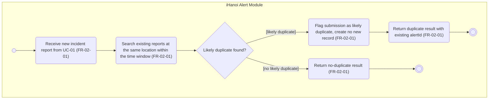

# Activity Diagram: AD-UC-02 Duplicate Detection

| Field | Value |
| :---- | :---- |
| AD ID | `AD-UC-02` |
| Use case | `UC-02 Duplicate Detection` |
| Feature | `F-02 AI Classification & Smart Routing` (W0 Table 2) |
| Priority | Should (W4 R2; W1 initial Must; FR-02-01) |
| Primary actor | System (duplicate check), as in W0 Table 1\. Called by UC-01 |
| Owner | Owner B (Nguyễn Tương Như) |
| Lanes | iHanoi Alert Module (ONE lane). The actor of this use case is the system itself; the citizen's steps are in AD-UC-01 |
| Inputs (L3-L5) | Context Diagram v3 (system boundary "iHanoi Alert Module") · Use Case Diagram v3 (UC-01 includes UC-02) · Sequence: `SD-UC-01`, SQ-04 and SQ-05 (alt [duplicate found]) · Architecture/ADR: none · W1 row FR-02-01 · W4 note on radius and time window |
| Trigger | WHEN a new incident report is submitted (called from UC-01) |
| Preconditions | The report passed validation in UC-01 |
| Success end state | Duplicate: the submission is flagged, no new record is created and the existing alertId is returned. No duplicate: a no-duplicate result is returned and UC-01 continues |
| Failure end state(s) | none: both branches are normal results |
| FRs covered | `FR-02-01` |
| Business rules applied | BR-03 (FR-02-01): same location within a time window; a duplicate is flagged and no new record is created |
| Version / status | v1.1 · Reviewed against the final project files (2026-11-07); peer review by another team pending |
| Author | Manhs |

## 1. Diagram

Notation: plain `flowchart` with one subgraph per lane. Circle = initial, double circle = final, rounded box = action, diamond = decision, dashed box = open question, thin bar = fork / join.

Reading notes:

- Single lane: the actor is the system, so no second lane exists.  
- The citizen's duplicate notice belongs to UC-01 (AD-UC-01, nodes s4 and a3). The citizen has no confirm or cancel choice.  
- The check runs before classification (SQ-04 before SQ-08), so only location and time can be compared.

## 2. Node trace

| Node | Kind | Text | Traces to |
| :---- | :---- | :---- | :---- |
| a1 | Action | Receive new incident report from UC-01 | FR-02-01 (WHEN clause, SQ-04) |
| a2 | Action | Search existing reports at the same location within the time window | FR-02-01 (SQ-04) |
| d1 | Decision | Likely duplicate found? | FR-02-01 (SQ-04, alt frame) |
| a3 | Action | Flag submission as likely duplicate, create no new record | FR-02-01 ("flag ... instead of creating a new record", SQ-05) |
| a4 | Action | Return duplicate result with existing alertId | FR-02-01 (SQ-05) |
| a5 | Action | Return no-duplicate result | FR-02-01 (implied else branch; UC-01 then saves, SQ-07) |

## 3. Branches and acceptance tests

Values follow the defaults in section 6: radius 100 m, window 24 h, boundary inclusive.

| Branch | Given | When | Then |
| :---- | :---- | :---- | :---- |
| d1 \[likely duplicate\] | Report A-1001 (Submitted) at 21.0136, 105.8014, 09:00 | New report at 21.0137, 105.8015 (about 15 m), 09:40 | Flagged, no record, the result carries A-1001 |
| d1 \[likely duplicate\], boundary | Same A-1001 | New report exactly 100 m away at 09:00 the next day (exactly 24 h) | Flagged (inclusive boundary) |
| d1 \[no likely duplicate\], distance | Same A-1001 | New report 1.2 km away at 09:40 | No-duplicate result |
| d1 \[no likely duplicate\], time | Same A-1001 | New report at the same spot 3 days later | No-duplicate result |
| d1 \[no likely duplicate\], empty | No reports within 100 m in the last 24 h | New report submitted | No-duplicate result |

## 4. Object states used

| Object | States in this diagram | Full state list (all diagrams) |
| :---- | :---- | :---- |
| Incident Report | none: this use case stores nothing and sets no state | Submitted, Routed, In Progress, Resolved (W1 FR-01-02) |

## 5. Screens touched

None: system-only use case. The duplicate notice screen is part of FR-01-01-FE (AD-UC-01).

## 6. Open questions and decisions

Questions are logged with the default the diagram and tests use.

| \# | Question | Blocking? | Default applied |
| :---- | :---- | :---- | :---- |
| 1 | \[NEEDS CLARIFICATION: what are the location radius and the time window? FR-02-01 gives no values and W4 asks to fix them before build\] | Yes | Radius 100 m, window 24 h, boundary inclusive, both held as configurable values. These are team assumptions to state to the client |
| 2 | \[NEEDS CLARIFICATION: are Resolved reports compared with the new one?\] | No | No: only reports not in state Resolved are compared, because a problem recurring at the same spot is a new incident |
| 3 | \[NEEDS CLARIFICATION: with several matches, which alertId is returned?\] | No | The earliest report, because later ones are duplicates of the original |

Decision: a flagged duplicate is not written to the audit trail, because FR-04-03 records state changes only and no state changes here.

## 7. Verification log

| Check | Result |
| :---- | :---- |
| Mermaid syntax | Parsed without error with Mermaid 12.3.0 in Node on 2026-11-07. Visual render on mermaid.live not run |
| Every decision has guards on all outgoing flows, no overlap, no gap | Pass (d1: 2 guards) |
| No action has two incoming flows (merge used instead) | Pass: only final, join and merge nodes have several incoming flows |
| Every fork has a matching join | n/a, no fork |
| Every system action cites an FR or a called use case | Pass (a1 to a5) |
| Every FR of this use case appears in the diagram | 1 of 1 (FR-02-01) |
| Lane names match Context Diagram v3 and the use case actors; no Web App, API or database lanes | Pass: "iHanoi Alert Module" (single system lane; the actor is the system) |
| Related sequence diagram uses the same names and FR IDs | Pass: SQ-04 and SQ-05 use FR-02-01; alt [duplicate found] is d1. The SQ-06 confirm/cancel choice is dropped |
| Project conventions applied (actor codes, status Submitted, duplicate rule, audit call, routing ownership) | Pass: see [activity-index.md](activity-index.md) section 2 |
| Cross-check against the final project files | 2026-11-07: W0, W1, W4, Context, Use Case and Sequence v3, ADR-001 to ADR-005. Peer review by another team: pending |
