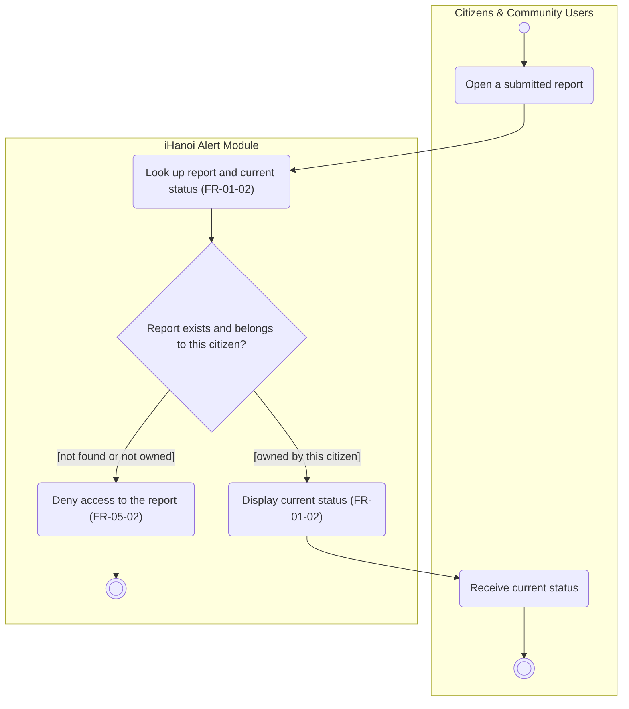

# Activity Diagram: AD-UC-03 Track Report Status

| Field | Value |
| :---- | :---- |
| AD ID | `AD-UC-03` |
| Use case | `UC-03 Track Report Status` |
| Feature | `F-01 Incident & Case Reporting` (W0 Table 2) |
| Priority | Should (W4 R2; W1 initial Must; FR-01-02) |
| Primary actor | Citizens & Community Users (ACT-E1) |
| Owner | Owner A (Lê Minh Anh) |
| Lanes | Citizens & Community Users · iHanoi Alert Module (ONE lane). No external-system lane |
| Inputs (L3-L5) | Context Diagram v3 (ENT-CIT, Flow-04 "case status") · Use Case Diagram v3 (Citizens to UC-03) · Sequence: none exists for UC-03 · Architecture/ADR: none · W1 rows FR-01-02, FR-05-02 |
| Trigger | WHEN a citizen opens a submitted report |
| Preconditions | The citizen is signed in and holds an alertId from UC-01 |
| Success end state | The citizen has seen the current status of the report; no data changes (read-only, FP type EQ) |
| Failure end state(s) | The report does not exist or does not belong to this citizen: access is denied and nothing is shown |
| FRs covered | `FR-01-02`. Cross-cutting, cited once: `FR-05-02` (role-based authorisation, applies to UC-01 to UC-17) |
| Business rules applied | none with a BR ID in W1. Owner-only access (open question 1\) |
| Version / status | v1.1 · Reviewed against the final project files (2026-11-07); peer review by another team pending |
| Author | Minh Anh |

## 1. Diagram

Notation: plain `flowchart` with one subgraph per lane. Circle = initial, double circle = final, rounded box = action, diamond = decision, dashed box = open question, thin bar = fork / join.

Reading notes:

- The use case only reads. No object node is drawn, because nothing is produced or changed; the four statuses the citizen can see are in section 4\.  
- The status is read at the moment the citizen opens the report (no polling or push).  
- Statuses are set elsewhere: Submitted by UC-01; Routed by UC-08 and UC-09; Resolved by UC-06. Who sets In Progress is open question 2\.

## 2. Node trace

| Node | Kind | Text | Traces to |
| :---- | :---- | :---- | :---- |
| s1 | Action | Look up report and current status | FR-01-02 (BE row: read report status) |
| d1 | Decision | Report exists and belongs to this citizen? | FR-01-02 (FE row: "my reports list"), FR-05-02; open question 1 |
| s2 | Action | Display current status | FR-01-02 (FE row: status detail; Context Flow-04) |
| s3 | Action | Deny access to the report | FR-05-02 |
| a1, a2 | Actor actions (citizen lane) | Open a submitted report; receive current status | UC-03, no FR ID needed |

## 3. Branches and acceptance tests

| Branch | Given | When | Then |
| :---- | :---- | :---- | :---- |
| d1 \[owned by this citizen\] | Citizen C1 owns A-1001, status Routed | C1 opens A-1001 | Status "Routed" is displayed |
| d1 \[not found or not owned\] | C1 signed in; A-9999 does not exist; A-1002 belongs to citizen C2 | C1 opens A-9999, then A-1002 | Access denied both times; no status shown |

Status display, one row per status of FR-01-02:

| Given state | When C1 opens the report | Then displayed |
| :---- | :---- | :---- |
| Submitted | opens | Submitted |
| Routed | opens | Routed |
| In Progress | opens | In Progress |
| Resolved | opens | Resolved |

## 4. Object states used

| Object | States in this diagram | Full state list (all diagrams) |
| :---- | :---- | :---- |
| Incident Report | Submitted, Routed, In Progress, Resolved (read only, none is set here) | Submitted, Routed, In Progress, Resolved (W1 FR-01-02) |

## 5. Screens touched

Screen "my reports list" and status detail (W1 FR-01-02-FE); ID not assigned yet.

## 6. Open questions and decisions

| # | Question | Blocking? | Default applied |
| :---- | :---- | :---- | :---- |
| 1 | [NEEDS CLARIFICATION: is "only the owner sees the report" part of role-based authorisation (FR-05-02) or a separate business rule? Roles do not cover ownership] | No | Owner-only access. A report that does not exist or belongs to someone else is denied the same way, so its existence is not revealed. Consequence of the duplicate rule (FR-02-01): a citizen who received a duplicate notice has the existing alertId but cannot open that report unless they own it |
| 2 | [NEEDS CLARIFICATION: who sets In Progress? FR-01-04 (UC-06) sets only Resolved or Handed to Police, and FR-01-02 lists four statuses] | No | "Handed to Police" is shown as In Progress; until FR-01-04 ships (W4: Should) citizens see only Submitted and Routed |

Decisions (basis in the project files):

| # | Decision | Basis |
| :---- | :---- | :---- |
| 1 | A report flagged for human verification (FR-02-05) stays Submitted until it is routed | FR-02-05 flags "before final routing"; Routed means an agency or Hanoi Portal has the report |
| 2 | The source trace of FR-01-02 now includes CTX:Flow-04 (case status to citizens) | Context Diagram Flow-04; applied in w1-function-list.md |

## 7. Verification log

| Check | Result |
| :---- | :---- |
| Mermaid syntax | Parsed without error with Mermaid 12.3.0 in Node on 2026-11-07. Visual render on mermaid.live not run |
| Every decision has guards on all outgoing flows, no overlap, no gap | Pass (d1: 2 guards) |
| No action has two incoming flows (merge used instead) | Pass: only final, join and merge nodes have several incoming flows |
| Every fork has a matching join | n/a, no fork |
| Every system action cites an FR or a called use case | Pass (s1 to s3) |
| Every FR of this use case appears in the diagram | 1 of 1 (FR-01-02), plus FR-05-02 as cross-cutting |
| Lane names match Context Diagram v3 and the use case actors; no Web App, API or database lanes | Pass: "Citizens & Community Users" (Context entity ENT-CIT, Use Case actor ACT-E1) and "iHanoi Alert Module" |
| Related sequence diagram uses the same names and FR IDs | n/a, no sequence diagram exists for UC-03 (listed as not drawn in use-case-diagram.md) |
| Project conventions applied (actor codes, status Submitted, duplicate rule, audit call, routing ownership) | Pass: see [activity-index.md](activity-index.md) section 2 |
| Cross-check against the final project files | 2026-11-07: W0, W1, W4, Context, Use Case and Sequence v3, ADR-001 to ADR-005. Peer review by another team: pending |
