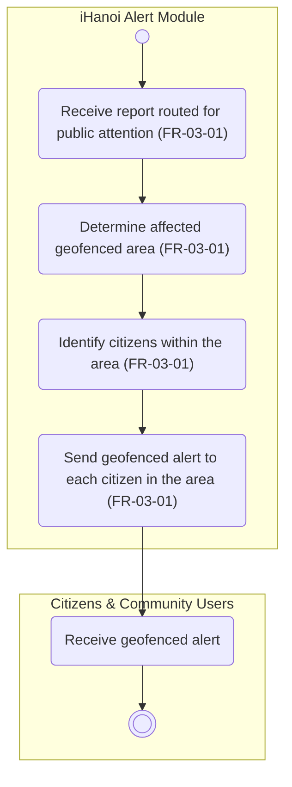

# Activity Diagram: AD-UC-04 Geofenced Alert / Notification

| Field | Value |
| :---- | :---- |
| AD ID | `AD-UC-04` |
| Use case | `UC-04 Geofenced Alert / Notification` |
| Feature | `F-03 Alerts & Notifications` (W0 Table 2) |
| Priority | Should (W4 R2; W1 initial Must; FR-03-01) |
| Primary actor | Citizens & Community Users (ACT-E1). The use case is started by the system, not by the citizen |
| Owner | Owner C (Trần Khánh Ngọc) |
| Lanes | Citizens & Community Users · iHanoi Alert Module (ONE lane). No lane for the push provider: it is part of the internal Notification Service (activity-index.md section 2) |
| Inputs (L3-L5) | Context Diagram v3 (ENT-CIT, Flow-04 "geofenced alerts and case status") · Use Case Diagram v3 (Citizens to UC-04; UC-09 to UC-04) · Sequence: `SD-UC-01`, SQ-12 (inside alt [confidence > 0.9]) · Architecture/ADR: ADR-001 · W1 row FR-03-01 · CVCA "Response & alert" O4 to E1 |
| Trigger | WHEN UC-09 has auto-routed a report with confidence above 0.9 (SQ-11, then SQ-12) |
| Preconditions | The report has been classified and routed; its status is Routed |
| Success end state | Every citizen inside the affected geofenced area has received the alert; if nobody is inside, nothing is sent and the activity ends without error |
| Failure end state(s) | none defined by an FR |
| FRs covered | `FR-03-01` |
| Business rules applied | none with a BR ID in W1. Only citizens inside the affected geofenced area are notified (FR-03-01) |
| Version / status | v1.1 · Reviewed against the final project files (2026-11-07); peer review by another team pending |
| Author | Owner C (Trần Khánh Ngọc) |

## 1. Diagram

Notation: plain `flowchart` with one subgraph per lane. Circle = initial, double circle = final, rounded box = action, diamond = decision, dashed box = open question, thin bar = fork / join.

Reading notes:

- FR-03-01 is a WHEN rule with no IF, so the diagram has no decision. "Which reports are routed for public attention" is decided earlier, in UC-08 and UC-09 (alt \[confidence \> 0.9\] in the sequence), not here.  
- "Each citizen in the area" covers an empty area: with nobody inside, nothing is sent and the activity ends.  
- Notifying the nearest police station (UC-10, FR-03-02) is a separate use case and is not drawn. Guidance and service-update notifications (FR-03-03) are on the Won't-have list (W0 Table 3).  
- Source-diagram finding: the sequence shows a Notification Service lifeline, and W1 has FR-03-01-INT "Integrate push-notification service", but Context Diagram v3 has no such entity.

## 2. Node trace

| Node | Kind | Text | Traces to |
| :---- | :---- | :---- | :---- |
| s1 | Action | Receive report routed for public attention | FR-03-01 (WHEN clause; SQ-11 to SQ-12) |
| s2 | Action | Determine affected geofenced area | FR-03-01 ("affected geofenced area"; BE row geofencing and alert targeting) |
| s3 | Action | Identify citizens within the area | FR-03-01 ("citizens within the ... area"; BE row) |
| s4 | Action | Send geofenced alert to each citizen in the area | FR-03-01 ("SHALL notify"; INT row push-notification service; SQ-12) |
| c1 | Actor action (citizen lane) | Receive geofenced alert | UC-04 (Context Flow-04), no FR ID needed |

## 3. Branches and acceptance tests

The diagram has no decision, so the rows below test the main flow and its edge case.

| Branch | Given | When | Then |
| :---- | :---- | :---- | :---- |
| Main flow | Report A-1021 "flooded street" is auto-routed (confidence 0.95); citizens Lan and Minh are inside the geofenced area | The report is routed | Lan and Minh each receive an alert about A-1021 |
| Edge case: nobody in the area | Report A-1022 is auto-routed; no citizen is inside its area | The report is routed | No alert is sent and the activity ends without error |
| Outside the area | Citizen Hoa is outside the area of A-1021 | The report is routed | Hoa receives no alert |

## 4. Object states used

| Object | States in this diagram | Full state list (all diagrams) |
| :---- | :---- | :---- |
| Incident Report | Routed (precondition only; this use case sets no state) | Submitted, Routed, In Progress, Resolved (W1 FR-01-02)&nbsp; |

## 5. Screens touched

Push notification on the citizen's device (W1 FR-03-01-INT); screen ID not assigned yet.

## 6. Open questions and decisions

| # | Question | Blocking? | Default applied |
| :---- | :---- | :---- | :---- |
| 1 | [NEEDS CLARIFICATION: which reports count as "routed for public attention"? In the sequence only the auto-route path (confidence above 0.9) sends the alert; reports routed manually after human verification do not] | No | Only reports auto-routed by UC-09 trigger the alert (Use Case Diagram edge UC-09 to UC-04; SQ-11 to SQ-12) |
| 2 | [NEEDS CLARIFICATION: how is the affected geofenced area defined (radius or district)?] | No | Area taken from the GPS location of the report; its size is a configurable value to be agreed with the client |
| 3 | [NEEDS CLARIFICATION: can a citizen turn alerts off, and is that checked before sending?] | No | Not modelled until an FR exists |

Decisions (basis in the project files):

| # | Decision | Basis |
| :---- | :---- | :---- |
| 1 | The push-notification provider is part of the internal Notification Service, not a Context Diagram entity | Sequence lifeline "Notification Service"; FR-03-01-INT; add a lane and an entity only if a named external provider is chosen |

## 7. Verification log

| Check | Result |
| :---- | :---- |
| Mermaid syntax | Parsed without error with Mermaid 12.3.0 in Node on 2026-11-07. Visual render on mermaid.live not run |
| Every decision has guards on all outgoing flows, no overlap, no gap | n/a, no decision (FR-03-01 has no IF) |
| No action has two incoming flows (merge used instead) | Pass: only final, join and merge nodes have several incoming flows |
| Every fork has a matching join | n/a, no fork |
| Every system action cites an FR or a called use case | Pass (s1 to s4) |
| Every FR of this use case appears in the diagram | 1 of 1 (FR-03-01) |
| Lane names match Context Diagram v3 and the use case actors; no Web App, API or database lanes | Pass: "Citizens & Community Users" (Context entity ENT-CIT, Use Case actor ACT-E1) and "iHanoi Alert Module" |
| Related sequence diagram uses the same names and FR IDs | Pass: SQ-12 uses FR-03-01-BE and FR-03-01-INT. Its alt [confidence > 0.9] is the trigger condition, decided in UC-08 and UC-09, so it is not a decision here |
| Project conventions applied (actor codes, status Submitted, duplicate rule, audit call, routing ownership) | Pass: see [activity-index.md](activity-index.md) section 2 |
| Cross-check against the final project files | 2026-11-07: W0, W1, W4, Context, Use Case and Sequence v3, ADR-001 to ADR-005. Peer review by another team: pending |
