# Activity Diagram: AD-UC-05 Report Missing Person / Pet / Asset

| Field | Value |
| :---- | :---- |
| AD ID | `AD-UC-05` |
| Use case | `UC-05 Report Missing Person / Pet / Asset` |
| Feature | `F-01 Incident & Case Reporting` (W0 Table 2) |
| Priority | Must (W4 R1; W1 initial Must; FR-01-03) |
| Primary actor | Citizens & Community Users (ACT-E1) |
| Owner | Owner A (Lê Minh Anh) |
| Lanes | Citizens & Community Users · iHanoi Alert Module (ONE lane). The police receive the notification in AD-UC-10, so there is no Police lane here |
| Inputs (L3-L5) | Context Diagram v3 (Flow-03 missing-case reports) · Use Case Diagram v3 (Citizens to UC-05, UC-05 to UC-10, UC-05 to UC-11) · Sequence: none traced to UC-05 · Architecture/ADR: none · W1 row FR-01-03 (calls FR-03-02, FR-01-05) · W4 |
| Trigger | A citizen declares a missing person, pet or asset |
| Preconditions | The citizen can give a description and a last-known location |
| Success end state | A missing-person / pet / asset case exists, separate from incident reports; the nearest police station is notified (AD-UC-10); sighting assistance is started (AD-UC-11) |
| Failure end state(s) | Description or last-known location missing: behaviour undefined (see Open question 1\) |
| FRs covered | `FR-01-03` |
| Business rules applied | BR-08: a missing-person / pet / asset case is a separate record from an incident report (FR-01-03) |
| Version / status | v1.1 · Reviewed against the final project files (2026-11-07); peer review by another team pending |
| Author | Owner A (Lê Minh Anh) |

## 1. Diagram

Notation: plain `flowchart` with one subgraph per lane. Circle = initial, double circle = final, rounded box = action, diamond = decision, dashed box = open question, thin bar = fork / join.

```mermaid
flowchart TB
  subgraph CIT["Citizens & Community Users"]
    start1(( ))
    c1["Declare missing person, pet or asset with description and last-known location"]
  end
  subgraph SYS["iHanoi Alert Module"]
    s1["Receive the declaration (FR-01-03)"]
    d1{"Description and last-known location provided?"}
    s2["Create missing person / pet / asset case, distinct from an incident report (FR-01-03)"]
    fk1[" "]
    s3["Call: Auto-Notify Nearest Police Station (AD-UC-10, FR-03-02)"]
    s4["Call: Community Sighting Assistance (AD-UC-11, FR-01-05)"]
    jn1[" "]
    q1["[NEEDS CLARIFICATION: what happens when description or last-known location is missing?]"]
    stop1((( )))
    stop2((( )))
  end
  start1 --> c1 --> s1 --> d1
  d1 -->|"[both provided]"| s2 --> fk1
  fk1 --> s3 --> jn1
  fk1 --> s4 --> jn1
  jn1 --> stop1
  d1 -->|"[one or both missing]"| q1 --> stop2
  classDef nc stroke-dasharray: 4 3
  classDef bar fill:#333,stroke:#333
  class q1 nc
  class fk1,jn1 bar
```

Reading notes:

- FR-01-03 only names the two inputs in its WHEN clause. The "missing" branch is therefore an open question, not an invented retry loop.
- UC-10 and UC-11 are independent of each other, so they run in parallel after the case exists (fork `fk1`, join `jn1`). Include or extend for UC-11 is open (question 2).
- The police notification always follows case creation (FR-03-02: WHEN a missing-person / pet / asset case is created), so it has no decision of its own. The police receive the notification in AD-UC-10; that step is not repeated here.

## 2. Node trace

| Node | Kind | Text | Traces to |
| :---- | :---- | :---- | :---- |
| c1 | Action (actor) | Declare missing person, pet or asset | FR-01-03 (L3 FR-01-03-FE) |
| s1 | Action | Receive the declaration | FR-01-03 (L3 FR-01-03-BE) |
| d1 | Decision | Description and last-known location provided? | FR-01-03 (both inputs named in the WHEN clause); gap in open question 1 |
| s2 | Action | Create case, distinct from an incident report | FR-01-03 |
| fk1 / jn1 | Fork / Join | Start and end of the two calls | UC-05 → UC-10, UC-05 → UC-11 |
| s3 | Call | Auto-Notify Nearest Police Station | FR-03-02 (UC-10, not copied) |
| s4 | Call | Community Sighting Assistance | FR-01-05 (UC-11, not copied) |
| q1 | Clarification | Incomplete declaration | open question 1 |

## 3. Branches and acceptance tests

| Branch | Given | When | Then |
| :---- | :---- | :---- | :---- |
| d1 \[both provided\] | A citizen lost a dog named Mimi; description "brown poodle, red collar"; last-known location "Hoan Kiem Lake, Hanoi" | The citizen submits the declaration | A missing-pet case is created (not an incident report); the nearest police station is notified; sighting assistance is started |
| d1 \[one or both missing\] | Description "brown poodle, red collar"; last-known location empty | The citizen submits the declaration | Behaviour undefined (open question 1). No case is created in this diagram |

## 4. Object states used

| Object | States in this diagram | Full state list (all diagrams) |
| :---- | :---- | :---- |
| Missing person / pet / asset case | None drawn (initial state not defined, open question 2\) | Not defined. FR-01-02 lists statuses for incident reports only |

## 5. Screens touched

| Actor action | Screen ID |
| :---- | :---- |
| Declare missing person, pet or asset | Form "declare missing person / pet / asset details" (W1 FR-01-03-FE); ID not assigned yet |

## 6. Open questions and decisions

| \# | Question | Blocking? | Default applied |
| :---- | :---- | :---- | :---- |
| 1 | \[NEEDS CLARIFICATION: is the declaration rejected when description or last-known location is missing, and which message does the citizen get?\] | Yes | Node q1 kept in diagram; no case created |
| 2 | \[NEEDS CLARIFICATION: what is the initial status of a new case? FR-01-02 lists statuses for incident reports only.\] | No | No state drawn |
| 3 | \[NEEDS CLARIFICATION: is UC-11 an include (always) or an extend (optional)? It is Could priority.\] | No | Drawn as a call in parallel with UC-10 |
| 4 | Does the citizen get a confirmation after the case is created (compare SQ-19 for UC-01)? No FR covers it | No | Not drawn |
| 5 | No sequence diagram traced to UC-05 in W1. Confirm whether one exists | No | Drawn from the FR only |

## 7. Verification log

| Check | Result |
| :---- | :---- |
| Mermaid syntax | Parsed without error with Mermaid 12.3.0 in Node on 2026-11-07. Visual render on mermaid.live not run |
| Every decision has guards on all outgoing flows, no overlap, no gap | Pass (d1: 2 guards) |
| No action has two incoming flows (merge used instead) | Pass: only final, join and merge nodes have several incoming flows |
| Every fork has a matching join | Pass (1 fork, 1 join) |
| Every system action cites an FR or a called use case | Pass (s1 to s4 cite FR-01-03, or a called FR-03-02 / FR-01-05) |
| Every FR of this use case appears in the diagram | 1 of 1 (FR-01-03); FR-03-02 and FR-01-05 appear as calls only |
| Lane names match Context Diagram v3 and the use case actors; no Web App, API or database lanes | Pass: "Citizens & Community Users" (Context entity ENT-CIT, Use Case actor ACT-E1) and "iHanoi Alert Module"; Police is drawn in AD-UC-10 |
| Related sequence diagram uses the same names and FR IDs | n/a: no sequence diagram traced to UC-05 (listed as not drawn in use-case-diagram.md) |
| Project conventions applied (actor codes, status Submitted, duplicate rule, audit call, routing ownership) | Pass: see [activity-index.md](activity-index.md) section 2 |
| Cross-check against the final project files | 2026-11-07: W0, W1, W4, Context, Use Case and Sequence v3, ADR-001 to ADR-005. Peer review by another team: pending |
