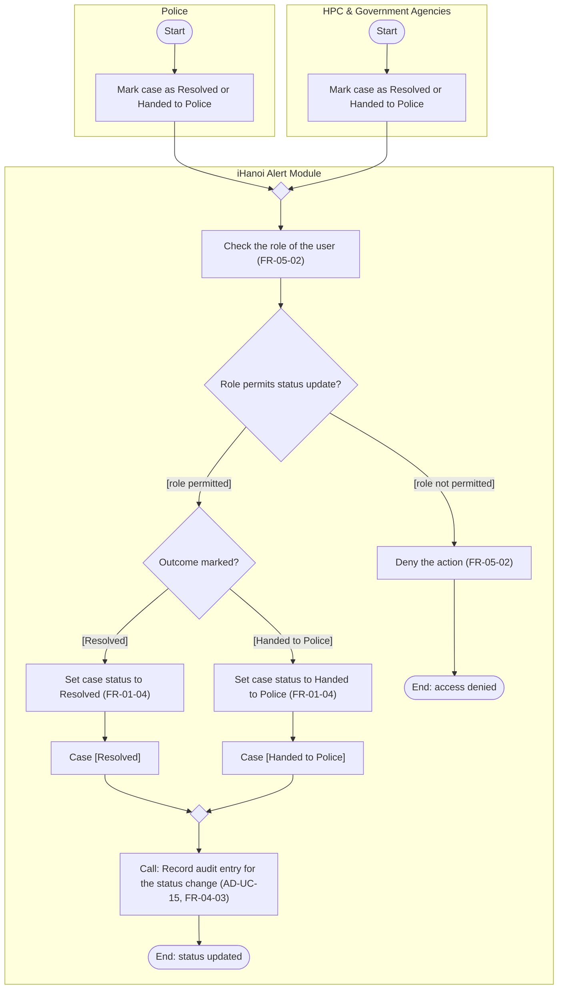

# Activity Diagram: AD-UC-06 Update Case Status (Resolved / Handed to Police)

| Field | Value |
| :---- | :---- |
| AD ID | `AD-UC-06` |
| Use case | `UC-06 Update Case Status (Resolved / Handed to Police)` |
| Feature | `F-01 Incident & Case Reporting` (W0 Table 2) |
| Priority | Should (W4 R2; W1 initial Must; FR-01-04) |
| Primary actor | Police (ACT-P2); HPC & Government Agencies (ACT-G2), authorised staff |
| Owner | Owner A (Lê Minh Anh) |
| Lanes | Police · HPC & Government Agencies · iHanoi Alert Module |
| Inputs (L3-L5) | Context Diagram v3 (Flow-10 case status updates) · Use Case Diagram v3 (Police and HPC & Government Agencies to UC-06) · Sequence: none traced to UC-06 · Architecture/ADR: none · W1 row FR-01-04 (cross-cutting: FR-05-02, FR-04-03) · W4 |
| Trigger | An authorised user marks a case as resolved or handed to police |
| Preconditions | The case exists and the user is signed in |
| Success end state | The case status is updated and the change is recorded in the audit trail |
| Failure end state(s) | Access denied: the case status does not change |
| FRs covered | `FR-01-04` |
| Business rules applied | BR-05 role-based access (FR-05-02); BR-04 every status change is audited (FR-04-03); BR-07 only authorised users may mark a case resolved or handed to police |
| Version / status | v1.1 · Reviewed against the final project files (2026-11-07); peer review by another team pending |
| Author | Owner A (Lê Minh Anh) |

## 1. Diagram

Notation: plain `flowchart` with one subgraph per lane. Circle = initial, double circle = final, rounded box = action, diamond = decision, dashed box = open question, thin bar = fork / join.

Reading notes:

- Police and HPC staff are two actors of the same use case (Use Case Diagram v3), so each has its own lane and start. Their flows meet at the merge `m0`.
- `d2` is the user's choice between the two outcomes. FR-01-04 allows one outcome per update.
- The audit entry (FR-04-03) is one call step; recording and viewing are drawn in AD-UC-15. Viewing the audit trail is UC-15 (AD-UC-15).
- Denied attempts are not recorded (open question 4).

## 2. Node trace

| Node | Kind | Text | Traces to |
| :---- | :---- | :---- | :---- |
| p1 / h1 | Action (actor) | Mark case as Resolved or Handed to Police | FR-01-04 (WHEN an authorised user marks a case ...) |
| m0 | Merge | Join of the two actor lanes | Notation rule (two incoming flows) |
| s1 | Action | Check the role of the user | FR-05-02 |
| d1 | Decision | Role permits status update? | FR-05-02, FR-01-04 ("authorised user") |
| s2 | Action | Deny the action | FR-05-02 |
| d2 | Decision | Outcome marked? | FR-01-04 (resolved or handed to police) |
| s3 | Action | Set case status to Resolved | FR-01-04 (L3 FR-01-04-BE) |
| o1 | Object | Case \[Resolved\] | FR-01-02 (status value) |
| s4 | Action | Set case status to Handed to Police | FR-01-04 (L3 FR-01-04-BE) |
| o2 | Object | Case \[Handed to Police\] | none (open question 1\) |
| m1 | Merge | Join of the two outcomes | Notation rule (two incoming flows) |
| s5 | Call | Record audit entry for the status change (AD-UC-15) | FR-01-04, FR-04-03 |

## 3. Branches and acceptance tests

| Branch | Given | When | Then |
| :---- | :---- | :---- | :---- |
| d1 \[role not permitted\] | A technology-partner account; case C-2031 with status "In Progress" | The account tries to mark C-2031 as Resolved | Access is denied; the status of C-2031 stays "In Progress" |
| d1 \[role permitted\] | A police officer with the Police role; case C-2031 with status "In Progress" | The officer marks the case | The flow continues to the outcome decision |
| d2 \[Resolved\] | Authorised police officer; case C-2031 with status "In Progress" | The officer marks C-2031 as Resolved | Status becomes "Resolved"; an audit entry is written (who, when, "In Progress" to "Resolved") |
| d2 \[Handed to Police\] | HPC staff member with the HPC role; case C-2044 with status "Routed" | The staff member marks C-2044 as Handed to Police | Status becomes "Handed to Police"; an audit entry is written (who, when, "Routed" to "Handed to Police") |

## 4. Object states used

| Object | States in this diagram | Full state list (all diagrams) |
| :---- | :---- | :---- |
| Case | Resolved, Handed to Police | Submitted / Routed / In Progress / Resolved (FR-01-02), plus Handed to Police (proposed, open question 1\) |

## 5. Screens touched

| Actor action | Screen ID |
| :---- | :---- |
| Mark case as Resolved or Handed to Police | Screen "mark case resolved / escalate to police" (W1 FR-01-04-FE); ID not assigned yet |

## 6. Open questions and decisions

| \# | Question | Blocking? | Default applied |
| :---- | :---- | :---- | :---- |
| 1 | \[NEEDS CLARIFICATION: "Handed to Police" is not in the status list of FR-01-02 (Submitted / Routed / In Progress / Resolved). Add it as a fifth status?\] | No | Added as proposed state |
| 2 | \[NEEDS CLARIFICATION: does the update apply to incident reports, to missing-person / pet / asset cases, or to both? FR-01-04 says "case".\] | No | Both |
| 3 | \[NEEDS CLARIFICATION: does "Handed to Police" also trigger the police notification of UC-10?\] | No | No. UC-10 stays separate until an FR links them |
| 4 | \[NEEDS CLARIFICATION: is a denied attempt also written to the audit trail?\] | No | Not recorded until an FR exists |
| 5 | \[NEEDS CLARIFICATION: may both Police and HPC staff set both outcomes, or is each role limited to one?\] | No | Both roles may set both outcomes |

## 7. Verification log

| Check | Result |
| :---- | :---- |
| Mermaid syntax | Parsed without error with Mermaid 12.3.0 in Node on 2026-11-07. Visual render on mermaid.live not run |
| Every decision has guards on all outgoing flows, no overlap, no gap | Pass (d1: 2 guards; d2: 2 guards) |
| No action has two incoming flows (merge used instead) | Pass: only final, join and merge nodes have several incoming flows |
| Every fork has a matching join | n/a, no fork |
| Every system action cites an FR or a called use case | Pass (s1 to s5 cite FR-05-02, FR-01-04 or FR-04-03; s5 is a call to AD-UC-15) |
| Every FR of this use case appears in the diagram | 1 of 1 (FR-01-04). FR-05-02 and FR-04-03 are cross-cutting rules, not counted |
| Lane names match Context Diagram v3 and the use case actors; no Web App, API or database lanes | Pass: Police, HPC & Government Agencies, iHanoi Alert Module (Context entities; ACT-P2, ACT-G2) |
| Related sequence diagram uses the same names and FR IDs | n/a: no sequence traced to UC-06 (listed as not drawn in use-case-diagram.md) |
| Project conventions applied (actor codes, status Submitted, duplicate rule, audit call, routing ownership) | Pass: see [activity-index.md](activity-index.md) section 2 |
| Cross-check against the final project files | 2026-11-07: W0, W1, W4, Context, Use Case and Sequence v3, ADR-001 to ADR-005. Peer review by another team: pending |
