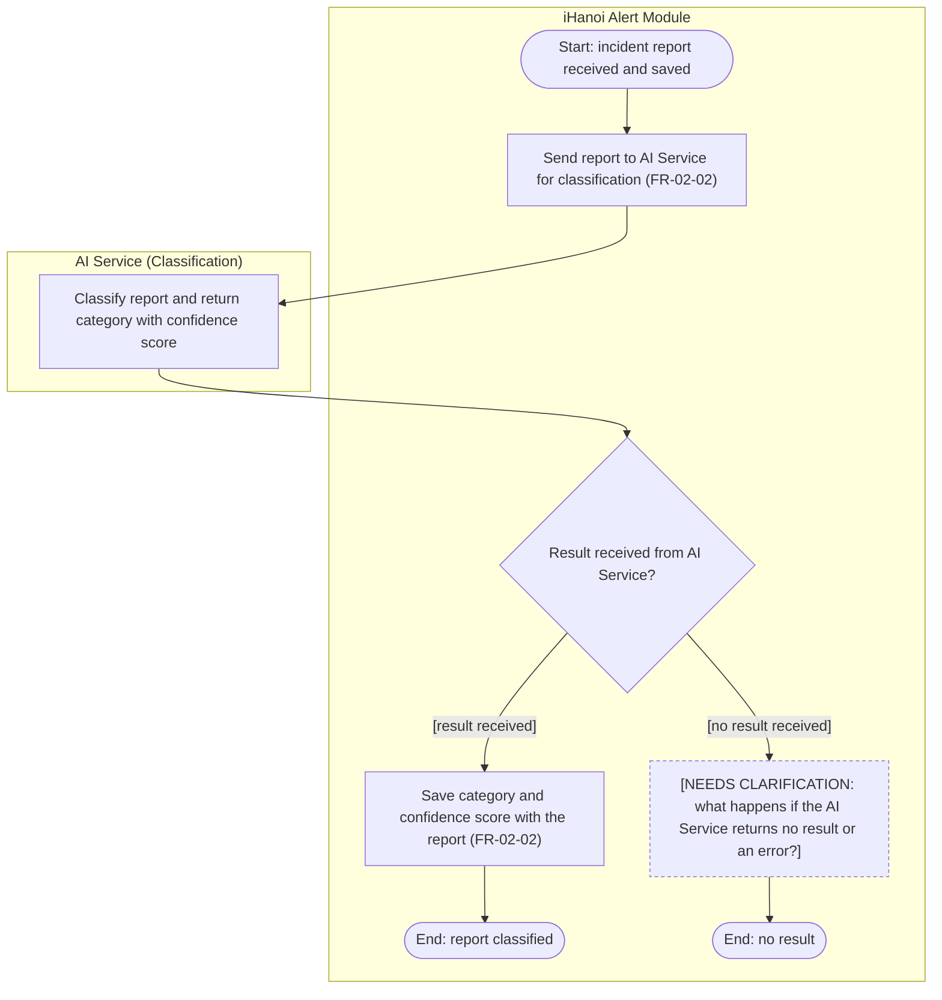

# Activity Diagram: AD-UC-07 AI Classification & Confidence Scoring

| Field | Value |
| :---- | :---- |
| AD ID | `AD-UC-07` |
| Use case | `UC-07 AI Classification & Confidence Scoring` |
| Feature | `F-02 AI Classification & Smart Routing` (W0 Table 2) |
| Priority | Must (W4 R1; W1 initial Must; FR-02-02) |
| Primary actor | System (AI Service); no human actor |
| Owner | Owner B (Nguyễn Tương Như) |
| Lanes | iHanoi Alert Module · AI Service (Classification), a separate service behind the Alert Service (ADR-003) |
| Inputs (L3-L5) | Context Diagram v3 (the AI Service is not an entity) · Use Case Diagram v3 (UC-01 includes UC-07, UC-08 includes UC-07) · Sequence v3: SQ-08, SQ-09, SQ-10 · Architecture/ADR: ADR-003 · W1 row FR-02-02 · W4 |
| Trigger | UC-08 requests classification of a saved incident report (UC-07 runs once per report, called from UC-08) |
| Preconditions | The incident report exists in the module with status Submitted |
| Success end state | The report has a category and a confidence score saved with it |
| Failure end state(s) | No result from the AI Service: undefined (see Open question 1\) |
| FRs covered | `FR-02-02` |
| Business rules applied | None defined |
| Version / status | v1.1 · Reviewed against the final project files (2026-11-07); peer review by another team pending |
| Author | Owner B (Nguyễn Tương Như) |

## 1. Diagram

Notation: plain `flowchart` with one subgraph per lane. Circle = initial, double circle = final, rounded box = action, diamond = decision, dashed box = open question, thin bar = fork / join.

Reading notes:

- FR-02-02 has no IF-THEN, so decision d1 only holds the failure question (node c1). It is not backed by an FR.
- The score is the input of UC-08 (FR-02-03, threshold 0.9). That handoff is drawn in AD-UC-08, not here.
- UC-07 has two callers on the diagrams: UC-01 (SQ-08) and UC-08 (include). See open question 3\.

## 2. Node trace

| Node | Kind | Text | Traces to |
| :---- | :---- | :---- | :---- |
| s1 | Action | Send report to AI Service for classification | FR-02-02 (L3 FR-02-02-BE), SQ-08 |
| a1 | Action (AI Service) | Classify report and return category and score | L3 FR-02-02-INT, SQ-09 (external lane, no FR on the node) |
| d1 | Decision | Result received from AI Service? | none (open question 1\) |
| s2 | Action | Save category and confidence score with the report | FR-02-02 (L3 FR-02-02-BE), SQ-10 |
| c1 | Clarification | AI Service failure handling | open question 1 |

## 3. Branches and acceptance tests

| Branch | Given | When | Then |
| :---- | :---- | :---- | :---- |
| d1 \[result received\] | Alert AL-0601, text "Fallen tree blocking Nguyen Trai street", photo attached; AI Service available | The module sends the report for classification | The AI Service returns category "Fallen tree" with confidence 0.93; the module saves both with AL-0601 |
| d1 \[result received\], low score | Alert AL-0602, text "Strange smell near the river" | The module sends the report for classification | The AI Service returns category "Pollution" with confidence 0.62; the module saves both (what 0.62 means is decided in AD-UC-08) |
| d1 \[no result received\] | Alert AL-0603; AI Service unreachable | The module sends the report for classification | The report has no category or score; the flow ends pending open question 1 |

## 4. Object states used

| Object | States in this diagram | Full state list (all diagrams) |
| :---- | :---- | :---- |
| Report | None | Submitted / Routed / In Progress / Resolved (FR-01-02). |

## 5. Screens touched

| Actor action | Screen ID |
| :---- | :---- |
| None (system-triggered, no screen) | n/a |

## 6. Open questions and decisions

| # | Question | Blocking? | Default applied |
| :---- | :---- | :---- | :---- |
| 1 | [NEEDS CLARIFICATION: what happens if the AI Service returns no result or an error (retry, manual path, wait time)?] | Yes | Node c1 kept in diagram |
| 2 | Is there a status value for a classified report? FR-01-02 lists none | No | No object state shown |

Decisions (basis in the project files):

| # | Decision | Basis |
| :---- | :---- | :---- |
| 1 | The AI Service is a separate service behind the Alert Service. It is drawn as its own lane, as in the Sequence, and is not a Context Diagram entity | ADR-003; SQ-08 to SQ-10 |
| 2 | UC-07 runs once per report, called by UC-08. AD-UC-01 calls UC-08, not UC-07 | Use Case Diagram (UC-08 includes UC-07); AD-UC-01, AD-UC-08 |
| 3 | A report flagged as a duplicate by UC-02 is not classified | AD-UC-01 ends at the duplicate notice before UC-08 is called |

## 7. Verification log

| Check | Result |
| :---- | :---- |
| Mermaid syntax | Parsed without error with Mermaid 12.3.0 in Node on 2026-11-07. Visual render on mermaid.live not run |
| Every decision has guards on all outgoing flows, no overlap, no gap | Pass (d1: 2 guards) |
| No action has two incoming flows (merge used instead) | Pass: only final, join and merge nodes have several incoming flows |
| Every fork has a matching join | n/a, no fork |
| Every system action cites an FR or a called use case | Pass: s1 and s2 cite FR-02-02; clarification and external-lane nodes are not system actions |
| Every FR of this use case appears in the diagram | 1 of 1 (FR-02-02) |
| Lane names match Context Diagram v3 and the use case actors; no Web App, API or database lanes | Pass by design: "AI Service (Classification)" is a separate service (ADR-003) and matches the Sequence lifeline; it is not a Context Diagram entity. "iHanoi Alert Module" matches |
| Related sequence diagram uses the same names and FR IDs | Pass for SQ-08, SQ-09, SQ-10 (same FR IDs: FR-02-02-BE, FR-02-02-INT). The alts in the Sequence (duplicate, confidence 0.9) are not part of these messages |
| Project conventions applied (actor codes, status Submitted, duplicate rule, audit call, routing ownership) | Pass: see [activity-index.md](activity-index.md) section 2 |
| Cross-check against the final project files | 2026-11-07: W0, W1, W4, Context, Use Case and Sequence v3, ADR-001 to ADR-005. Peer review by another team: pending |
