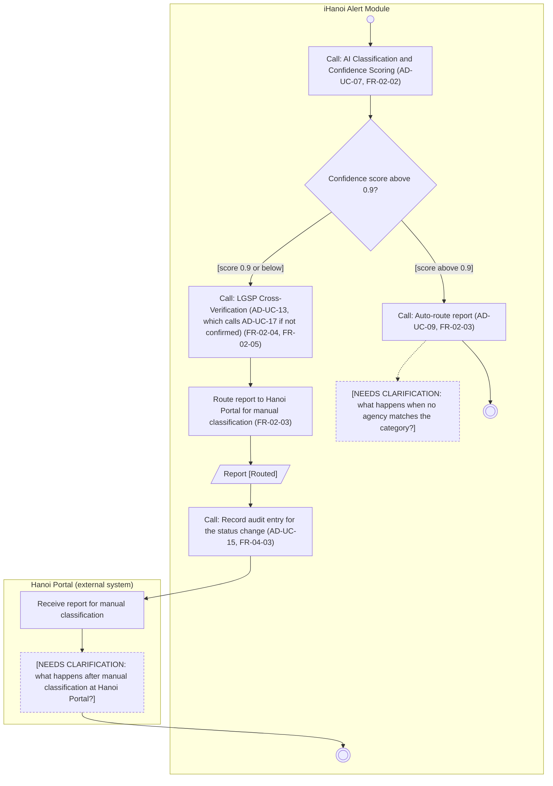

# Activity Diagram: AD-UC-08 Smart Routing to Responsible Agency

| Field | Value |
| :---- | :---- |
| AD ID | `AD-UC-08` |
| Use case | `UC-08 Smart Routing to Responsible Agency` (UC-09 Auto-route is its confidence-above-0.9 branch and has its own diagram, AD-UC-09) |
| Feature | `F-02 AI Classification & Smart Routing` (W0 Table 2) |
| Priority | Must (W4 R1; W1 initial Must; FR-02-03) |
| Primary actor | System (routing engine); no human actor |
| Owner | Owner B (Nguyễn Tương Như) |
| Lanes | iHanoi Alert Module · Hanoi Portal (external system, Context Flow-11) |
| Inputs (L3-L5) | Context Diagram v3 plus Flow-11 to Hanoi Portal (added) · Use Case Diagram v3 (UC-08 to UC-07, UC-08 to UC-09 [confidence > 0.9], UC-08 to UC-13 [confidence ≤ 0.9], UC-13 to UC-17, UC-17 to UC-08; UC-01 calls UC-08, line to be added) · Sequence v3: SQ-11, SQ-16 (SQ-08 to SQ-10 via UC-07, SQ-13 to SQ-15 via UC-13) · Architecture/ADR: ADR-001, ADR-004 · W1 row FR-02-03 (calls FR-02-02, FR-02-04, FR-02-05) · W4 |
| Trigger | UC-01 has saved a report and calls UC-08, or UC-17 returns a reviewed report to UC-08 |
| Preconditions | The report exists with description and location (status Submitted) |
| Success end state | Confidence above 0.9: the report is auto-routed by UC-09. Confidence 0.9 or below: the report is cross-verified (UC-13, with UC-17 when LGSP does not confirm) and routed to Hanoi Portal for manual classification. In both cases the status becomes Routed and an audit entry is recorded |
| Failure end state(s) | No responsible agency matches the category; no result after manual classification at Hanoi Portal (open questions 1 and 2) |
| FRs covered | `FR-02-03`. Calls: FR-02-02 (UC-07), FR-02-04 (UC-13), FR-02-05 (UC-17) |
| Business rules applied | BR-01 and BR-02: confidence threshold 0.9 (FR-02-03) |
| Version / status | v1.1 · Reviewed against the final project files (2026-11-07); peer review by another team pending |
| Author | Owner B (Nguyễn Tương Như) |

## 1. Diagram

Notation: plain `flowchart` with one subgraph per lane. Circle = initial, double circle = final, rounded box = action, diamond = decision, dashed box = open question, thin bar = fork / join.

Reading notes:

- The threshold follows FR-02-03: above 0.9 is auto-route, 0.9 or below is manual. The boundary value 0.90 takes the manual branch.
- UC-09 (auto-route) is a called use case with its own diagram, AD-UC-09. It sets the status Routed, starts the geofenced alert (UC-04) and records the audit entry.
- On the manual path UC-13 (LGSP cross-verification) runs first and calls UC-17 (human verification) when LGSP does not confirm the category. UC-13 and UC-17 only return a result; UC-08 does the final routing to Hanoi Portal (SQ-16).
- Both paths set the status Routed; there is no separate "Routed to Hanoi Portal" status.
- Hanoi Portal is an external system (Context Flow-11).

## 2. Node trace

| Node | Kind | Text | Traces to |
| :---- | :---- | :---- | :---- |
| s0 | Call | AI classification and confidence scoring (AD-UC-07) | FR-02-02 (UC-08 to UC-07 include) |
| d1 | Decision | Confidence score above 0.9? | FR-02-03 (BE row), alt in Sequence v3 |
| s1 | Call | Auto-route report (AD-UC-09) | FR-02-03 (UC-08 to UC-09 [confidence > 0.9]), SQ-11 |
| s3 | Call | LGSP cross-verification (AD-UC-13; calls AD-UC-17 if not confirmed) | FR-02-04, FR-02-05 (UC-08 to UC-13 [confidence ≤ 0.9]) |
| s2 | Action | Route report to Hanoi Portal for manual classification | FR-02-03 (BE and INT rows), SQ-16 |
| o2 | Object | Report [Routed] | FR-01-02 (status value) |
| s4 | Call | Record audit entry for the status change (AD-UC-15) | FR-04-03 |
| p1 | Action (Hanoi Portal) | Receive report for manual classification | SQ-16 |
| n1 | Clarification | No agency matches the category | open question 1 |
| c1 | Clarification | Step after manual classification | open question 2 |

## 3. Branches and acceptance tests

| Branch | Given | When | Then |
| :---- | :---- | :---- | :---- |
| d1 [score above 0.9] | Alert AL-0701 classified "Fallen tree", confidence 0.95 | Routing runs | UC-09 is called: the report is auto-routed to the specialized agency under HPC (status Routed) |
| d1 [score 0.9 or below] | Alert AL-0702 classified "Pollution", confidence 0.85 | Routing runs | LGSP cross-verification runs (AD-UC-13), then the report is routed to Hanoi Portal for manual classification; status Routed; audit entry recorded |
| d1 boundary | Alert AL-0703 classified "Flooding", confidence exactly 0.90 | Routing runs | 0.90 is not above 0.9: manual branch, as for 0.85 |
| d1 boundary | Alert AL-0704 classified "Flooding", confidence 0.91 | Routing runs | Auto-route branch (UC-09), as for 0.95 |

## 4. Object states used

| Object | States in this diagram | Full state list (all diagrams) |
| :---- | :---- | :---- |
| Report | Routed (set by s2 on the manual path; set by UC-09 on the auto path) | Submitted, Routed, In Progress, Resolved (W1 FR-01-02) |

## 5. Screens touched

| Actor action | Screen ID |
| :---- | :---- |
| None for the routing itself (system-triggered). The receiving side is a screen of the agency or of Hanoi Portal | n/a |

## 6. Open questions and decisions

| # | Question | Blocking? | Default applied |
| :---- | :---- | :---- | :---- |
| 1 | [NEEDS CLARIFICATION: what happens when no specialized agency matches the category? W1 FR-02-03-INT covers the agency directory but gives no rule for a missing match] | Yes | Node n1 kept in diagram |
| 2 | [NEEDS CLARIFICATION: what happens after manual classification at Hanoi Portal? Is the result sent back to the module?] | Yes | Node c1 kept in diagram |
| 3 | Does the geofenced alert (UC-04) also run on the manual path? SQ-12 sits inside the auto-route branch | No | Auto-route branch only (AD-UC-09) |
| 4 | FR-02-04 (Could) supplies the LGSP result for UC-13. If it is not built, what does UC-08 do for scores of 0.9 or below? | No | FR-02-03 alone routes them to Hanoi Portal; UC-13 and UC-17 are inserted when FR-02-04 is built (see AD-UC-17 question 5) |

Decisions (basis in the project files):

| # | Decision | Basis |
| :---- | :---- | :---- |
| 1 | UC-08 owns the final routing. UC-13 and UC-17 return a result to UC-08 | Use Case Diagram (UC-17 to UC-08); SQ-16 |
| 2 | UC-09 is a called use case with its own diagram. UC-08 does not repeat its steps | Use Case Diagram (UC-08 to UC-09) |
| 3 | Both paths set the status Routed | FR-01-02 status list; no fifth status |
| 4 | Hanoi Portal is an external system with its own lane | Context Flow-11 (added); SQ-16 |
| 5 | The audit entry is one call step to AD-UC-15 | BR-04; FR-04-03 |

## 7. Verification log

| Check | Result |
| :---- | :---- |
| Mermaid syntax | Parsed without error with Mermaid 12.3.0 in Node on 2026-11-07. Visual render on mermaid.live not run |
| Every decision has guards on all outgoing flows, no overlap, no gap | Pass (d1: 2 guards) |
| No action has two incoming flows (merge used instead) | Pass: only final, join and merge nodes have several incoming flows |
| Every fork has a matching join | n/a, no fork |
| Every system action cites an FR or a called use case | Pass: s0, s1, s2, s3, s4 cite FR-02-02, FR-02-03, FR-02-04/05 or FR-04-03; external-lane and clarification nodes are not system actions |
| Every FR of this use case appears in the diagram | 1 of 1 (FR-02-03). FR-02-02, FR-02-04, FR-02-05 and FR-04-03 are call steps |
| Lane names match Context Diagram v3 and the use case actors; no Web App, API or database lanes | Pass: "iHanoi Alert Module" and "HPC & Government Agencies" (in AD-UC-09) match the Context Diagram; "Hanoi Portal" is the external entity added as Flow-11 |
| Related sequence diagram uses the same names and FR IDs | Pass: SQ-11 and SQ-16 use the same FR IDs; alt [confidence > 0.9] is decision d1; SQ-13 to SQ-15 are inside AD-UC-13 |
| Project conventions applied (actor codes, status Submitted, duplicate rule, audit call, routing ownership) | Pass: see [activity-index.md](activity-index.md) section 2 |
| Cross-check against the final project files | 2026-11-07: W0, W1, W4, Context, Use Case and Sequence v3, ADR-001 to ADR-005. Peer review by another team: pending |
