# Activity Diagram: AD-UC-09 Auto-route report (confidence > 0.9)

| Field | Value |
| :---- | :---- |
| AD ID | `AD-UC-09` |
| Use case | `UC-09 Auto-route report (confidence > 0.9)` |
| Feature | `F-02 AI Classification & Smart Routing` (W0 Table 2) |
| Priority | Must (W4 R1; W1 initial Must; FR-02-03) |
| Primary actor | System (routing engine); no human actor |
| Owner | Owner B (Nguyễn Tương Như) |
| Lanes | iHanoi Alert Module · HPC & Government Agencies |
| Inputs (L3-L5) | Context Diagram v3 (entity HPC & Government Agencies) · Use Case Diagram v3 (UC-08 to UC-09 [confidence > 0.9], UC-09 to UC-04) · Sequence v3: SQ-11, SQ-12 · Architecture/ADR: ADR-001 · W0 Table 1 (UC-09), Table 4 (Government Agency & Routing Directory, EIF) · W1 row FR-02-03 (FR-02-03-BE, FR-02-03-INT), calls FR-03-01 · W4 |
| Trigger | UC-08 calls UC-09 because the confidence score is above 0.9 |
| Preconditions | The report has a category and a confidence score above 0.9 (FR-02-02); status Submitted |
| Success end state | The report is auto-routed to the specialized department/agency under HPC, its status is Routed, the agency has received it, the geofenced alert (UC-04) has been started and an audit entry is recorded |
| Failure end state(s) | No agency matches the category (open question 1) |
| FRs covered | `FR-02-03` (auto-route branch only; shared with UC-08). Calls: FR-03-01 (UC-04) |
| Business rules applied | BR-01: the threshold 0.9 is decided in UC-08 (AD-UC-08, decision d1); this diagram starts after that decision |
| Version / status | v1.1 · Reviewed against the final project files (2026-11-07); peer review by another team pending |
| Author | Owner B (Nguyễn Tương Như) |

## 1. Diagram

Notation: plain `flowchart` with one subgraph per lane. Circle = initial, double circle = final, rounded box = action, diamond = decision, dashed box = open question, thin bar = fork / join.

```mermaid
flowchart TB
  subgraph SYS["iHanoi Alert Module"]
    start1(( ))
    s1("Look up the responsible agency for the category (FR-02-03)")
    s2("Auto-route report to the specialized department or agency under HPC (FR-02-03)")
    o1[/"Report [Routed]"/]
    s3("Call: Record audit entry for the status change (AD-UC-15, FR-04-03)")
    fk1[" "]
    s4("Call: Geofenced Alert / Notification (AD-UC-04, FR-03-01)")
    jn1[" "]
    n1("[NEEDS CLARIFICATION: what happens when no agency matches the category?]")
    stop1((( )))
  end
  subgraph AGY["HPC & Government Agencies"]
    a1("Receive routed report")
  end
  start1 --> s1 --> s2 --> o1 --> s3 --> fk1
  fk1 --> a1 --> jn1
  fk1 --> s4 --> jn1
  jn1 --> stop1
  s1 -.-> n1
  classDef nc stroke-dasharray: 4 3
  classDef bar fill:#333,stroke:#333
  class n1 nc
  class fk1,jn1 bar
```

Reading notes:

- The decision "score above 0.9?" is made once, in AD-UC-08 (d1). UC-09 starts after it, so there is no decision here.
- The agency is found through the Government Agency & Routing Directory (W0 Table 4, EIF; FR-02-03-INT). The directory is data, not a lane.
- After routing, the agency receives the report and the geofenced alert (UC-04) is started in parallel (Use Case Diagram: UC-09 to UC-04; SQ-12).
- The audit entry for the change to Routed is a call step to AD-UC-15 (FR-04-03).
- The manual path (score 0.9 or below) belongs to UC-08.

## 2. Node trace

| Node | Kind | Text | Traces to |
| :---- | :---- | :---- | :---- |
| s1 | Action | Look up the responsible agency for the category | FR-02-03 (INT row: agency directory) |
| s2 | Action | Auto-route report to the specialized department or agency under HPC | FR-02-03 (BE routing rule), SQ-11 |
| o1 | Object | Report [Routed] | FR-01-02 (status value Routed) |
| s3 | Call | Record audit entry for the status change (AD-UC-15) | FR-04-03 |
| fk1, jn1 | Fork, join | Agency receipt and alert run without required order | UC-09 to UC-04 |
| a1 | Actor action (agency lane) | Receive routed report | Result of FR-02-03 on the agency side; no separate FR |
| s4 | Call | Geofenced Alert / Notification (AD-UC-04) | FR-03-01 (not copied), SQ-12 |
| n1 | Clarification | No agency matches the category | open question 1 |

## 3. Branches and acceptance tests

All values are synthetic test fixtures.

| Branch | Given | When | Then |
| :---- | :---- | :---- | :---- |
| Main flow | UC-08 has decided: report AL-0701 "Fallen tree", confidence 0.95 | UC-08 calls UC-09 | The report is routed to the specialized agency under HPC; status Routed; an audit entry is recorded; the agency receives it and a geofenced alert is started |
| Not invoked below the threshold | Report AL-0702, confidence 0.85 | UC-08 decides | UC-09 is not called (tested in AD-UC-08, decision d1) |
| No agency match | Category with no entry in the directory | UC-09 looks up the agency | Reaches n1; behaviour needs a client decision (open question 1) |

The agency name in the Then column depends on the directory content (open question 1); no agency name is asserted.

## 4. Object states used

| Object | States in this diagram | Full state list (all diagrams) |
| :---- | :---- | :---- |
| Report | Routed (set by s2) | Submitted, Routed, In Progress, Resolved (W1 FR-01-02) |

## 5. Screens touched

No screen: the primary actor is the system and the agency lane has no screen defined yet. To be filled in Lesson 8.

| Actor action | Screen ID |
| :---- | :---- |
| Receive routed report | (Lesson 8, not yet defined) |

## 6. Open questions and decisions

| # | Question | Blocking? | Default applied |
| :---- | :---- | :---- | :---- |
| 1 | [NEEDS CLARIFICATION: which category maps to which agency, and what happens if no agency matches or the directory cannot be read?] | No for the diagram; yes before acceptance tests with real agency names | Directory treated as a black box; no mapping and no failure branch invented |
| 2 | [NEEDS CLARIFICATION: W0 Table 3 says legacy manual routing is not carried into the Alert Module, while FR-02-03 routes scores of 0.9 or below to Hanoi Portal for manual classification. Is that the intended fallback?] | No for UC-09; yes for AD-UC-08 | UC-08 follows FR-02-03 as written |

Decisions (basis in the project files):

| # | Decision | Basis |
| :---- | :---- | :---- |
| 1 | UC-09 is a called use case and does not repeat the threshold decision | Use Case Diagram (UC-08 to UC-09 [confidence > 0.9]); AD-UC-08 |
| 2 | UC-09 starts the geofenced alert | Use Case Diagram (UC-09 to UC-04); SQ-12 |
| 3 | The audit entry on routing is a call step to AD-UC-15 | BR-04; FR-04-03 |
| 4 | "Specialized agency under HPC" is the lane HPC & Government Agencies; Hanoi Portal is a different destination (AD-UC-08) | FR-02-03; Context Diagram |
| 5 | Routing itself sets the status Routed | FR-01-02 status list |

## 7. Verification log

| Check | Result |
| :---- | :---- |
| Mermaid syntax | Parsed without error with Mermaid 12.3.0 in Node on 2026-11-07. Visual render on mermaid.live not run |
| Every decision has guards on all outgoing flows, no overlap, no gap | n/a, no decision (decision made in AD-UC-08) |
| No action has two incoming flows (merge used instead) | Pass: only final, join and merge nodes have several incoming flows |
| Every fork has a matching join | Pass (1 fork, 1 join) |
| Every system action cites an FR or a called use case | Pass: s1 to s4 cite FR-02-03, FR-04-03 or FR-03-01; the agency action a1 is not a system action |
| Every FR of this use case appears in the diagram | 1 of 1 (FR-02-03, auto-route branch); the manual branch is in AD-UC-08 |
| Lane names match Context Diagram v3 and the use case actors; no Web App, API or database lanes | Pass: "iHanoi Alert Module" and "HPC & Government Agencies" match the Context Diagram (ACT-G2); no technical lane |
| Related sequence diagram uses the same names and FR IDs | Pass: SQ-11 (routing) and SQ-12 (alert) use the same FR IDs; the alt [confidence > 0.9] is decision d1 of AD-UC-08 |
| Project conventions applied (actor codes, status Submitted, duplicate rule, audit call, routing ownership) | Pass: see [activity-index.md](activity-index.md) section 2 |
| Cross-check against the final project files | 2026-11-07: W0, W1, W4, Context, Use Case and Sequence v3, ADR-001 to ADR-005. Peer review by another team: pending |
