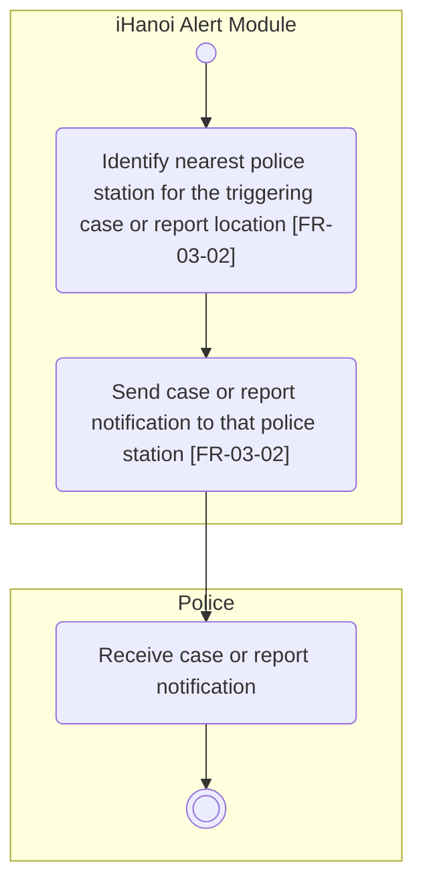

# Activity Diagram: AD-UC-10 Auto-Notify Nearest Police Station

| Field | Value |
| :---- | :---- |
| AD ID | `AD-UC-10` |
| Use case | `UC-10 Auto-Notify Nearest Police Station` |
| Feature | `F-03 Alerts & Notifications` |
| Priority | Must (W4 R1; W1 initial Must; FR-03-02) |
| Primary actor | Police (ACT-P2), as recipient; the module initiates automatically from a business event |
| Owner | Owner C (Trần Khánh Ngọc) |
| Lanes | iHanoi Alert Module · Police |
| Inputs (L3-L5) | Context Diagram v3 (entity Police, Flow-09, Flow-10) · Use Case Diagram v3 (UC-10; UC-05 to UC-10) · Sequence v3: SQ-12 (shared with UC-04, see open question 5) · Architecture/ADR: none · W0 Tables 1, 2 and 4 · W1 row FR-03-02 (FR-03-02-BE) · W4 |
| Trigger | A missing-person/pet/asset case is created OR a routed report requires police attention |
| Preconditions | A qualifying event has occurred and its location is available; an authoritative station directory and a notification channel must be agreed (open questions 1 to 3) |
| Success end state | The module sends the notification to the nearest police station. Case/report status is unchanged |
| Failure end state(s) | Not specified in W1 (missing location or station, send failure, no acknowledgement): see question 3. No failure branch is drawn |
| FRs covered | `FR-03-02` (BE). FR-05-02 is not drawn: this flow is automatic, not a request by an actor |
| Business rules applied | BR-06: the nearest police station is notified automatically (FR-03-02); the nearest-station rule is open (question 1) |
| Version / status | v1.1 · Reviewed against the final project files (2026-11-07); peer review by another team pending |
| Author | Owner C (Trần Khánh Ngọc) |

## 1. Diagram

Notation: plain `flowchart` with one subgraph per lane. Circle = initial, double circle = final, rounded box = action, diamond = decision, dashed box = open question, thin bar = fork / join.

Reading notes:

- No decision is drawn: the two qualifying events are alternative entry triggers with the same outcome. No failure branch is drawn because W1 gives none; the gap is logged in question 3 instead of being invented.  
- FR-03-02 (W1): "WHEN a missing-person/pet/asset case is created or a routed report requires police attention, the system SHALL automatically notify the nearest police station."  
- Upstream triggers: UC-05 creates a case; UC-08/UC-09 route a report. They are not steps of UC-10. UC-04 / FR-03-01 (citizen geofence alert) is a separate use case.  
- Police receipt does not imply a police response, acknowledgement or a UC-06 status change.

## 2. Node trace

| Node | Lane | Label | FR / rule | Source |
| :---- | :---- | :---- | :---- | :---- |
| s1 | iHanoi Alert Module | Identify nearest police station | FR-03-02 | W1 FR-03-02-BE "Nearest-station lookup and notification trigger"; gaps in questions 1 and 2 |
| s2 | iHanoi Alert Module | Send case or report notification | FR-03-02 | W1 FR-03-02; source trace UC-10, SQ-12 |
| p1 | Police | Receive case or report notification | Actor side of FR-03-02 | No separate FR |

## 3. Branches and acceptance tests

All values are synthetic test fixtures. These are specification checks, not executed application tests. The diagram has no decision, so the rows below are entry-trigger scenarios.

| Scenario | Given | When | Then |
| :---- | :---- | :---- | :---- |
| Missing-case trigger | Case M-101 has just been created; its last-known location is supplied; the agreed lookup fixture returns station P-01 uniquely | UC-05 emits the case-created event | s1 identifies P-01; s2 sends the case notification to P-01 |
| Routed-report trigger | Report A-201 is routed, requires police attention and has a location; the lookup fixture returns P-02 uniquely | Routing emits the qualifying report event | s1 identifies P-02; s2 sends the report notification to P-02 |
| No qualifying trigger | Report A-202 does not require police attention and no missing case has been created | No qualifying event occurs | UC-10 is not invoked (entry-condition check, not a rejection path) |

## 4. Object states used

None. W1 defines no persisted Notification lifecycle and no Delivered state. UC-10 does not set Resolved, Handed to Police or In Progress. Nothing to add to the state table of activity-index.md.

## 5. Screens touched

Police receives the notification through a channel that is not defined (question 3). No screen can be named yet. To be filled in Lesson 8.

| Actor action | Screen ID |
| :---- | :---- |
| Receive case or report notification | (Lesson 8, channel undefined) |

## 6. Open questions and decisions

| # | Question | Blocking? | Default applied |
| :---- | :---- | :---- | :---- |
| 1 | [NEEDS CLARIFICATION: which location and distance metric define "nearest", and how are equal-distance stations resolved?] | No | One uniquely resolved station in the test fixture; no metric or tie rule invented |
| 2 | [NEEDS CLARIFICATION: which authoritative directory supplies police stations and their coordinates?] | No | W0 Table 4 lists the Government Agency & Routing Directory (agencies under HPC) but not police stations or coordinates. No external lane added; add a data source to W0 Table 4 or confirm this directory |
| 3 | [NEEDS CLARIFICATION: what happens when location or station data is missing, sending fails, or delivery is not acknowledged? Which channel and payload apply?] | No | No retry, acknowledgement or fallback in FR-03-02; nothing added. W1 has an INT row for the citizen push (FR-03-01-INT) but none for police: check whether a work item is missing |
| 4 | [NEEDS CLARIFICATION: what determines that a routed report "requires police attention"?] | No | FR-03-02 gives the condition, not the rule. UC-10 consumes that upstream decision and does not classify again |
| 5 | SQ-12 notifies for UC-04 and UC-10 together. Should it be split into one sequence per use case? | No | Split when the sequence diagrams are redrawn (SD-UC-01.md) |

Decisions (basis in the project files):

| # | Decision | Basis |
| :---- | :---- | :---- |
| 1 | Police is the primary actor as recipient (ACT-P2); the flow starts automatically from an event | W0 Table 1 says Police; FR-03-02 says "automatically"; Context entity Police |
| 2 | The police receipt step is drawn only here. AD-UC-05 calls this diagram | Convention in activity-index.md section 2 |

## 7. Verification log

| Check | Result |
| :---- | :---- |
| Mermaid syntax | Parsed without error with Mermaid 12.3.0 in Node on 2026-11-07. Visual render on mermaid.live not run |
| Every decision has guards on all outgoing flows, no overlap, no gap | n/a, no decision (the two triggers are alternative entries with the same outcome) |
| No action has two incoming flows (merge used instead) | Pass: only final, join and merge nodes have several incoming flows |
| Every fork has a matching join | n/a, no fork |
| Every system action cites an FR or a called use case | Pass (s1, s2 cite FR-03-02) |
| Every FR of this use case appears in the diagram | 1 of 1 (FR-03-02) |
| Lane names match Context Diagram v3 and the use case actors; no Web App, API or database lanes | Pass: "iHanoi Alert Module" and "Police" (Context entity Police, ACT-P2); no technical lane |
| Related sequence diagram uses the same names and FR IDs | Pass: SQ-12 uses FR-03-02-BE; it is shared with UC-04 (question 5) |
| Project conventions applied (actor codes, status Submitted, duplicate rule, audit call, routing ownership) | Pass: see [activity-index.md](activity-index.md) section 2 |
| Cross-check against the final project files | 2026-11-07: W0, W1, W4, Context, Use Case and Sequence v3, ADR-001 to ADR-005. Peer review by another team: pending |
