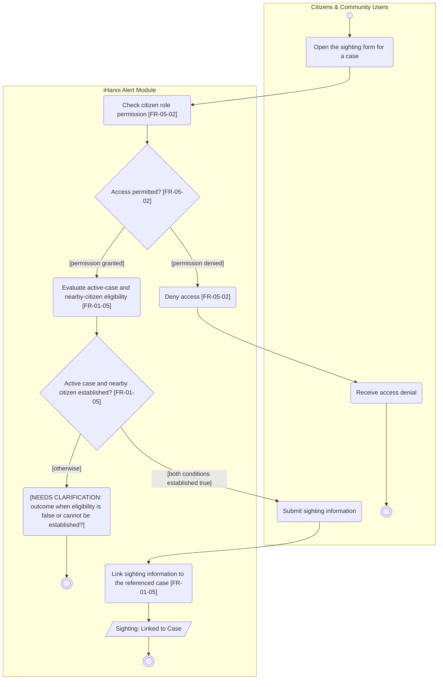

# Activity Diagram: AD-UC-11 Community Sighting Assistance

| Field | Value |
| :---- | :---- |
| AD ID | `AD-UC-11` |
| Use case | `UC-11 Community Sighting Assistance` |
| Feature | `F-01 Incident & Case Reporting` |
| Priority | Could (W4 R3; W1 initial Could; FR-01-05). Drawn although optional by the guide |
| Primary actor | Citizens & Community Users (ACT-E1) |
| Owner | Owner A (Lê Minh Anh) |
| Lanes | Citizens & Community Users · iHanoi Alert Module |
| Inputs (L3-L5) | Context Diagram v3 (entity Citizens & Community Users, Flow-03) · Use Case Diagram v3 (Citizens to UC-11; UC-05 to UC-11) · Sequence: none identified for UC-11 · Architecture/ADR: none · W0 Table 1 (UC-11), Table 4 (Citizen Account Directory EIF, Missing Person / Pet / Asset Case ILF) · W1 rows FR-01-05 (FE, BE), FR-05-02 · W4 |
| Trigger | A citizen opens the sighting option for a missing-person/pet/asset case; FR-01-05 applies when the case is active and the citizen is nearby |
| Preconditions | Citizen identity and role come from the core iHanoi platform (Citizen Account Directory, EIF); the submission references a case. "Active" and "nearby" are not defined (questions 1 and 2) |
| Success end state | Sighting information is linked to its case. Case status is unchanged |
| Failure end state(s) | Access denied: the function is not executed. Not eligible or eligibility unknown: not specified (question 3), no business outcome asserted |
| FRs covered | `FR-01-05` (FE, BE); `FR-05-02` (cross-cutting authorisation, drawn because a citizen invokes the function) |
| Business rules applied | BR-08: sightings attach only to an active case (FR-01-05); BR-05 role-based access |
| Version / status | v1.1 · Reviewed against the final project files (2026-11-07); peer review by another team pending |
| Author | Owner A (Lê Minh Anh) |

## 1. Diagram

Notation: plain `flowchart` with one subgraph per lane. Circle = initial, double circle = final, rounded box = action, diamond = decision, dashed box = open question, thin bar = fork / join.

Reading notes:

- FR-01-05: "WHEN a missing-person/pet/asset case is active, the system SHALL allow nearby citizens to submit sighting information linked to that case." The eligibility check therefore comes before the submission.
- FR-05-02 gives permit/deny by role; it does not define the permission matrix. It is drawn here because the actor is a citizen. AD-UC-09 and AD-UC-10 do not draw it because the system starts their flow.
- `q1` is a placeholder for a missing specification, not an action.
- The diagram shows submission only. UC-05 creates the case and UC-06 updates its status; neither is repeated here. FR-01-05 specifies no confirmation message, public alert, police notification or automatic closure.

## 2. Node trace

| Node | Lane | Label | FR / rule | Source |
| :---- | :---- | :---- | :---- | :---- |
| a1 | Citizens & Community Users | Open the sighting form for a case | Actor side of FR-01-05 | No separate FR |
| s1 | iHanoi Alert Module | Check citizen role permission | FR-05-02 | W1 FR-05-02: permission checks on every endpoint |
| d1 | iHanoi Alert Module | Access permitted? | FR-05-02 | W1 FR-05-02: permit or deny according to the assigned role |
| s2 | iHanoi Alert Module | Deny access | FR-05-02 | W1 FR-05-02 |
| a2 | Citizens & Community Users | Receive access denial | Actor side of FR-05-02 | No separate FR |
| s3 | iHanoi Alert Module | Evaluate active-case and nearby-citizen eligibility | FR-01-05 | W1 FR-01-05 ("case is active", "nearby citizens"); predicates open in questions 1 and 2 |
| d2 | iHanoi Alert Module | Active case and nearby citizen established? | FR-01-05 | Positive condition of the EARS sentence and its complement |
| a3 | Citizens & Community Users | Submit sighting information | Actor side of FR-01-05 | No separate FR |
| s4 | iHanoi Alert Module | Link sighting information to the referenced case | FR-01-05 | W1 FR-01-05-BE "link sighting to case" |
| o1 | iHanoi Alert Module | Sighting: Linked to Case | FR-01-05 | Descriptive state |
| q1 | iHanoi Alert Module | Unresolved non-eligible outcome (placeholder, not action) | None | Question 3 |

## 3. Branches and acceptance tests

All values are synthetic test fixtures. These are specification checks, not executed application tests.

| Decision | Branch | Given | When | Then |
| :---- | :---- | :---- | :---- | :---- |
| d1 | [permission granted] | Citizen C-11 has a role whose permission fixture grants UC-11; the request references M-101 | s1 evaluates the request | Proceed to the eligibility check |
| d1 | [permission denied] | C-12 has a role whose permission fixture denies UC-11 | C-12 opens the sighting form for M-101 | Access is denied; no sighting is linked |
| d2 | [both conditions established true] | M-101 is active under the eventual agreed rule; C-11 has nearby = true from an agreed fixture | C-11 opens the form, then submits "Pet seen at entrance A at 10:15" | The form accepts the submission and the sighting is linked to M-101; case status unchanged |
| d2 | [otherwise] | M-102 has active = false; C-11 has nearby = true | C-11 opens the form for M-102 | Reach q1; the outcome needs a client decision (no rejection or save is asserted) |

Complement cases that also reach q1: active = true with nearby = false; active = true with citizen location unavailable. A numeric boundary test cannot be written until questions 1 and 2 are resolved.

## 4. Object states used

| Object | States in this diagram | Full state list (all diagrams) |
| :---- | :---- | :---- |
| Sighting | Linked to Case (descriptive; not an enumerated status) | Not defined in W1 |
| Missing Person / Pet / Asset Case | Referenced only; "active" is not a confirmed status value | Resolved / Handed to Police (FR-01-04); full list not defined |

Add `Sighting: Linked to Case` to the state table of [activity-index.md](activity-index.md), spelled exactly as in o1.

## 5. Screens touched

| Actor action | Screen ID |
| :---- | :---- |
| Open the sighting form; submit sighting information | Form "submit sighting for a case" (W1 FR-01-05-FE); ID not assigned yet |

## 6. Open questions and decisions

| # | Question | Blocking? | Default applied |
| :---- | :---- | :---- | :---- |
| 1 | [NEEDS CLARIFICATION: which case states count as active, and how is a case that closes during submission handled?] | No | W1 FR-01-05 uses "active" without a state list; FR-01-04 only defines Resolved / Handed to Police. Eligibility fixture, no state mapping invented |
| 2 | [NEEDS CLARIFICATION: what is "nearby", which case location is used, and where does the citizen's location come from?] | No | No radius, metric or location source in FR-01-05; W0 Table 4 lists only identity/profile in the Citizen Account Directory. Unresolved predicate, no radius chosen |
| 3 | [NEEDS CLARIFICATION: what must the system do when the case is absent or inactive, the citizen is not nearby, or eligibility is unknown?] | No | The EARS sentence is positive only. q1 marks the gap; no rejection, storage or override asserted |
| 4 | [NEEDS CLARIFICATION: which sighting fields and validation rules are mandatory, and which citizen roles may submit?] | No | W1 specifies only submission and linking; FR-05-02 gives no matrix. No fields copied from UC-01, no validation branch |
| 5 | Sighting records are stored (linked to a case) but W0 Table 4 has no data group for them. Are they part of the Missing Person / Pet / Asset Case ILF or a missing ILF? | No | Update W0 Table 4 and the function-point count if needed |

Decisions (basis in the project files):

| # | Decision | Basis |
| :---- | :---- | :---- |
| 1 | The diagram is drawn although the priority is Could | The guide allows optional diagrams; priority stays Could |
| 2 | Eligibility is checked before the form accepts input | FR-01-05: "allow nearby citizens to submit" |
| 3 | The lane name is "Citizens & Community Users" | Context Diagram entity; actor ACT-E1 |

## 7. Verification log

| Check | Result |
| :---- | :---- |
| Mermaid syntax | Parsed without error with Mermaid 12.3.0 in Node on 2026-11-07. Visual render on mermaid.live not run |
| Every decision has guards on all outgoing flows, no overlap, no gap | Pass (d1: 2 guards; d2: 2 guards) |
| No action has two incoming flows (merge used instead) | Pass: only final, join and merge nodes have several incoming flows |
| Every fork has a matching join | n/a, no fork |
| Every system action cites an FR or a called use case | Pass (s1 to s4 cite FR-05-02 or FR-01-05; q1 is a clarification node) |
| Every FR of this use case appears in the diagram | 1 of 1 (FR-01-05), plus FR-05-02 as cross-cutting rule |
| Lane names match Context Diagram v3 and the use case actors; no Web App, API or database lanes | Pass: "Citizens & Community Users" (Context entity ENT-CIT, Use Case actor ACT-E1) and "iHanoi Alert Module" |
| Related sequence diagram uses the same names and FR IDs | n/a: no sequence diagram exists for UC-11 |
| Project conventions applied (actor codes, status Submitted, duplicate rule, audit call, routing ownership) | Pass: see [activity-index.md](activity-index.md) section 2 |
| Cross-check against the final project files | 2026-11-07: W0, W1, W4, Context, Use Case and Sequence v3, ADR-001 to ADR-005. Peer review by another team: pending |
