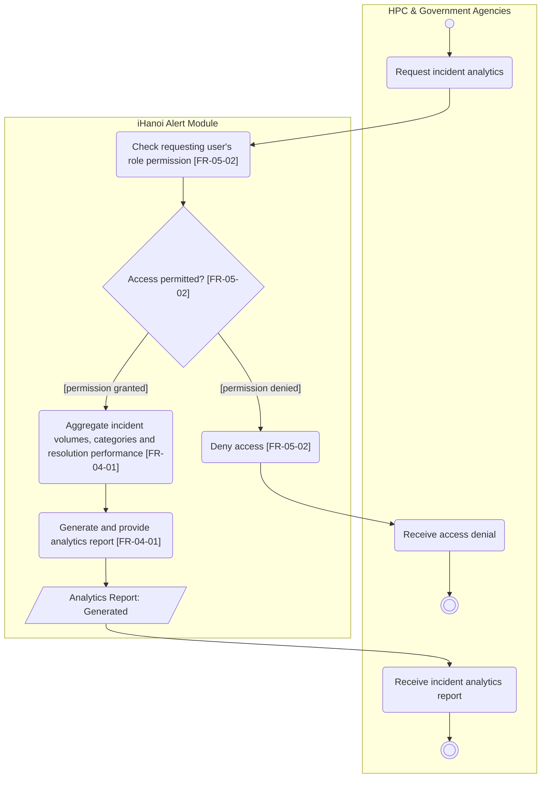

# Activity Diagram: AD-UC-12 Generate Reports & Analytics

| Field | Value |
| :---- | :---- |
| AD ID | `AD-UC-12` |
| Use case | `UC-12 Generate Reports & Analytics` |
| Feature | `F-04 Oversight & Analytics` |
| Priority | Won't (W4 R4; W1 initial Should; FR-04-01). Deferred in W0 Table 3, pending client confirmation; drawn as a deferred design only |
| Primary actor | HPC & Government Agencies (ACT-G2) |
| Owner | Owner D (Phạm Khánh Linh) |
| Lanes | HPC & Government Agencies · iHanoi Alert Module |
| Inputs (L3-L5) | Context Diagram v3 (entity HPC & Government Agencies, Flow-01) · Use Case Diagram v3 (UC-12) · Sequence: none identified for UC-12 (CVCA "Reports & analytics" O4 to G2) · Architecture/ADR: none · W0 Table 1 (UC-12), Table 3 (deferral), Table 4 (Incident Report, SLA & Routing Metrics, Audit Trail) · W1 rows FR-04-01 (FE, BE), FR-05-02 · W4 |
| Trigger | An authorised HPC/government user requests analytics |
| Preconditions | The requesting user's identity and role are available; incident, category and resolution data are readable. Scope and metric definitions are open (questions 1 and 2) |
| Success end state | A report of incident volumes, categories and resolution performance is generated for the requesting user. No incident or case state changes |
| Failure end state(s) | Access denied: no analytics generated. Empty or incomplete data: not specified (question 3) |
| FRs covered | `FR-04-01` (FE, BE); `FR-05-02` (cross-cutting authorisation, drawn because an HPC user invokes the function) |
| Business rules applied | BR-05 role-based access (FR-05-02); metric definitions open (question 1) |
| Version / status | v1.1 · Deferred design, reviewed against the final project files (2026-11-07); peer review by another team pending |
| Author | Owner D (Phạm Khánh Linh) |

## 1. Diagram

Notation: plain `flowchart` with one subgraph per lane. Circle = initial, double circle = final, rounded box = action, diamond = decision, dashed box = open question, thin bar = fork / join.

Reading notes:

- FR-04-01 (W1): "WHEN an authorised HPC/government user requests analytics, the system SHALL generate a report of incident volumes, categories and resolution performance."  
- FR-05-02 gives permit/deny by role; an HPC affiliation alone does not define the permission matrix.  
- UC-14 / FR-04-02 (SLA dashboard) and UC-15 / FR-04-03 (audit trail) are separate use cases, not calls needed here.  
- FR-04-01 does not promise export, e-mail, scheduling, a new analytics service or report storage. Producing this design does not restore UC-12 to release scope or change effort or cost.

## 2. Node trace

| Node | Lane | Label | FR / rule | Source |
| :---- | :---- | :---- | :---- | :---- |
| s1 | iHanoi Alert Module | Check requesting user's role permission | FR-05-02 | W1 FR-05-02; "authorised" is also explicit in FR-04-01 |
| d1 | iHanoi Alert Module | Access permitted? | FR-05-02 | W1 FR-05-02: permit or deny according to the role |
| s2 | iHanoi Alert Module | Deny access | FR-05-02 | W1 FR-05-02 |
| s3 | iHanoi Alert Module | Aggregate incident volumes, categories and resolution performance | FR-04-01 | W1 FR-04-01-BE "Aggregation queries"; metric definition open in question 1 |
| s4 | iHanoi Alert Module | Generate and provide analytics report | FR-04-01 | W1 FR-04-01-FE "analytics & reports dashboard"; no export or persistence promise |
| a1, a2, a3 | HPC & Government Agencies | Request analytics; Receive access denial; Receive report | Actor side of FR-04-01 / FR-05-02 | No separate FR |

## 3. Branches and acceptance tests

All values are synthetic test fixtures. These are specification checks, not executed application tests.

| Decision | Branch | Given | When | Then |
| :---- | :---- | :---- | :---- | :---- |
| d1 | \[permission granted\] | Staff user H-01 has a permission fixture allowing UC-12; dataset: A-301 category Road, A-302 category Road, A-303 category Safety | H-01 requests analytics for that dataset | A report shows incident volume 3, category counts Road \= 2 and Safety \= 1, plus the agreed resolution-performance measure (its value is blocked by question 1) |
| d1 | \[permission denied\] | H-02 has a role whose permission fixture denies UC-12 | H-02 requests the same analytics | Access is denied; no aggregation and no report generation run |

These tests exercise the draft specification; they do not mean UC-12 is enabled in the current release. No SLA threshold or percentage formula is asserted.

## 4. Object states used

| Object | States in this diagram | Full state list (all diagrams) |
| :---- | :---- | :---- |
| Analytics Report | Generated (descriptive output state, not a persisted status) | Not defined in W1 |

Incident Report states stay unchanged. No Empty, Exported, Scheduled or Delivered state is introduced. Add `Analytics Report: Generated` to the state table of activity-index.md, spelled exactly as in o1.

## 5. Screens touched

| Actor action | Screen ID |
| :---- | :---- |
| Request incident analytics | (Lesson 8, not yet defined; W1 FR-04-01-FE names an "analytics & reports dashboard") |
| Receive incident analytics report | (Lesson 8, same dashboard) |
| Receive access denial | (Lesson 8, not yet defined) |

## 6. Open questions and decisions

| # | Question | Blocking? | Default applied |
| :---- | :---- | :---- | :---- |
| 1 | [NEEDS CLARIFICATION: how are incident volume, category grouping and resolution performance calculated?] | No | W1 flags the EARS sentence of FR-04-01 as not precise. Keep the three output families; no rates, averages, SLA thresholds or denominators invented |
| 2 | [NEEDS CLARIFICATION: which reporting period, agency or geographic scope, permissions and time zone apply?] | No | FR-04-01 has no filters or access scope. Controlled dataset and permission fixtures; no unrestricted city-wide access assumed |
| 3 | [NEEDS CLARIFICATION: how are zero matching incidents, missing categories or incomplete resolution data represented?] | No | No empty-data rule; no empty-state branch added |

Decisions (basis in the project files):

| # | Decision | Basis |
| :---- | :---- | :---- |
| 1 | The design is prepared without changing the priority. FR-04-01 stays Won't and is excluded from in-scope cost | W0 Table 3 (deferral pending client confirmation); W4 R4; W2 |
| 2 | "Generated" is a descriptive output state only | W1 promises report generation, not storage, export or lifecycle |
| 3 | The actor is HPC & Government Agencies (ACT-G2) | CVCA G2; actor register in w0-scope.md |

## 7. Verification log

| Check | Result |
| :---- | :---- |
| Mermaid syntax | Parsed without error with Mermaid 12.3.0 in Node on 2026-11-07. Visual render on mermaid.live not run |
| Every decision has guards on all outgoing flows, no overlap, no gap | Pass (d1: 2 guards) |
| No action has two incoming flows (merge used instead) | Pass: only final, join and merge nodes have several incoming flows |
| Every fork has a matching join | n/a, no fork |
| Every system action cites an FR or a called use case | Pass (s1 to s4 cite FR-05-02 or FR-04-01) |
| Every FR of this use case appears in the diagram | 1 of 1 (FR-04-01), plus FR-05-02 as cross-cutting rule |
| Lane names match Context Diagram v3 and the use case actors; no Web App, API or database lanes | Pass: "HPC & Government Agencies" (Context entity, ACT-G2) and "iHanoi Alert Module"; no technical lane |
| Related sequence diagram uses the same names and FR IDs | n/a: no sequence diagram exists for UC-12 |
| Project conventions applied (actor codes, status Submitted, duplicate rule, audit call, routing ownership) | Pass: see [activity-index.md](activity-index.md) section 2 |
| Cross-check against the final project files | 2026-11-07: W0, W1, W4, Context, Use Case and Sequence v3, ADR-001 to ADR-005. Peer review by another team: pending |
