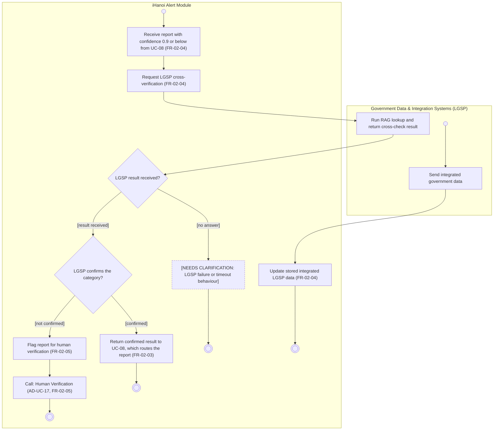

# Activity Diagram: AD-UC-13 LGSP Cross-Verification (RAG-based)

| Field | Value |
| :---- | :---- |
| AD ID | `AD-UC-13` |
| Use case | `UC-13 LGSP Cross-Verification (RAG-based)` |
| Feature | `F-02 AI Classification & Smart Routing` (W0 Table 2) |
| Priority | Could (W4 R3; W1 initial Should; FR-02-04). Drawn early on purpose |
| Primary actor | Government Data & Integration Systems (LGSP) (ACT-O3) |
| Owner | Owner B (Nguyễn Tương Như) |
| Lanes | iHanoi Alert Module · Government Data & Integration Systems (LGSP) |
| Inputs (L3-L5) | Context Diagram v3 (LGSP, Flow-07 integrated data and sync, Flow-08 cross-verification queries) · Use Case Diagram v3 (UC-08 to UC-13 [confidence ≤ 0.9], UC-13 to UC-17) · Sequence v3: SQ-13, SQ-14, SQ-15 · Architecture/ADR: ADR-004 · W1 row FR-02-04 (references FR-02-03, FR-02-05) · W4 |
| Trigger | (1) UC-08 calls UC-13 for a report with confidence 0.9 or below. (2) Time event: the LGSP sync interval is reached (daily batch by default, ADR-004) |
| Preconditions | The report has a category and a confidence score (FR-02-02); status Submitted |
| Success end state | Confirmed: the result is returned to UC-08, which routes the report (FR-02-03). Not confirmed: the report is flagged for human verification and handed to UC-17, which returns to UC-08. Sync: the stored LGSP data is refreshed |
| Failure end state(s) | LGSP gives no answer: behaviour not defined (open question 1) |
| FRs covered | `FR-02-04`. Referenced: FR-02-03 (UC-08), FR-02-05 (UC-17) |
| Business rules applied | BR-02: scores of 0.9 or below take the manual path (FR-02-03, FR-02-05) |
| Version / status | v1.1 · Reviewed against the final project files (2026-11-07); peer review by another team pending |
| Author | Owner B (Nguyễn Tương Như) |

## 1. Diagram

Notation: plain `flowchart` with one subgraph per lane. Circle = initial, double circle = final, rounded box = action, diamond = decision, dashed box = open question, thin bar = fork / join.

Reading notes:

- UC-13 is reached only from UC-08 with confidence 0.9 or below, so the "confidence 0.9 or below" part of FR-02-05 is always true here and needs no decision of its own.
- UC-13 does not route. On "confirmed" it returns the result to UC-08, which applies FR-02-03 and routes to Hanoi Portal (SQ-16). On "not confirmed" it flags the report (FR-02-05, SQ-15) and calls UC-17, which also returns to UC-08.
- A confirmed category does not trigger human verification: FR-02-05 flags only when LGSP does not confirm.
- The LGSP data sync is a time event inside this diagram because FR-02-04-INT carries it and no separate use case exists. Default cadence: daily batch (ADR-004).
- Sequence: SQ-13 (query), SQ-14 (result), SQ-15 (flag); SQ-16 belongs to AD-UC-08.

Business rules and links:

- BR-1 Confidence threshold: 0.9 or below means the report does not auto-route (FR-02-03, FR-02-05, UC diagram).  
- BR-2 UC-13 is reached only from UC-08 with confidence 0.9 or below, so the "AND" part of FR-02-05 (confidence 0.9 or below) is always true here and does not need its own decision.  
- Includes: UC-17 Human Verification (call step a5, not a copy).  
- Sequence: SQ-13, SQ-14, SQ-15 (SQ-16 for the Hanoi Portal path). The sequence is a combined UC-01 diagram; it must be split (Inputs check \#3).  
- Lanes match Context Diagram: LGSP \= "Government Data & Integration Systems (LGSP)", system \= "iHanoi Alert Module".

## 2. Node trace

| Node | Type | Lane | Label (short) | FR / rule | Source |
| :---- | :---- | :---- | :---- | :---- | :---- |
| s1 | Start | System | Report routed for verification | FR-02-04 (WHEN a report is routed for verification) | Use Case Diagram UC-08 to UC-13 |
| a1 | Action | System | Receive report with category and confidence | FR-02-04 | SQ-13 |
| a2 | Action | System | Request LGSP cross-verification | FR-02-04 | SQ-13, Context Flow-08 |
| l1 | Action | LGSP | Run RAG lookup and return result | (external lane, no FR) | SQ-14 |
| d1 | Decision | System | LGSP result received? | none (open question 1) | not in W1 |
| n1 | Open question | System | Behaviour when LGSP does not answer | open question 1 | - |
| d2 | Decision | System | LGSP confirms the category? | FR-02-05 (IF 0.9 or below AND LGSP does not confirm) | SQ-15 |
| a3 | Return | System | Return confirmed result to UC-08 | FR-02-03 is applied by UC-08 | Use Case Diagram; W1 FR-02-03 |
| a4 | Action | System | Flag report for human verification | FR-02-05 | SQ-15 |
| a5 | Call | System | Human Verification (AD-UC-17) | FR-02-05 (UC-13 to UC-17) | Use Case Diagram |
| t0 | Start (time) | LGSP | Sync interval reached | FR-02-04 (INT: LGSP data sync) | Context Flow-07 |
| t1 | Action | LGSP | Send integrated government data | (external lane, no FR) | Context Flow-07 |
| a6 | Action | System | Update stored LGSP data | FR-02-04 | Context Flow-07 |
| e1 to e4 | End | - | - | - | - |

## 3. Branches and acceptance tests

| ID | Decision | Branch | Given | When | Then |
| :---- | :---- | :---- | :---- | :---- | :---- |
| BT-13-01 | d1 | Result received | Alert AL-0412, category "Road damage", confidence 0.82. LGSP is online | The system sends the RAG query | LGSP returns a cross-check result within the waiting time and the flow goes to d2 |
| BT-13-02 | d1 | No answer | Alert AL-0413, confidence 0.70. LGSP is offline | The system sends the RAG query | No result arrives. The flow ends at the open question. The waiting time is unknown (question 1), so this test has no number yet |
| BT-13-03 | d2 | Confirmed | Alert AL-0412, category "Road damage", confidence 0.82. LGSP data lists a road work order at the same location | LGSP returns "category confirmed" | UC-13 returns the result to UC-08; UC-08 applies FR-02-03 and routes the report to Hanoi Portal for manual classification. No human verification |
| BT-13-04 | d2 | Not confirmed | Alert AL-0414, category "Flooding", confidence 0.65. LGSP data has no match | LGSP returns "category not confirmed" | The system flags AL-0414 for human verification and calls UC-17; the status stays Submitted |
| BT-13-05 | t0 | Time event | Last sync was yesterday at 02:00. Sync interval is daily (ADR-004 default) | The next daily sync time is reached | LGSP sends integrated data and the system updates the stored copy |

## 4. Object states used

No report status is set by this diagram. A report flagged for human verification keeps the status Submitted until UC-08 routes it. It returns the cross-check result to UC-08 or calls UC-17; no new persisted state is asserted.

## 5. Screens touched

None: this is a system-to-system flow. The reviewer screen belongs to AD-UC-17.

## 6. Open questions and decisions

| # | Question | Blocking? | Default applied |
| :---- | :---- | :---- | :---- |
| 1 | [NEEDS CLARIFICATION: how long does the module wait for LGSP, and what happens on timeout or LGSP error?] | No | Diagram stops at an open-question node. No invented behaviour |
| 2 | [NEEDS CLARIFICATION: does the release include FR-02-04 (Could), which supplies the result needed by FR-02-05 (Must)?] | Yes | When FR-02-04 is built: not confirmed leads to UC-17, then back to UC-08 for FR-02-03 routing. Release behaviour without FR-02-04 needs a product decision (AD-UC-08 question 4, AD-UC-17 question 4) |

Decisions (basis in the project files):

| # | Decision | Basis |
| :---- | :---- | :---- |
| 1 | UC-13 returns its result to UC-08; UC-08 performs the final routing | Use Case Diagram (UC-17 to UC-08); SQ-16; AD-UC-08 |
| 2 | LGSP sync is a daily batch | ADR-004 (proposed default; W5 question 2 is still open) |
| 3 | The time event stays in this diagram | FR-02-04-INT carries the sync; no separate use case exists |

## 7. Verification log

| Check | Result |
| :---- | :---- |
| Mermaid syntax | Parsed without error with Mermaid 12.3.0 in Node on 2026-11-07. Visual render on mermaid.live not run |
| Every decision has guards on all outgoing flows, no overlap, no gap | Pass (d1: 2 guards; d2: 2 guards) |
| No action has two incoming flows (merge used instead) | Pass: only final, join and merge nodes have several incoming flows |
| Every fork has a matching join | n/a, no fork |
| Every system action cites an FR or a called use case | Pass (a1 to a6 cite FR-02-04, FR-02-05 or FR-02-03 as a return) |
| Every FR of this use case appears in the diagram | 1 of 1 (FR-02-04). FR-02-03 and FR-02-05 are referenced as return and call steps |
| Lane names match Context Diagram v3 and the use case actors; no Web App, API or database lanes | Pass: "Government Data & Integration Systems (LGSP)" (Context entity, ACT-O3) and "iHanoi Alert Module" |
| Related sequence diagram uses the same names and FR IDs | Pass: SQ-13, SQ-14, SQ-15 use FR-02-04 and FR-02-05; SQ-16 is in AD-UC-08 |
| Project conventions applied (actor codes, status Submitted, duplicate rule, audit call, routing ownership) | Pass: see [activity-index.md](activity-index.md) section 2 |
| Cross-check against the final project files | 2026-11-07: W0, W1, W4, Context, Use Case and Sequence v3, ADR-001 to ADR-005. Peer review by another team: pending |
