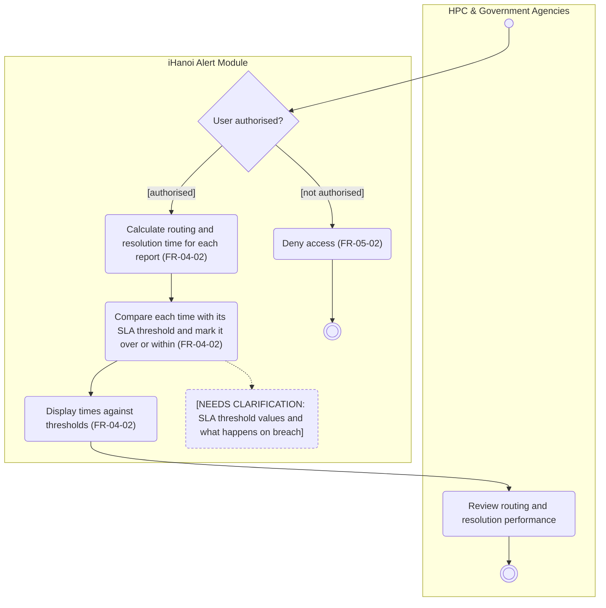

# Activity Diagram: AD-UC-14 Monitor SLA Dashboard

| Field | Value |
| :---- | :---- |
| AD ID | `AD-UC-14` |
| Use case | `UC-14 Monitor SLA Dashboard` |
| Feature | `F-04 Oversight & Analytics` (W0 Table 2) |
| Priority | Could (W4 R3; W1 initial Should; FR-04-02). Drawn early on purpose |
| Primary actor | HPC & Government Agencies (ACT-G2), authorised staff |
| Owner | Owner D (Phạm Khánh Linh) |
| Lanes | HPC & Government Agencies · iHanoi Alert Module |
| Inputs (L3-L5) | Context Diagram v3 (HPC & Government Agencies, Flow-01 SLA dashboard data) · Use Case Diagram v3 (HPC & Government Agencies to UC-14) · Sequence: none exists for UC-14 · Architecture/ADR: none · W1 rows FR-04-02, FR-05-02 · W4 |
| Trigger | An authorised user opens the SLA dashboard |
| Preconditions | The user has a role that may see the dashboard. Reports exist with routing and resolution times |
| Success end state | The user has seen routing and resolution times against the SLA thresholds |
| Failure end state(s) | Access denied: no SLA data is shown |
| FRs covered | `FR-04-02`. Cross-cutting: FR-05-02 |
| Business rules applied | BR-05 role-based access (FR-05-02); times are compared with SLA thresholds, equality rule open (question 3) |
| Version / status | v1.1 · Reviewed against the final project files (2026-11-07); peer review by another team pending |
| Author | Owner D (Phạm Khánh Linh) |

## 1. Diagram

Notation: plain `flowchart` with one subgraph per lane. Circle = initial, double circle = final, rounded box = action, diamond = decision, dashed box = open question, thin bar = fork / join.

Reading notes:

- FR-04-02 asks the system to display times against the SLA thresholds. Marking a time as over or within the threshold is part of that display, so it is one action, not a decision with two different outcomes.
- There is no sign-in use case in W0, so d1 stands in for the sign-in call step.
- A breach changes only the display unless question 2 says otherwise.

Business rules and links:

- BR-1 Role-based access: every actor is permitted or denied by role (FR-05-02). There is no sign-in use case in W0, so d1 stands in for the sign-in call step.  
- BR-2 Dashboard compares times to SLA thresholds. Equality behavior is unspecified (Q3); neither guard assumes a final breach status.  
- Lanes match Context Diagram: HPC \= "HPC & Government Agencies", system \= "iHanoi Alert Module".  
- No sequence diagram exists. Consider one for UC-14 at home.

## 2. Node trace

| Node | Type | Lane | Label (short) | FR / rule | Source |
| :---- | :---- | :---- | :---- | :---- | :---- |
| start1 | Start | HPC | User opens SLA dashboard | FR-04-02 (WHEN an authorised user opens the SLA dashboard) | UC-14 |
| d1 | Decision | System | User authorised? | FR-05-02 (permit or deny by role) | W1 FR-05-02 |
| a0 | Action | System | Deny access | FR-05-02 | W1 FR-05-02 |
| a1 | Action | System | Calculate routing and resolution time for each report | FR-04-02 (SLA calculation) | W1 FR-04-02-BE |
| a2 | Action | System | Compare each time with its SLA threshold and mark it over or within | FR-04-02 (threshold-breach logic) | W1 FR-04-02-BE |
| a5 | Action | System | Display times against thresholds | FR-04-02 (WHEN ... SHALL display) | W1 FR-04-02-FE |
| h1 | Action | HPC | Review performance | actor lane, no FR | - |
| n1 | Open question | System | Threshold values and breach handling | questions 1 and 2 | - |

## 3. Branches and acceptance tests

| ID | Decision / step | Branch | Given | When | Then |
| :---- | :---- | :---- | :---- | :---- | :---- |
| BT-14-01 | d1 | Authorised | User "hpc.officer01" with role HPC staff | The user opens the SLA dashboard | The system continues to the time calculation |
| BT-14-02 | d1 | Not authorised | User "citizen_77" with role Citizen | The user opens the SLA dashboard | The system denies access. No SLA data is shown |
| BT-14-03 | a2 / a5 | Over threshold | Alert AL-0501 routed after 3.0 h. Threshold value unknown (question 1); 2 h is used as an example only | The dashboard is opened | AL-0501 is displayed with 3.0 h against the threshold and marked over; no report status is changed |
| BT-14-04 | a2 / a5 | Within threshold | Alert AL-0502 routed after 0.5 h. Example threshold 2 h | The dashboard is opened | AL-0502 is displayed with 0.5 h against the threshold and not marked; no report status is changed |

## 4. Object states used

No report state is changed. The dashboard displays elapsed times against the thresholds.

## 5. Screens touched

| Actor action | Screen ID |
| :---- | :---- |
| Open the SLA dashboard; review performance | SLA dashboard (W1 FR-04-02-FE); ID not assigned yet |

## 6. Open questions and decisions

| # | Question | Blocking? | Default applied |
| :---- | :---- | :---- | :---- |
| 1 | [NEEDS CLARIFICATION: what are the SLA thresholds for routing and for resolution (in hours)?] | No for the diagram; yes before acceptance tests with real values | Examples only in the tests, marked as example |
| 2 | [NEEDS CLARIFICATION: does a breach only change the display, or does the system also notify someone?] | No | Display only |
| 3 | [NEEDS CLARIFICATION: is a time exactly equal to the threshold a breach?] | No | Not a breach (strictly greater) |
| 4 | [NEEDS CLARIFICATION: is the dashboard calculated when opened, or refreshed on a schedule?] | No | Calculated when opened |
| 5 | Which roles may open the SLA dashboard (all HPC staff, or only some)? | No | All authorised HPC & Government Agencies staff |

## 7. Verification log

| Check | Result |
| :---- | :---- |
| Mermaid syntax | Parsed without error with Mermaid 12.3.0 in Node on 2026-11-07. Visual render on mermaid.live not run |
| Every decision has guards on all outgoing flows, no overlap, no gap | Pass (d1: 2 guards) |
| No action has two incoming flows (merge used instead) | Pass: only final, join and merge nodes have several incoming flows |
| Every fork has a matching join | n/a, no fork |
| Every system action cites an FR or a called use case | Pass (a0 to a5 cite FR-05-02 or FR-04-02) |
| Every FR of this use case appears in the diagram | 1 of 1 (FR-04-02). FR-05-02 is cross-cutting |
| Lane names match Context Diagram v3 and the use case actors; no Web App, API or database lanes | Pass: "HPC & Government Agencies" (Context entity, ACT-G2) and "iHanoi Alert Module" |
| Related sequence diagram uses the same names and FR IDs | n/a: no sequence diagram exists for UC-14 |
| Project conventions applied (actor codes, status Submitted, duplicate rule, audit call, routing ownership) | Pass: see [activity-index.md](activity-index.md) section 2 |
| Cross-check against the final project files | 2026-11-07: W0, W1, W4, Context, Use Case and Sequence v3, ADR-001 to ADR-005. Peer review by another team: pending |
