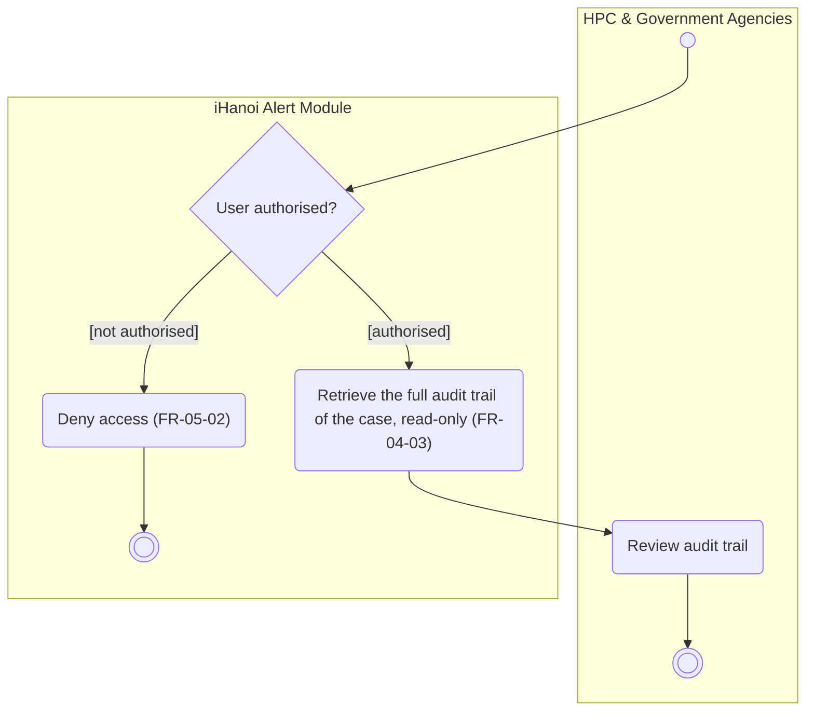
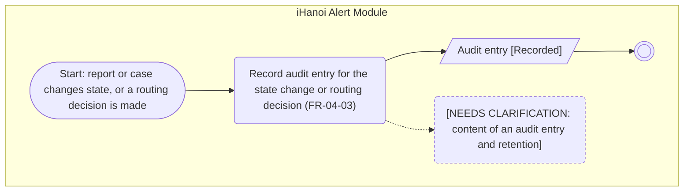

# Activity Diagram: AD-UC-15 View Audit Trail

| Field | Value |
| :---- | :---- |
| AD ID | `AD-UC-15` |
| Use case | `UC-15 View Audit Trail` (the recording of audit entries is drawn as a second diagram and called by other diagrams) |
| Feature | `F-04 Oversight & Analytics` (W0 Table 2) |
| Priority | Must (W4 R1; W1 initial Must; FR-04-03) |
| Primary actor | HPC & Government Agencies (ACT-G2), authorised staff (view). The recording is done by the system |
| Owner | Owner D (Phạm Khánh Linh) |
| Lanes | HPC & Government Agencies · iHanoi Alert Module |
| Inputs (L3-L5) | Context Diagram v3 (HPC & Government Agencies, Flow-01 audit-trail views) · Use Case Diagram v3 (HPC & Government Agencies to UC-15) · Sequence: none exists for UC-15 · Architecture/ADR: none · W0 Table 4 (Audit Trail) · W1 rows FR-04-03, FR-05-02 · W4 |
| Trigger | (A) An authorised user asks for the audit trail of a case. (B) Event: a report or case changes state, or a routing decision is made; AD-UC-06, AD-UC-08 and AD-UC-09 call diagram B |
| Preconditions | The case exists. For the view: the user is signed in with a role |
| Success end state | (A) The user sees the full audit trail of the case. (B) An audit entry is Recorded |
| Failure end state(s) | (A) Access denied. (B) The entry cannot be written: not defined (open question 4) |
| FRs covered | `FR-04-03`. Cross-cutting: FR-05-02 |
| Business rules applied | BR-04 every state change is audited; BR-05 role-based access; the audit trail is read-only for the user |
| Version / status | v1.1 · Reviewed against the final project files (2026-11-07); peer review by another team pending |
| Author | Owner D (Phạm Khánh Linh) |

## 1. Diagram

Notation: plain `flowchart` with one subgraph per lane. Circle = initial, double circle = final, rounded box = action, diamond = decision, dashed box = open question, thin bar = fork / join.

Diagram B: record an audit entry (called by other diagrams)

Reading notes:

- Diagram A (above) is the view. Diagram B is the recording, drawn separately so each trigger has its own diagram. W1 keeps one FR (FR-04-03); the split does not change effort.
- Other diagrams show the recording as one call step "Record audit entry (AD-UC-15)": AD-UC-06 (status Resolved or Handed to Police), AD-UC-08 and AD-UC-09 (status Routed).
- Setting the first status Submitted (AD-UC-01) is not a state change, so no audit entry is written there; entries start with the first transition.
- BR-05: role-based access (FR-05-02) covers diagram A. The recording has no user, so it has no authorisation decision.

Business rules and links:

- BR-1 Every state change is auditable (W4 justification of FR-04-03); W0 also defines the audit log to include routing decisions.  
- BR-2 The audit trail is read-only for the user (FR-04-03, FE row).  
- BR-3 Role-based access (FR-05-02): `d1` covers the view path. The recording path is done by the system and has no user, so it has no authorisation decision.  
- Calls from: AD-UC-06 and other state-changing use cases should show an "Audit entry recorded (AD-UC-15)" call step instead of copying a2.  
- Lanes match Context Diagram: HPC \= "HPC & Government Agencies", system \= "iHanoi Alert Module".

## 2. Node trace

| Node | Type | Lane | Label (short) | FR / rule | Source |
| :---- | :---- | :---- | :---- | :---- | :---- |
| start1 | Start | HPC | User requests audit trail of a case | FR-04-03 (authorised user SHALL be able to view) | UC-15 |
| d1 | Decision | System | User authorised? | FR-05-02 | W1 FR-05-02 |
| a0 | Action | System | Deny access | FR-05-02 | W1 FR-05-02 |
| a1 | Action | System | Retrieve full audit trail, read-only | FR-04-03 (FE: view trail, read-only) | W1 FR-04-03-FE |
| h1 | Action | HPC | Review audit trail | actor lane, no FR | - |
| s2 | Start (event) | System | Report or case changes state, or routing decision occurs | FR-04-03 state-change event; routing decision per W0 Audit Trail definition | W0 Table 4; W1 FR-04-03-BE |
| a2 | Action | System | Record audit entry | FR-04-03 | W0 Table 4; W1 FR-04-03-BE |
| o1 | Object | System | Audit entry [Recorded] | FR-04-03 | W1 FR-04-03-BE |
| n1 | Open question | System | Audit entry content and retention | questions 1 and 2 | - |

## 3. Branches and acceptance tests

| ID | Diagram / decision | Branch | Given | When | Then |
| :---- | :---- | :---- | :---- | :---- | :---- |
| BT-15-01 | A, d1 | Authorised | User "hpc.officer01" with role HPC staff. Case MP-0007 has 3 state changes | The user requests the audit trail of MP-0007 | The system returns all 3 entries, read-only |
| BT-15-02 | A, d1 | Not authorised | User "citizen_77" with role Citizen | The user requests the audit trail of MP-0007 | The system denies access. No entry is shown |
| BT-15-03 | B, s2 | Event | UC-08 makes a routing decision for report A-201 | The routing decision occurs | The system records an audit entry (Recorded). Which fields exactly: question 1 |

## 4. Object states used

Audit entry: **Recorded** (a2). Incident report and case states (Submitted, Routed, In Progress, Resolved) are inputs of the event, not drawn as separate nodes. Add `Audit entry: Recorded` to the state table of [activity-index.md](activity-index.md).

## 5. Screens touched

| Actor action | Screen ID |
| :---- | :---- |
| Request and review the audit trail | Audit trail view (W1 FR-04-03-FE, read-only); ID not assigned yet |
| Record audit entry | None (system event) |

## 6. Open questions and decisions

| # | Question | Blocking? | Default applied |
| :---- | :---- | :---- | :---- |
| 1 | [NEEDS CLARIFICATION: which fields does an audit entry hold (who, when, old status, new status, reason)?] | No | Old status, new status, time, user |
| 2 | [NEEDS CLARIFICATION: how long is the audit trail kept, and can anyone delete an entry?] | No | No deletion, no retention limit drawn |
| 3 | Which roles may view the audit trail (HPC only, or also Police for their own cases)? | No | HPC & Government Agencies only, as in the Use Case Diagram |
| 4 | What if the audit entry cannot be written? Should the state change be refused? | No | Not drawn, no FR covers it |

Decisions (basis in the project files):

| # | Decision | Basis |
| :---- | :---- | :---- |
| 1 | View and record are two diagrams in one file; W1 keeps one FR | Cost is unchanged; each trigger gets its own diagram |
| 2 | Other diagrams call diagram B as one step | Convention in activity-index.md section 2 |

## 7. Verification log

| Check | Result |
| :---- | :---- |
| Mermaid syntax | Parsed without error with Mermaid 12.3.0 in Node on 2026-11-07. Visual render on mermaid.live not run |
| Every decision has guards on all outgoing flows, no overlap, no gap | Pass (d1: 2 guards) |
| No action has two incoming flows (merge used instead) | Pass: only final, join and merge nodes have several incoming flows |
| Every fork has a matching join | n/a, no fork |
| Every system action cites an FR or a called use case | Pass (a0, a1, a2 cite FR-05-02 or FR-04-03) |
| Every FR of this use case appears in the diagram | 1 of 1 (FR-04-03), shown as diagram A (view) and diagram B (record). FR-05-02 is cross-cutting |
| Lane names match Context Diagram v3 and the use case actors; no Web App, API or database lanes | Pass: "HPC & Government Agencies" (Context entity, ACT-G2) and "iHanoi Alert Module" |
| Related sequence diagram uses the same names and FR IDs | n/a: no sequence diagram exists for UC-15 |
| Project conventions applied (actor codes, status Submitted, duplicate rule, audit call, routing ownership) | Pass: see [activity-index.md](activity-index.md) section 2 |
| Cross-check against the final project files | 2026-11-07: W0, W1, W4, Context, Use Case and Sequence v3, ADR-001 to ADR-005. Peer review by another team: pending |
