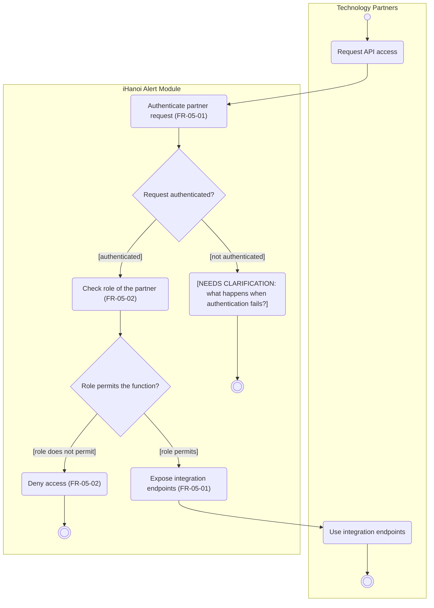

# Activity Diagram: AD-UC-16 Manage System Integration & API Access

| Field | Value |
| :---- | :---- |
| AD ID | `AD-UC-16` |
| Use case | `UC-16 Manage System Integration & API Access` |
| Feature | `F-05 Platform Integration & Access` (W0 Table 2) |
| Priority | Must (W4 R1; W1 initial Must; FR-05-01, FR-05-02) |
| Primary actor | Technology Partners, e.g. Viettel (ACT-P1) |
| Owner | Owner E (Vân Thuỷ) |
| Lanes | Technology Partners · iHanoi Alert Module (ONE lane). No external-system lane (no external system acts in this use case) |
| Inputs (L3-L5) | Context Diagram v3 (Technology Partners, Flow-05, Flow-06) · Use Case Diagram v3 (Technology Partners to UC-16) · Sequence: none exists for UC-16 (SQ-03 shows the API Gateway step, FR-05-01-INT) · Architecture/ADR: ADR-002 · W1 rows FR-05-01, FR-05-02 · W4 |
| Trigger | A technology partner requests API access to the Alert Module |
| Preconditions | The partner exists as a registered party with credentials and an assigned role (how this is registered is not covered by an FR, see open question 3\) |
| Success end state | The partner is authenticated, its role permits the function, and the integration endpoints defined for the Alert Module are exposed to it |
| Failure end state(s) | (a) Authentication fails: behaviour not defined (open question 1). (b) Role does not permit the function: access is denied |
| FRs covered | `FR-05-01`, `FR-05-02` |
| Business rules applied | BR-10 partners must be authenticated before the module exposes integration endpoints (FR-05-01); BR-05 role-based access (FR-05-02) |
| Version / status | v1.1 · Reviewed against the final project files (2026-11-07); peer review by another team pending |
| Author | Owner E (Vân Thuỷ) |

## 1. Diagram

Notation: plain `flowchart` with one subgraph per lane. Circle = initial, double circle = final, rounded box = action, diamond = decision, dashed box = open question, thin bar = fork / join.

Reading notes:

- FR-05-01 and FR-05-02 are written as WHEN rules, not IF-THEN. The two decisions come from "authenticate" (pass or fail) and "permit or deny" in the EARS text.  
- FR-05-01 says nothing about a failed authentication, so that branch ends in a `[NEEDS CLARIFICATION]` node instead of an invented behaviour.  
- `stop1` is success, `stop2` is an authentication failure and `stop3` is access denied.  
- FR-05-03 (automatic deployment to staging, source CVCA "Build" P1 to O4) is not drawn: it has no UC-16 trace and is not a step of an API-access flow (open question 4).

## 2. Node trace

| Node | Kind | Text | Traces to |
| :---- | :---- | :---- | :---- |
| s1 | Action | Authenticate partner request | FR-05-01 |
| d1 | Decision | Request authenticated? | FR-05-01 |
| s2 | Action | Check role of the partner | FR-05-02 |
| d2 | Decision | Role permits the function? | FR-05-02 |
| s3 | Action | Expose integration endpoints | FR-05-01 |
| s4 | Action | Deny access | FR-05-02 |
| nc1 | Clarification | What happens when authentication fails? | none (open question 1\) |
| a1, a2 | Actor actions (partner lane) | Request API access; Use integration endpoints | UC-16 (actor steps, no FR needed) |

## 3. Branches and acceptance tests

| Branch | Given | When | Then |
| :---- | :---- | :---- | :---- |
| d1 \[authenticated\] | A Viettel integration account with valid credentials | It sends a request for API access | The module accepts the authentication and goes on to the role check |
| d1 \[not authenticated\] | A request with an invalid or expired credential | It is sent to the module | \[NEEDS CLARIFICATION: no FR defines the outcome, see open question 1\] |
| d2 \[role permits\] | An authenticated partner whose role allows an integration endpoint defined for the Alert Module | It requests that endpoint | The integration endpoints are exposed to the partner |
| d2 \[role does not permit\] | An authenticated partner (role: Technology Partner) | It calls a function reserved for staff, for example Update Case Status (UC-06, primary actors Police and HPC & Government Agencies) | Access is denied and the activity ends at stop3 |

## 4. Object states used

| Object | States in this diagram | Full state list (all diagrams) |
| :---- | :---- | :---- |
| none | none | W1 names report statuses Submitted / Routed / In Progress / Resolved (FR-01-02) and the sequence uses Received (SQ-07); nothing in UC-16 changes a status |

## 5. Screens touched

None: this is a system-to-system flow; partners use the API, not a screen.

## 6. Open questions and decisions

| \# | Question | Blocking? | Default applied |
| :---- | :---- | :---- | :---- |
| 1 | \[NEEDS CLARIFICATION: when partner authentication fails, what does the module do (reject only, lock out after repeated failures, write an audit entry per FR-04-03)?\] | Yes | Request is not served and the activity ends (nc1 to stop2) |
| 2 | \[NEEDS CLARIFICATION: which authentication method is used for partners (API key, token, other)? FR-05-01 only says "authenticate"\] | No | Not shown in the diagram |
| 3 | \[NEEDS CLARIFICATION: how is a partner registered and given a role, and is that part of UC-16? No FR covers it\] | No | Registration treated as a precondition, not drawn |
| 4 | \[NEEDS CLARIFICATION: FR-05-03 (CI/CD to staging) comes from CVCA "Build" and is in W0 feature F-05 but has no use case. Does it need its own use case, or stay a non-functional item?\] | No | Not drawn in AD-UC-16 |
| 5 | \[NEEDS CLARIFICATION: FR-05-01 names "integration endpoints defined for the Alert Module" but W1 does not list them. Which endpoints exist, and which role may use which?\] | Yes (needed for concrete tests) | Test row for \[role permits\] uses a generic endpoint |

## 7. Verification log

| Check | Result |
| :---- | :---- |
| Mermaid syntax | Parsed without error with Mermaid 12.3.0 in Node on 2026-11-07. Visual render on mermaid.live not run |
| Every decision has guards on all outgoing flows, no overlap, no gap | Pass (d1: 2 guards; d2: 2 guards) |
| No action has two incoming flows (merge used instead) | Pass: only final, join and merge nodes have several incoming flows |
| Every fork has a matching join | n/a, no fork |
| Every system action cites an FR or a called use case | Pass (s1 to s4 cite FR-05-01 or FR-05-02; nc1 is a clarification node) |
| Every FR of this use case appears in the diagram | 2 of 2 (FR-05-01, FR-05-02) |
| Lane names match Context Diagram v3 and the use case actors; no Web App, API or database lanes | Pass: "Technology Partners" (Context entity, ACT-P1) and "iHanoi Alert Module" |
| Related sequence diagram uses the same names and FR IDs | Pass: no sequence diagram for UC-16; SQ-03 (API Gateway, FR-05-01-INT) is consistent with s1 and s3 |
| Project conventions applied (actor codes, status Submitted, duplicate rule, audit call, routing ownership) | Pass: see [activity-index.md](activity-index.md) section 2 |
| Cross-check against the final project files | 2026-11-07: W0, W1, W4, Context, Use Case and Sequence v3, ADR-001 to ADR-005. Peer review by another team: pending |
