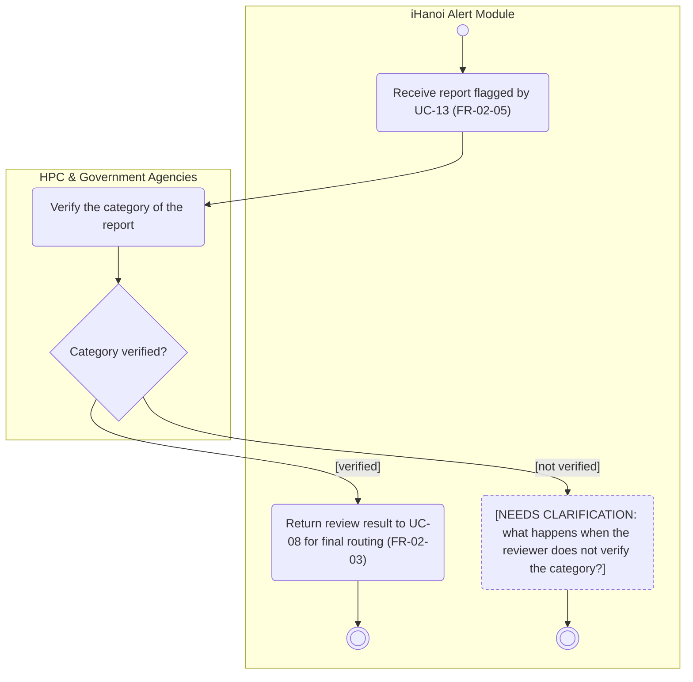

# Activity Diagram: AD-UC-17 Human Verification (if needed)

| Field | Value |
| :---- | :---- |
| AD ID | `AD-UC-17` |
| Use case | `UC-17 Human Verification (if needed)` |
| Feature | `F-02 AI Classification & Smart Routing` (W0 Table 2) |
| Priority | Must (W4 R1; W1 initial Must; FR-02-05) |
| Primary actor | HPC & Government Agencies (ACT-G2), authorised staff acting as reviewer |
| Owner | Owner B (Nguyễn Tương Như) |
| Lanes | HPC & Government Agencies · iHanoi Alert Module (ONE lane). No LGSP lane: the LGSP check is in AD-UC-13 |
| Inputs (L3-L5) | Context Diagram v3 (HPC & Government Agencies, Flow-02) · Use Case Diagram v3 (UC-13 to UC-17, UC-17 to UC-08, HPC & Government Agencies to UC-17) · Sequence: none exists for UC-17; steps taken from SQ-13 to SQ-16 of `SD-UC-01` · Architecture/ADR: ADR-001 · W1 rows FR-02-05 (references FR-02-04, FR-02-03) · W4 and W5 open questions |
| Trigger | UC-13 flags a report for human verification: the confidence score is 0.9 or below and LGSP does not confirm the category (FR-02-05) |
| Preconditions | The report is saved with its category and confidence score (SQ-07, SQ-10); status Submitted |
| Success end state | The reviewer verifies the category and the result is returned to UC-08, which performs the final routing under FR-02-03 |
| Failure end state(s) | The reviewer does not verify the category: next step not defined (open question 1) |
| FRs covered | `FR-02-05`. Shared: FR-02-04 (UC-13 flags the report), FR-02-03 (UC-08 routes) |
| Business rules applied | BR-02: scores of 0.9 or below that LGSP does not confirm get human verification before final routing (FR-02-05); the source of 0.9 is open (W5 question 1) |
| Version / status | v1.1 · Reviewed against the final project files (2026-11-07); peer review by another team pending |
| Author | Owner B (Nguyễn Tương Như) |

## 1. Diagram

Notation: plain `flowchart` with one subgraph per lane. Circle = initial, double circle = final, rounded box = action, diamond = decision, dashed box = open question, thin bar = fork / join.

Reading notes:

- UC-17 starts with a report already flagged by UC-13 under FR-02-05. UC-13 owns the LGSP check and the flagging; UC-17 handles only the human review.
- After the review, UC-17 returns the outcome to UC-08. UC-08 applies FR-02-03 and routes to Hanoi Portal; UC-17 does not route.
- The verification decision is in the reviewer lane because the reviewer makes that choice.
- A flagged report keeps the status Submitted, so flagging is not a state change and writes no audit entry.
- `stop1` is the result returned to UC-08; `stop2` is the unresolved "not verified" case.

## 2. Node trace

| Node | Kind | Text | Traces to |
| :---- | :---- | :---- | :---- |
| s1 | Input/action | Receive report flagged by UC-13 | FR-02-05 |
| a1 | Actor action (reviewer lane) | Verify the category of the report | UC-17 (actor step, no FR needed) |
| d1 | Decision (reviewer lane) | Category verified? | Human verification step, UC-17; outcome detail open |
| s2 | Return | Return review result to UC-08 for final routing | Use Case Diagram (UC-17 to UC-08); FR-02-03 applied by UC-08 |
| nc1 | Clarification | Next step when the reviewer does not verify | none (open question 1) |

## 3. Branches and acceptance tests

Category and confidence values below are examples, because W1 does not list the categories.

| Branch | Given | When | Then |
| :---- | :---- | :---- | :---- |
| d1 [verified] | A flagged report "Fire", 0.85; an HPC & Government Agencies reviewer checks it | The reviewer verifies the category | UC-17 returns the review result to UC-08; UC-08 applies the FR-02-03 routing rule |
| d1 [not verified] | A flagged report "Fire", 0.85; the reviewer cannot verify the category | The reviewer finishes the review | [NEEDS CLARIFICATION: no FR defines the outcome, see open question 1] |

## 4. Object states used

| Object | States in this diagram | Full state list (all diagrams) |
| :---- | :---- | :---- |
| none | none | Submitted, Routed, In Progress, Resolved (FR-01-02). A flagged report keeps the status Submitted; no new status is added |

## 5. Screens touched

| Actor action | Screen ID |
| :---- | :---- |
| Verify the category of the report | Reviewer screen: not costed (FR-02-05 has a BE row only; W5 question 3); ID not assigned yet |

## 6. Open questions and decisions

| # | Question | Blocking? | Default applied |
| :---- | :---- | :---- | :---- |
| 1 | [NEEDS CLARIFICATION: when the reviewer does not verify the category, what happens (return to queue, reject the report, ask the citizen, other)?] | Yes | Branch ends at nc1 with no behaviour invented |
| 2 | [NEEDS CLARIFICATION: who are the human reviewers (which HPC staff roles), and do they need a reviewer screen? FR-02-05 has a BE row only (W5 question 3)] | Yes | Reviewer is the lane "HPC & Government Agencies"; no screen costed |
| 3 | [NEEDS CLARIFICATION: is there a time limit for the human review (SLA)? No FR defines one, and the activity could wait forever] | No | No time event drawn |
| 4 | [NEEDS CLARIFICATION: W4 demoted FR-02-04 (LGSP cross-check) to Could, but FR-02-05 (Must) depends on its result. What handles low-confidence reports if FR-02-04 is not built?] | Yes | UC-17 assumes an upstream flag from UC-13; release fallback is unresolved (AD-UC-08 question 4) |
| 5 | [NEEDS CLARIFICATION: source of the 0.9 threshold, policy value or model default (W5 question 1)] | Yes | 0.9 as written in FR-02-03 and FR-02-05 |

Decisions (basis in the project files):

| # | Decision | Basis |
| :---- | :---- | :---- |
| 1 | UC-17 returns its result to UC-08; UC-08 does the final routing | Use Case Diagram (UC-17 to UC-08); SQ-16 |
| 2 | A flagged report keeps the status Submitted; no audit entry for flagging | FR-02-05 flags "before final routing"; FR-04-03 records state changes only |

## 7. Verification log

| Check | Result |
| :---- | :---- |
| Mermaid syntax | Parsed without error with Mermaid 12.3.0 in Node on 2026-11-07. Visual render on mermaid.live not run |
| Every decision has guards on all outgoing flows, no overlap, no gap | Pass (d1: 2 guards) |
| No action has two incoming flows (merge used instead) | Pass: only final, join and merge nodes have several incoming flows |
| Every fork has a matching join | n/a, no fork |
| Every system action cites an FR or a called use case | Pass (s1, s2 cite FR-02-05 or FR-02-03; nc1 is a clarification node) |
| Every FR of this use case appears in the diagram | 1 of 1 (FR-02-05), plus FR-02-04 and FR-02-03 as shared steps |
| Lane names match Context Diagram v3 and the use case actors; no Web App, API or database lanes | Pass: "HPC & Government Agencies" (Context entity, ACT-G2) and "iHanoi Alert Module" |
| Related sequence diagram uses the same names and FR IDs | Pass: SQ-13 to SQ-16 of SD-UC-01 use the same FR IDs; the "not confirmed" alt is handled in AD-UC-13, the review in d1 |
| Project conventions applied (actor codes, status Submitted, duplicate rule, audit call, routing ownership) | Pass: see [activity-index.md](activity-index.md) section 2 |
| Cross-check against the final project files | 2026-11-07: W0, W1, W4, Context, Use Case and Sequence v3, ADR-001 to ADR-005. Peer review by another team: pending |
