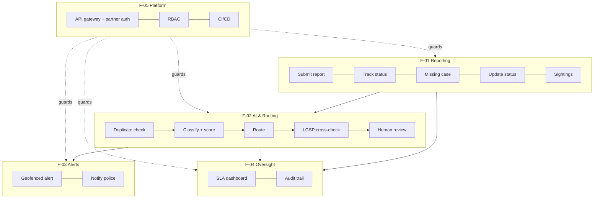
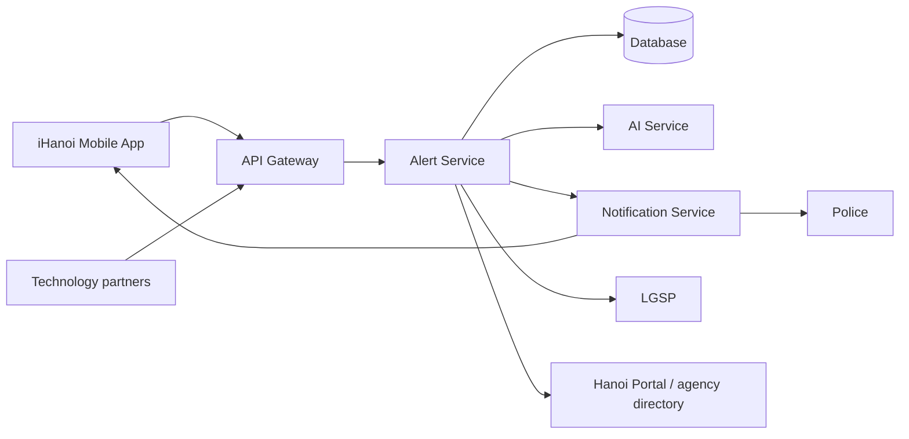

# Architecture

> Lesson 4 · No architecture document was uploaded. This page is **reconstructed** from the sequence diagram lifelines, the layer labels (FE / BE / INT) in the function list, and the open questions in the workbook. Decisions are written as proposed ADRs in [adr/](adr/); the team should confirm or correct them.

## 1. System requirements

### Functional
The 19 L2 functions in [w1-function-list.md](w1-function-list.md), grouped by feature:

| Feature | Functions | Release priority (W4) |
|---|---|---|
| F-01 Incident & Case Reporting | FR-01-01…05 | Must: 01, 03 · Should: 02, 04 · Could: 05 |
| F-02 AI Classification & Smart Routing | FR-02-01…05 | Must: 02, 03, 05 · Should: 01 · Could: 04 |
| F-03 Alerts & Notifications | FR-03-01…03 | Must: 02 · Should: 01 · Won't: 03 |
| F-04 Oversight & Analytics | FR-04-01…03 | Must: 03 · Could: 02 · Won't: 01 |
| F-05 Platform Integration & Access | FR-05-01…03 | Must: 01, 02 · Should: 03 |

### Non-functional (derived; no NFR document exists)
| ID | Requirement | Source | Status |
|---|---|---|---|
| NFR-01 | Role-based access on every endpoint | FR-05-02 | Specified (EARS) |
| NFR-02 | Every state change is audited | FR-04-03 | Specified |
| NFR-03 | Authenticated partner API access | FR-05-01 | Specified |
| NFR-04 | Automatic staging deployment after merge to main | FR-05-03 | Specified; Should |
| NFR-05 | Expected load about 2,000 reports a year (about 5–6 a day) | Cash-flow assumption S19 | Unverified |
| NFR-06 | Response time, availability, retention, privacy of photos/GPS | none | **Gap:** not stated anywhere |

## 2. Functional design

Main data: Incident Report, Missing Case, SLA & Routing Metrics, Audit Trail (maintained); Citizen Account Directory, Agency & Routing Directory, LGSP Integrated Data (read only). See [w0-scope.md](w0-scope.md) Table 4.

## 3. Physical design

Components taken from the sequence diagram:

| Component | Responsibility | Functions |
|---|---|---|
| iHanoi Mobile App | Capture report, show status and alerts | all FE rows |
| API Gateway | Authenticate, route, expose partner endpoints | FR-05-01, FR-05-02 |
| Alert Service (Backend) | Business logic: validation, duplicates, routing rules, audit, case status | all BE rows |
| AI Service (Classification) | Category + confidence score | FR-02-02-INT |
| Database | Reports, cases, metrics, audit | ILFs |
| Notification Service | Push alerts, police notices | FR-03-01-INT, FR-03-02 |
| LGSP (external) | Government data, RAG cross-check | FR-02-04-INT |
| Hanoi Portal (external) | Target of manual routing (context Flow-11) | FR-02-03-INT |
| Agency directory (external, read only) | Responsible-agency lookup | FR-02-03-INT |

## 4. Three layers

The workbook's three technical layers drive both cost and scheduling:

| Layer | What lives here | L3 rows | Base h | AI leverage | Band |
|---|---|---|---|---|---|
| FE | Mobile screens, forms, dashboards | 8 | 52 | 0.35 | Junior |
| BE | Business logic, state, persistence, authorisation | 17 | 136 | 0.70 | Senior |
| INT | AI service, LGSP, push, Hanoi Portal, gateway, CI/CD | 6 | 80 | 1.00 | Senior |

(Hours are from W1. INT is 30% of base hours but 108 of 237.4 in-scope person-hours, about 45%, and is built first.)

## 5. Decisions

| ADR | Decision | Status |
|---|---|---|
| [ADR-001](adr/ADR-001-confidence-threshold-routing.md) | Route by AI confidence threshold 0.9 | Proposed; source of 0.9 open |
| [ADR-002](adr/ADR-002-api-gateway-rbac.md) | Single API gateway with role-based access | Proposed |
| [ADR-003](adr/ADR-003-ai-service-boundary.md) | AI classification as a separate service behind the backend | Proposed |
| [ADR-004](adr/ADR-004-lgsp-daily-batch.md) | LGSP data via daily batch sync | Proposed default; open question #2 |
| [ADR-005](adr/ADR-005-module-boundary.md) | Alert Module as a bounded module inside iHanoi | Proposed |
