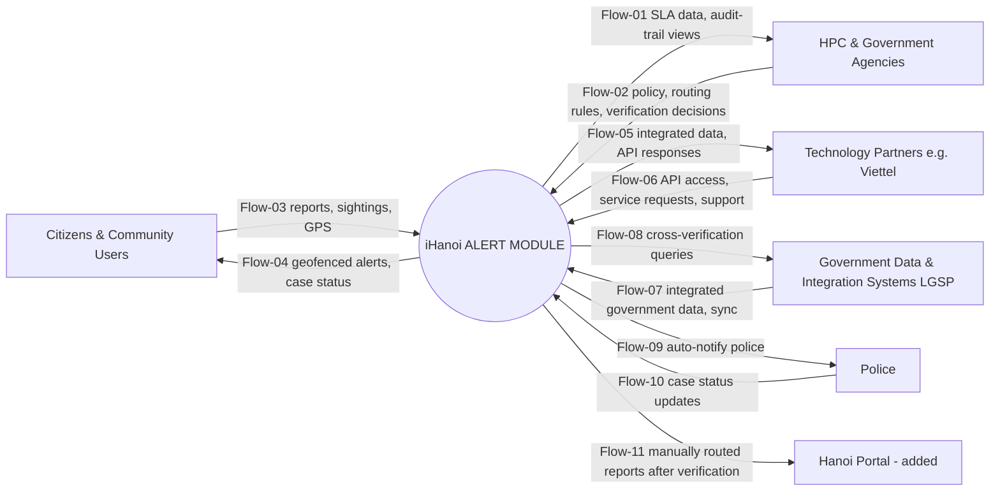

# Context diagram

> Lesson 3 · Source: `iHanoi_Alert_Context_Diagram_v3.drawio`, plus one entity and one flow (Hanoi Portal, Flow-11) added in these files because the sequence diagram, CVCA and FR-02-03 all depend on it. The drawing itself still needs the addition. The product is a black box, **iHanoi ALERT MODULE**, not the whole iHanoi platform.

## Entities
| Entity | CVCA stakeholder | Use Case actor |
|---|---|---|
| Citizens & Community Users | E1 | ACT-E1 Citizens |
| HPC & Government Agencies | G2 / O1 | ACT-G2 HPC & Government Agencies |
| Technology Partners (e.g. Viettel) | P1 | ACT-P1 Technology Partners |
| Government Data & Integration Systems (LGSP) | O3 | ACT-O3 LGSP |
| Police | O1 (part) | ACT-P2 Police |
| Hanoi Portal *(added here)* | O2 | none: external system, not an actor |

## Flows
| Flow | Direction | Data | Use cases | Functions |
|---|---|---|---|---|
| Flow-01 | Module → HPC | SLA dashboard data, audit-trail views. Reports & analytics (UC-12) deferred | UC-14, UC-15 | FR-04-02, FR-04-03 |
| Flow-02 | HPC → Module | Policy and routing-rule direction; human-verification decisions | UC-17 | FR-02-05 |
| Flow-03 | Citizens → Module | Incident and missing-case reports, sightings, GPS | UC-01, UC-05, UC-11 | FR-01-01, 03, 05 |
| Flow-04 | Module → Citizens | Geofenced alerts, case status. Guidance and service updates deferred | UC-04, UC-03 | FR-03-01, FR-01-02; FR-03-03 (Won't) |
| Flow-05 | Module → Partners | Integrated data, API responses | UC-16 | FR-05-01 |
| Flow-06 | Partners → Module | API access, service requests, technical support | UC-16 | FR-05-01 |
| Flow-07 | LGSP → Module | Integrated government data, sync | UC-13 | FR-02-04 |
| Flow-08 | Module → LGSP | Cross-verification queries | UC-13 | FR-02-04 |
| Flow-09 | Module → Police | Auto-notification | UC-10 | FR-03-02 |
| Flow-10 | Police → Module | Case status updates | UC-06 | FR-01-04 |
| Flow-11 *(added here)* | Module → Hanoi Portal | Reports routed manually after human verification | UC-08, UC-17 | FR-02-03 (INT row), SQ-16 |

## Observations
- **Resolved:** Hanoi Portal (CVCA O2) is now an entity with Flow-11, so every integration named in the function list (FR-02-03-INT) appears on the context diagram. Update the `.drawio`.
- The push-notification provider (FR-03-01-INT) is treated as part of the internal Notification Service and is deliberately not an entity. Add it if a named external provider is chosen.
- Police appear as a separate entity here, but are part of O1 in the CVCA.
- The drawing labels the entity "Police (UC-P2)"; these files use "Police" with code ACT-P2.
- Data stores touched by these flows are listed in [w0-scope.md](w0-scope.md) Table 4.
