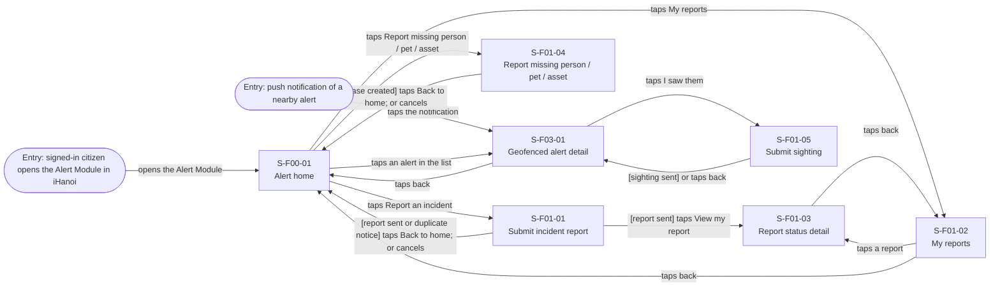
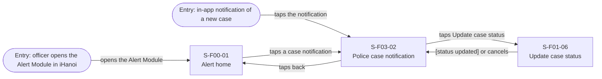
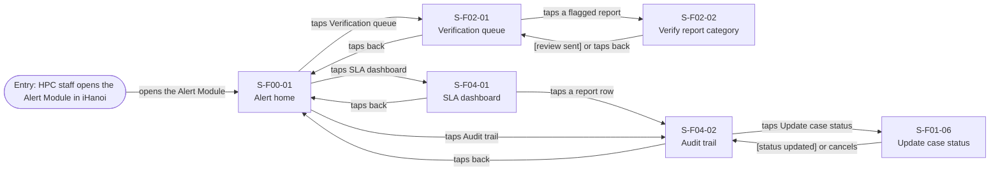

# Screen Transition Diagram: iHanoi Alert Module

> DBIZ2 Lesson 8 · Nodes are Screen IDs from [screen-list.md](screen-list.md). One diagram per actor (the module has 13 screens, no actor sees more than 7). Sign in belongs to the core iHanoi platform, so every diagram starts after it. Technology Partners have no screen (API only, AD-UC-16).

## 1. Citizens

## 2. Police

## 3. HPC & Government Agencies

Conventions:

- Node ID: the Screen ID without the letter F and with `-` replaced by `_` (for example `S01_02` for `S-F01-02`, `S00_01` for `S-F00-01`); the label shows the real Screen ID on the first line.
- Arrow label: the user action ("taps Book"), or a system event in brackets ("[booking saved]").
- A modal is not a node. The modals "Location permission", "Discard report?" and "Confirm status change" are written in the Screen Specs, not here.
- Rounded stadium nodes are entry points from outside the module (a tile in iHanoi, a push or in-app notification).
- "Cancels" on a form returns to the screen it was opened from (through the modal "Discard report?" when the form has content).

## Checks before you save

- [x] Every screen in the Screen List appears in one or more of the diagrams (S-F00-01 in all three; S-F01-06 in Police and HPC).
- [x] Every screen is reachable from an entry point.
- [x] No dead end: every screen has a way out (back, home or a next step).
- [x] The main task of each actor reaches its result in three screens or fewer from the start screen: submit a report 1 (the result is a state of S-F01-01); follow a report 2; declare a missing case 1; handle a police notification 2; verify a report 2; check the SLA dashboard 1; view an audit trail 1.
- [x] Every arrow label is a user action or a system event, never a screen name.
- [x] Usage-flow paths: every arrow "UC-a to UC-b" in [usage-flow.md](usage-flow.md) has a path (table below).
- [ ] The diagram renders on mermaid.live. Syntax was parsed with Mermaid 12.3.0 in Node; mermaid.live was not run.

## Usage-flow paths

| Usage-flow arrow | Path on this diagram |
|---|---|
| UC-01 to UC-03 | S-F01-01 → S-F01-03 (taps View my report), or S-F00-01 → S-F01-02 → S-F01-03 |
| UC-04 to UC-11 | S-F03-01 → S-F01-05 (taps I saw them) |
| UC-10 to UC-06 | entry "in-app notification" → S-F03-02 → S-F01-06 (taps Update case status) |
| UC-14 to UC-15 | S-F04-01 → S-F04-02 (taps a report row) |
| UC-15 to UC-06 | S-F04-02 → S-F01-06 (taps Update case status) |
