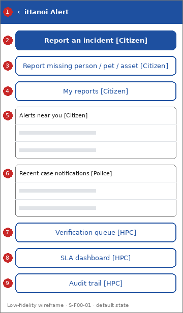

# Screen Spec: S-F00-01 Alert home

| Field | Value |
|---|---|
| Screen ID | `S-F00-01` |
| Screen name | Alert home |
| Actor | Citizens (ACT-E1); Police (ACT-P2); HPC & Government Agencies (ACT-G2) |
| Priority | Must |
| Feature | `F-00 Shared screens (serves FR-05-02 of F-05)` |
| Activity diagrams | none: navigation hub. It leads to AD-UC-01, 03, 05, 06, 10, 14, 15, 17 |
| Mockup image | `img/S-F00-01.png` |
| Status | Draft |

## 1. Purpose

**Shown when:** A signed-in user opens the Alert Module from iHanoi.

**The user leaves this screen when:** The user taps an action, a list item, or leaves the Alert Module.

## 2. Mockup

Low-fidelity wireframe of the default state, generated from the element inventory below; the numbers on the image are the numbers in the table. Elements marked with a state are not drawn.

## 3. Element inventory

| # | Element | Type | Content / data source | Required | Validation |
|---|---|---|---|---|---|
| 1 | `AlertHomeHeader` | Header | "iHanoi Alert" (static text) | Yes | - |
| 2 | `ReportIncidentButton` | Button | "Report an incident" (static text; shown to Citizens only) | Yes | - |
| 3 | `ReportMissingButton` | Button | "Report missing person / pet / asset" (static text; Citizens only) | Yes | - |
| 4 | `MyReportsButton` | Button | "My reports" (static text; Citizens only) | Yes | - |
| 5 | `RecentAlertsList` | List | "Alerts near you"; data: Incident Report routed for public attention (FR-03-01); Citizens only | No | - |
| 6 | `CaseNotificationsList` | List | "Recent case notifications"; data: Incident Report and Missing Person / Pet / Asset Case notified to the station (FR-03-02); Police only | No | - |
| 7 | `VerificationQueueButton` | Button | "Verification queue" (static text; HPC reviewers only) | Yes | - |
| 8 | `SlaDashboardButton` | Button | "SLA dashboard" (static text; HPC staff only) | Yes | - |
| 9 | `AuditTrailButton` | Button | "Audit trail" (static text; HPC staff only) | Yes | - |

## 4. States

| State | What the user sees | Trigger |
|---|---|---|
| Default | The buttons and lists permitted for the user's role (the mockup shows all roles at once; one role never sees all of them) | The user opens the Alert Module |
| Empty (no data) | "RecentAlertsList": "No alerts near you." "CaseNotificationsList": "No new case notifications." | No alert or notification exists |
| Loading | Skeleton rows in the two lists; buttons are already usable | Lists are being fetched |
| Error | Banner in place of the list: "Could not load. Try again." with a Retry button | The list request fails |
| Success / confirmation | Not applicable: nothing is saved on this screen | - |

## 5. Interactions and navigation

| # | Element | User action | System response | Goes to screen |
|---|---|---|---|---|
| 1 | ReportIncidentButton | tap | Opens the form | `S-F01-01` |
| 2 | ReportMissingButton | tap | Opens the form | `S-F01-04` |
| 3 | MyReportsButton | tap | Opens the list | `S-F01-02` |
| 4 | RecentAlertsList item | tap | Opens the alert | `S-F03-01` |
| 5 | CaseNotificationsList item | tap | Opens the notification | `S-F03-02` |
| 6 | VerificationQueueButton | tap | Opens the queue | `S-F02-01` |
| 7 | SlaDashboardButton | tap | Opens the dashboard | `S-F04-01` |
| 8 | AuditTrailButton | tap | Opens the audit trail | `S-F04-02` |
| 9 | Retry button | tap | Reloads the lists | stays |

## 6. Screen-level rules

| Rule ID | Rule | Source |
|---|---|---|
| SR-001 | Only the functions permitted for the user's role are shown; denied functions are hidden, not disabled | FR-05-02, BR-05 |
| SR-002 | Technology partners have no screen: they use the API (AD-UC-16) | FR-05-01 |
| SR-003 | Sign in is provided by the core iHanoi platform; this module starts after it | AD-UC-01 precondition |

## 7. Linked requirements

| FR ID | What this screen does for it |
|---|---|
| FR-05-02 | Shows each role only the actions it may use |
| FR-03-01 | "RecentAlertsList" is a second way into the geofenced alert (S-F03-01) |
| FR-03-02 | "CaseNotificationsList" gives police a way into the notification (S-F03-02) |

## 8. Responsive and accessibility notes

- Smallest supported width: 360px
- What collapses or stacks on a narrow screen: Nothing collapses: the screen is a single column of buttons and lists.
- Information never carried by colour alone: statuses and markers use text and an icon next to the colour (ui-conventions.md section 5)
- Text contrast and minimum size: body text at least 4.5:1 and 14px; tap targets at least 24 by 24 CSS pixels

## 9. Open questions

| # | Question | Blocking? | Status |
|---|---|---|---|
| 1 | [NEEDS CLARIFICATION: can one user hold several roles (for example a police officer who is also a citizen), and how are the actions then combined?] | No | Open |
| 2 | This screen has no function in W1: no FE work item covers it (see screen-list.md, cost gap). | No | Open |

---

## Completion checklist

- [x] The mockup is a separate cropped image file, named with the Screen ID.
- [x] Every visible element in the mockup appears in the element inventory.
- [x] Every input element has a validation rule or an explicit "none".
- [x] All five states are filled in, or marked "not applicable" with a reason.
- [x] Every navigation target is a Screen ID that exists in the Screen List.
- [x] Every element that displays data names the field it displays.
- [x] Every linked FR exists in the Function List, and every action of this screen in an activity diagram is covered by an interaction row.

---

Template source: DBIZ3 Session 4 Screen Spec template (VJCBI College - FTU, 2026), adopted unchanged in structure for DBIZ2 Lesson 8, with Feature and Activity diagram fields added.
