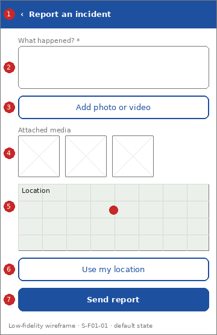

# Screen Spec: S-F01-01 Submit incident report

| Field | Value |
|---|---|
| Screen ID | `S-F01-01` |
| Screen name | Submit incident report |
| Actor | Citizens (ACT-E1) |
| Priority | Must |
| Feature | `F-01 Incident & Case Reporting` |
| Activity diagrams | AD-UC-01 (also AD-UC-02 duplicate notice) |
| Mockup image | `img/S-F01-01.png` |
| Status | Draft |

## 1. Purpose

**Shown when:** The citizen taps "Report an incident".

**The user leaves this screen when:** The report is sent (confirmation), a duplicate notice is shown, or the citizen cancels.

## 2. Mockup

Low-fidelity wireframe of the default state, generated from the element inventory below; the numbers on the image are the numbers in the table. Elements marked with a state are not drawn.

## 3. Element inventory

| # | Element | Type | Content / data source | Required | Validation |
|---|---|---|---|---|---|
| 1 | `SubmitReportHeader` | Header | "Report an incident" (static text, back arrow) | Yes | - |
| 2 | `DescriptionInput` | Input | "What happened?"; data: Incident Report: description | Yes | Not empty after trimming. Maximum length not defined in W1 (assumed 1,000 characters, question 2) |
| 3 | `PhotoVideoPicker` | Input | "Add photo or video"; data: Incident Report: media | No | Accepted types and size not defined (question 2) |
| 4 | `MediaThumbnailList` | List | "Attached media"; data: Incident Report: media (selected files) | No | Each item can be removed before sending |
| 5 | `LocationMap` | Map | "Location"; data: Incident Report: GPS location (latitude, longitude) | Yes | A location must be set: from the device GPS or by moving the pin |
| 6 | `UseMyLocationButton` | Button | "Use my location" | No | - |
| 7 | `SendReportButton` | Button | "Send report" | Yes | Enabled only when "DescriptionInput" and "LocationMap" are valid |
| 8 | `DuplicateNotice` | Banner | "A similar report already exists: A-1001"; data: Incident Report: alert ID of the existing report (FR-02-01) [shown in state: Duplicate found] | No | - |
| 9 | `ConfirmationPanel` | Text | "Report sent. Alert ID A-1002. Status: Submitted"; data: Incident Report: alert ID and status (FR-01-01) [shown in state: Success] | No | - |

## 4. States

| State | What the user sees | Trigger |
|---|---|---|
| Default | Blank form; "LocationMap" shows the device location when permission is granted | The screen opens |
| Empty (no data) | Not applicable: this is an input form; the blank form is the Default state | - |
| Loading | "SendReportButton" shows a spinner and is disabled; fields are locked | The citizen taps "Send report" |
| Error | Field-level message under "DescriptionInput" or "LocationMap" (see ui-conventions.md section 4). System error: banner "Could not send. Your report is kept on this screen. Try again." | Validation fails or the request fails |
| Duplicate found | "DuplicateNotice" banner with the existing alert ID and a "Back to home" button; no new record is created | The duplicate check finds a likely duplicate (FR-02-01) |
| Success / confirmation | "ConfirmationPanel" with alert ID and status Submitted, buttons "View my report" and "Back to home" | The report is saved (status Submitted) |

## 5. Interactions and navigation

| # | Element | User action | System response | Goes to screen |
|---|---|---|---|---|
| 1 | UseMyLocationButton | tap | Fills "LocationMap" from the device GPS; asks for permission first if needed (modal: Location permission) | stays |
| 2 | LocationMap | drag pin | Updates the location | stays |
| 3 | PhotoVideoPicker | tap | Opens the device picker; adds the file to "MediaThumbnailList" | stays |
| 4 | SendReportButton | tap | Validates, sends, then shows the Success or Duplicate found state | stays |
| 5 | View my report button (Success) | tap | Opens the new report | `S-F01-03` |
| 6 | Back to home button (Success, Duplicate) | tap | Returns home | `S-F00-01` |
| 7 | Back arrow | tap | If the form has content, opens the modal "Discard report?"; otherwise returns home | `S-F00-01` |

## 6. Screen-level rules

| Rule ID | Rule | Source |
|---|---|---|
| SR-001 | Description and location are mandatory; photo/video is optional | AD-UC-01 question 1 (default) |
| SR-002 | A likely duplicate creates no new record; the citizen is shown the existing alert ID and has no confirm or cancel choice | FR-02-01, BR-03 |
| SR-003 | A new report is saved as Submitted and the confirmation shows that status | FR-01-01, BR-09 |
| SR-004 | The confirmation does not wait for classification or routing | AD-UC-01 decision 1 |
| SR-005 | Only signed-in citizens can open this screen | FR-05-02 |

## 7. Linked requirements

| FR ID | What this screen does for it |
|---|---|
| FR-01-01 | Captures description, media and GPS; shows the confirmation with alert ID and status |
| FR-02-01 | Shows the duplicate notice |
| FR-05-02 | Role check before the screen opens |

## 8. Responsive and accessibility notes

- Smallest supported width: 360px
- What collapses or stacks on a narrow screen: On a narrow screen the map and thumbnails stack under the description; buttons keep full width.
- Information never carried by colour alone: statuses and markers use text and an icon next to the colour (ui-conventions.md section 5)
- Text contrast and minimum size: body text at least 4.5:1 and 14px; tap targets at least 24 by 24 CSS pixels

## 9. Open questions

| # | Question | Blocking? | Status |
|---|---|---|---|
| 1 | [NEEDS CLARIFICATION: which fields are mandatory? Default applied: description and GPS location are mandatory, media is optional (AD-UC-01 question 1)] | No | Open |
| 2 | [NEEDS CLARIFICATION: maximum description length, accepted media types and maximum file size] | No | Open |
| 3 | [NEEDS CLARIFICATION: what happens when the device has no signal while sending?] | No | Open |

---

## Completion checklist

- [x] The mockup is a separate cropped image file, named with the Screen ID.
- [x] Every visible element in the mockup appears in the element inventory.
- [x] Every input element has a validation rule or an explicit "none".
- [x] All five states are filled in, or marked "not applicable" with a reason.
- [x] Every navigation target is a Screen ID that exists in the Screen List.
- [x] Every element that displays data names the field it displays.
- [x] Every linked FR exists in the Function List, and every action of this screen in an activity diagram is covered by an interaction row.

---

Template source: DBIZ3 Session 4 Screen Spec template (VJCBI College - FTU, 2026), adopted unchanged in structure for DBIZ2 Lesson 8, with Feature and Activity diagram fields added.
