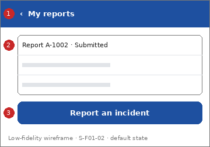

# Screen Spec: S-F01-02 My reports

| Field | Value |
|---|---|
| Screen ID | `S-F01-02` |
| Screen name | My reports |
| Actor | Citizens (ACT-E1) |
| Priority | Should |
| Feature | `F-01 Incident & Case Reporting` |
| Activity diagrams | AD-UC-03 |
| Mockup image | `img/S-F01-02.png` |
| Status | Draft |

## 1. Purpose

**Shown when:** The citizen taps "My reports".

**The user leaves this screen when:** The citizen opens a report or goes back.

## 2. Mockup

Low-fidelity wireframe of the default state, generated from the element inventory below; the numbers on the image are the numbers in the table. Elements marked with a state are not drawn.

## 3. Element inventory

| # | Element | Type | Content / data source | Required | Validation |
|---|---|---|---|---|---|
| 1 | `MyReportsHeader` | Header | "My reports" (static text, back arrow) | Yes | - |
| 2 | `ReportList` | List | "Report A-1002 · Submitted"; data: Incident Report: alert ID, description (first line), submitted date and time, status (FR-01-02) | Yes | - |
| 3 | `NewReportButton` | Button | "Report an incident" | No | - |

## 4. States

| State | What the user sees | Trigger |
|---|---|---|
| Default | Reports of the signed-in citizen, newest first; each row shows alert ID, first line of the description, date and time, and a status chip with text | The screen opens |
| Empty (no data) | "You have not sent any reports yet." and the "Report an incident" button | The citizen owns no report |
| Loading | Skeleton rows | The list is being fetched |
| Error | Banner "Could not load your reports. Try again." with Retry | The request fails |
| Success / confirmation | Not applicable: the screen only reads data | - |

## 5. Interactions and navigation

| # | Element | User action | System response | Goes to screen |
|---|---|---|---|---|
| 1 | ReportList item | tap | Opens the report | `S-F01-03` |
| 2 | NewReportButton | tap | Opens the form | `S-F01-01` |
| 3 | Pull down | swipe | Reloads the list | stays |
| 4 | Back arrow | tap | Returns home | `S-F00-01` |

## 6. Screen-level rules

| Rule ID | Rule | Source |
|---|---|---|
| SR-001 | Only the citizen's own reports are listed | AD-UC-03 question 1 (owner-only) |
| SR-002 | Status is one of Submitted, Routed, In Progress, Resolved; "Handed to Police" is shown as In Progress | FR-01-02; AD-UC-03 question 2 |
| SR-003 | A report flagged for human verification stays Submitted until it is routed | AD-UC-03 decision 1 |

## 7. Linked requirements

| FR ID | What this screen does for it |
|---|---|
| FR-01-02 | Lists the citizen's reports with current status |

## 8. Responsive and accessibility notes

- Smallest supported width: 360px
- What collapses or stacks on a narrow screen: Rows keep one line per report; the status chip moves under the first line on narrow screens.
- Information never carried by colour alone: statuses and markers use text and an icon next to the colour (ui-conventions.md section 5)
- Text contrast and minimum size: body text at least 4.5:1 and 14px; tap targets at least 24 by 24 CSS pixels

## 9. Open questions

| # | Question | Blocking? | Status |
|---|---|---|---|
| 1 | [NEEDS CLARIFICATION: are missing person / pet / asset cases the citizen declared also listed here? FR-01-02 mentions reports only] | No | Open |

---

## Completion checklist

- [x] The mockup is a separate cropped image file, named with the Screen ID.
- [x] Every visible element in the mockup appears in the element inventory.
- [x] Every input element has a validation rule or an explicit "none".
- [x] All five states are filled in, or marked "not applicable" with a reason.
- [x] Every navigation target is a Screen ID that exists in the Screen List.
- [x] Every element that displays data names the field it displays.
- [x] Every linked FR exists in the Function List, and every action of this screen in an activity diagram is covered by an interaction row.

---

Template source: DBIZ3 Session 4 Screen Spec template (VJCBI College - FTU, 2026), adopted unchanged in structure for DBIZ2 Lesson 8, with Feature and Activity diagram fields added.
