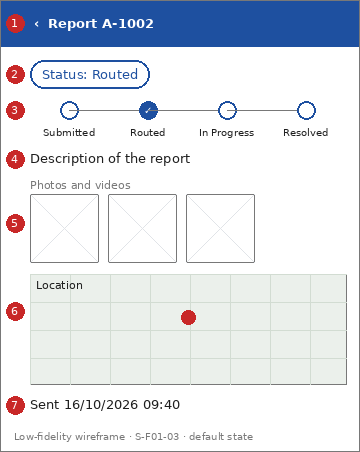

# Screen Spec: S-F01-03 Report status detail

| Field | Value |
|---|---|
| Screen ID | `S-F01-03` |
| Screen name | Report status detail |
| Actor | Citizens (ACT-E1) |
| Priority | Should |
| Feature | `F-01 Incident & Case Reporting` |
| Activity diagrams | AD-UC-03 |
| Mockup image | `img/S-F01-03.png` |
| Status | Draft |

## 1. Purpose

**Shown when:** The citizen opens one of their reports.

**The user leaves this screen when:** The citizen goes back.

## 2. Mockup

Low-fidelity wireframe of the default state, generated from the element inventory below; the numbers on the image are the numbers in the table. Elements marked with a state are not drawn.

## 3. Element inventory

| # | Element | Type | Content / data source | Required | Validation |
|---|---|---|---|---|---|
| 1 | `ReportDetailHeader` | Header | "Report A-1002"; data: Incident Report: alert ID; back arrow | Yes | - |
| 2 | `StatusChip` | Chip | "Status: Routed"; data: Incident Report: status (FR-01-02) | Yes | - |
| 3 | `StatusSteps` | Text | "Submitted > Routed > In Progress > Resolved"; data: status list of FR-01-02; the current step is marked with an icon and text | Yes | - |
| 4 | `DescriptionText` | Text | "Description of the report"; data: Incident Report: description | Yes | - |
| 5 | `MediaGallery` | Image | "Photos and videos"; data: Incident Report: media | No | - |
| 6 | `LocationMapView` | Map | "Location"; data: Incident Report: GPS location (read only) | Yes | - |
| 7 | `SubmittedAtText` | Text | "Sent 16/10/2026 09:40"; data: Incident Report: submitted date and time | Yes | - |

## 4. States

| State | What the user sees | Trigger |
|---|---|---|
| Default | Status chip, four-step status line, description, media, location and sent time | The citizen opens an owned report |
| Empty (no data) | Not applicable: a report always has a description and a location | - |
| Loading | Skeleton in place of the content | The report is being fetched |
| Error | "This report is not available." The same message appears whether the report does not exist or belongs to someone else, so its existence is not revealed | The report does not exist or is not owned by the citizen (FR-05-02) |
| Success / confirmation | Not applicable: the screen only reads data | - |

## 5. Interactions and navigation

| # | Element | User action | System response | Goes to screen |
|---|---|---|---|---|
| 1 | MediaGallery item | tap | Shows the media full screen | stays |
| 2 | Back arrow | tap | Returns to the list | `S-F01-02` |

## 6. Screen-level rules

| Rule ID | Rule | Source |
|---|---|---|
| SR-001 | Owner-only access: a report that does not exist or belongs to someone else is denied with the same message | AD-UC-03 question 1; FR-05-02 |
| SR-002 | A citizen who received a duplicate notice can see the existing alert ID but cannot open that report unless they own it | AD-UC-03 question 1 |
| SR-003 | Status is read when the screen opens; there is no push or polling | AD-UC-03 reading notes |

## 7. Linked requirements

| FR ID | What this screen does for it |
|---|---|
| FR-01-02 | Displays the current status of the report |
| FR-05-02 | Denies access to reports the citizen does not own |

## 8. Responsive and accessibility notes

- Smallest supported width: 360px
- What collapses or stacks on a narrow screen: The status line wraps to two rows; the map keeps full width.
- Information never carried by colour alone: statuses and markers use text and an icon next to the colour (ui-conventions.md section 5)
- Text contrast and minimum size: body text at least 4.5:1 and 14px; tap targets at least 24 by 24 CSS pixels

## 9. Open questions

| # | Question | Blocking? | Status |
|---|---|---|---|
| 1 | [NEEDS CLARIFICATION: who sets In Progress? FR-01-04 sets only Resolved or Handed to Police (AD-UC-03 question 2)] | No | Open |

---

## Completion checklist

- [x] The mockup is a separate cropped image file, named with the Screen ID.
- [x] Every visible element in the mockup appears in the element inventory.
- [x] Every input element has a validation rule or an explicit "none".
- [x] All five states are filled in, or marked "not applicable" with a reason.
- [x] Every navigation target is a Screen ID that exists in the Screen List.
- [x] Every element that displays data names the field it displays.
- [x] Every linked FR exists in the Function List, and every action of this screen in an activity diagram is covered by an interaction row.

---

Template source: DBIZ3 Session 4 Screen Spec template (VJCBI College - FTU, 2026), adopted unchanged in structure for DBIZ2 Lesson 8, with Feature and Activity diagram fields added.
