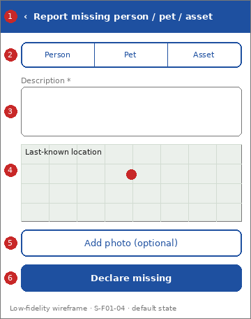

# Screen Spec: S-F01-04 Report missing person / pet / asset

| Field | Value |
|---|---|
| Screen ID | `S-F01-04` |
| Screen name | Report missing person / pet / asset |
| Actor | Citizens (ACT-E1) |
| Priority | Must |
| Feature | `F-01 Incident & Case Reporting` |
| Activity diagrams | AD-UC-05 |
| Mockup image | `img/S-F01-04.png` |
| Status | Draft |

## 1. Purpose

**Shown when:** The citizen taps "Report missing person / pet / asset".

**The user leaves this screen when:** The case is created (confirmation) or the citizen cancels.

## 2. Mockup

Low-fidelity wireframe of the default state, generated from the element inventory below; the numbers on the image are the numbers in the table. Elements marked with a state are not drawn.

## 3. Element inventory

| # | Element | Type | Content / data source | Required | Validation |
|---|---|---|---|---|---|
| 1 | `MissingHeader` | Header | "Report missing person / pet / asset" (static text, back arrow) | Yes | - |
| 2 | `CaseTypeSelector` | Input | "Person \| Pet \| Asset"; data: Missing Person / Pet / Asset Case: type | Yes | One option must be selected |
| 3 | `MissingDescriptionInput` | Input | "Description"; data: Missing Person / Pet / Asset Case: description | Yes | Not empty after trimming; maximum length not defined (assumed 1,000 characters) |
| 4 | `LastKnownLocationMap` | Map | "Last-known location"; data: Missing Person / Pet / Asset Case: last-known location | Yes | A location must be set by pin or by the device GPS |
| 5 | `MissingPhotoPicker` | Input | "Add photo (optional)"; data: Missing Person / Pet / Asset Case: media (assumed) | No | Accepted types and size not defined |
| 6 | `DeclareButton` | Button | "Declare missing" | Yes | Enabled when type, description and location are valid |
| 7 | `CaseCreatedPanel` | Text | "Case M-101 created. The nearest police station has been notified"; data: Missing Person / Pet / Asset Case: case ID (FR-01-03, FR-03-02) [shown in state: Success] | No | - |

## 4. States

| State | What the user sees | Trigger |
|---|---|---|
| Default | Blank form with the type not yet chosen | The screen opens |
| Empty (no data) | Not applicable: input form | - |
| Loading | "DeclareButton" shows a spinner; fields are locked | The citizen taps "Declare missing" |
| Error | Field-level message when description or location is missing (default applied, behaviour not defined in W1: question 1); banner "Could not send. Try again." on a system error | Validation or request fails |
| Success / confirmation | "CaseCreatedPanel" with the case ID and a "Back to home" button | The case is created |

## 5. Interactions and navigation

| # | Element | User action | System response | Goes to screen |
|---|---|---|---|---|
| 1 | CaseTypeSelector | tap | Selects the type | stays |
| 2 | LastKnownLocationMap | drag pin | Sets the location | stays |
| 3 | DeclareButton | tap | Validates, creates the case, shows the Success state | stays |
| 4 | Back to home button (Success) | tap | Returns home | `S-F00-01` |
| 5 | Back arrow | tap | Asks "Discard report?" if the form has content, then returns home | `S-F00-01` |

## 6. Screen-level rules

| Rule ID | Rule | Source |
|---|---|---|
| SR-001 | A missing person / pet / asset case is a separate record from an incident report | FR-01-03, BR-08 |
| SR-002 | Description and last-known location are required | FR-01-03 |
| SR-003 | Creating the case notifies the nearest police station automatically; the citizen sees only the confirmation | FR-03-02, AD-UC-05 |

## 7. Linked requirements

| FR ID | What this screen does for it |
|---|---|
| FR-01-03 | Captures the declaration and creates the case |
| FR-03-02 | The confirmation states that the police station was notified |

## 8. Responsive and accessibility notes

- Smallest supported width: 360px
- What collapses or stacks on a narrow screen: Selector segments stay on one row; map and photo stack under the description.
- Information never carried by colour alone: statuses and markers use text and an icon next to the colour (ui-conventions.md section 5)
- Text contrast and minimum size: body text at least 4.5:1 and 14px; tap targets at least 24 by 24 CSS pixels

## 9. Open questions

| # | Question | Blocking? | Status |
|---|---|---|---|
| 1 | [NEEDS CLARIFICATION: is the declaration rejected when description or last-known location is missing, and which message does the citizen get? (AD-UC-05 question 1)] | Yes | Open |
| 2 | [NEEDS CLARIFICATION: what is the initial status of a case, and can the citizen follow it? (AD-UC-05 question 2)] | No | Open |
| 3 | [NEEDS CLARIFICATION: is a photo accepted? FR-01-03 names description and last-known location only] | No | Open |

---

## Completion checklist

- [x] The mockup is a separate cropped image file, named with the Screen ID.
- [x] Every visible element in the mockup appears in the element inventory.
- [x] Every input element has a validation rule or an explicit "none".
- [x] All five states are filled in, or marked "not applicable" with a reason.
- [x] Every navigation target is a Screen ID that exists in the Screen List.
- [x] Every element that displays data names the field it displays.
- [x] Every linked FR exists in the Function List, and every action of this screen in an activity diagram is covered by an interaction row.

---

Template source: DBIZ3 Session 4 Screen Spec template (VJCBI College - FTU, 2026), adopted unchanged in structure for DBIZ2 Lesson 8, with Feature and Activity diagram fields added.
