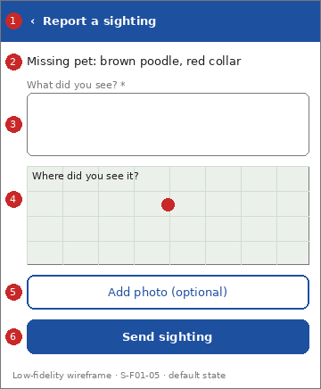

# Screen Spec: S-F01-05 Submit sighting

| Field | Value |
|---|---|
| Screen ID | `S-F01-05` |
| Screen name | Submit sighting |
| Actor | Citizens (ACT-E1) |
| Priority | Could |
| Feature | `F-01 Incident & Case Reporting` |
| Activity diagrams | AD-UC-11 |
| Mockup image | `img/S-F01-05.png` |
| Status | Draft |

## 1. Purpose

**Shown when:** A nearby citizen taps "I saw them" on an alert about an active missing case.

**The user leaves this screen when:** The sighting is sent or the citizen goes back.

## 2. Mockup

Low-fidelity wireframe of the default state, generated from the element inventory below; the numbers on the image are the numbers in the table. Elements marked with a state are not drawn.

## 3. Element inventory

| # | Element | Type | Content / data source | Required | Validation |
|---|---|---|---|---|---|
| 1 | `SightingHeader` | Header | "Report a sighting" (static text, back arrow) | Yes | - |
| 2 | `CaseSummaryText` | Text | "Missing pet: brown poodle, red collar"; data: Missing Person / Pet / Asset Case: type, description, last-known location | Yes | - |
| 3 | `SightingDescriptionInput` | Input | "What did you see?"; data: Sighting: description (linked to the case) | Yes | Not empty after trimming; other fields not defined (question 2) |
| 4 | `SightingLocationMap` | Map | "Where did you see it?"; data: Sighting: location (assumed) | No | If set, must be a valid location |
| 5 | `SightingPhotoPicker` | Input | "Add photo (optional)"; data: Sighting: media (assumed) | No | Accepted types and size not defined |
| 6 | `SendSightingButton` | Button | "Send sighting" | Yes | Enabled when "SightingDescriptionInput" is valid |
| 7 | `SightingSentPanel` | Text | "Thank you. Your sighting was linked to the case"; data: Sighting: linked to case (FR-01-05) [shown in state: Success] | No | - |

## 4. States

| State | What the user sees | Trigger |
|---|---|---|
| Default | Case summary and a blank sighting form | The screen opens after the eligibility check passes (case active and citizen nearby) |
| Empty (no data) | Not applicable: input form | - |
| Loading | "SendSightingButton" shows a spinner | The citizen taps "Send sighting" |
| Error | Access denied: "You cannot report a sighting for this case." Not eligible (case not active or citizen not nearby): same message, because the specified outcome is open (question 1). System error: banner with Retry | Permission or eligibility fails, or the request fails |
| Success / confirmation | "SightingSentPanel" with a "Back" button; case status is unchanged | The sighting is linked to the case |

## 5. Interactions and navigation

| # | Element | User action | System response | Goes to screen |
|---|---|---|---|---|
| 1 | SendSightingButton | tap | Validates and sends; shows the Success state | stays |
| 2 | Back button (Success) | tap | Returns to the alert | `S-F03-01` |
| 3 | Back arrow | tap | Returns to the alert | `S-F03-01` |

## 6. Screen-level rules

| Rule ID | Rule | Source |
|---|---|---|
| SR-001 | The form opens only when the case is active and the citizen is nearby; the check runs before the form accepts input | FR-01-05; AD-UC-11 decision 2 |
| SR-002 | Role check before the screen opens | FR-05-02 |
| SR-003 | A sighting is linked to the case and does not change the case status | FR-01-05 |

## 7. Linked requirements

| FR ID | What this screen does for it |
|---|---|
| FR-01-05 | Lets a nearby citizen submit sighting information linked to the case |
| FR-05-02 | Role check |

## 8. Responsive and accessibility notes

- Smallest supported width: 360px
- What collapses or stacks on a narrow screen: Case summary collapses to two lines with a "more" link.
- Information never carried by colour alone: statuses and markers use text and an icon next to the colour (ui-conventions.md section 5)
- Text contrast and minimum size: body text at least 4.5:1 and 14px; tap targets at least 24 by 24 CSS pixels

## 9. Open questions

| # | Question | Blocking? | Status |
|---|---|---|---|
| 1 | [NEEDS CLARIFICATION: how does a citizen find an active case? No FR sends an alert about a missing case. Default: via "RecentAlertsList" and S-F03-01] | No | Open |
| 2 | [NEEDS CLARIFICATION: which sighting fields are mandatory, and what are "active" and "nearby"? (AD-UC-11 questions 1, 2 and 4)] | No | Open |
| 3 | [NEEDS CLARIFICATION: what does the citizen see when not eligible? (AD-UC-11 question 3)] | No | Open |

---

## Completion checklist

- [x] The mockup is a separate cropped image file, named with the Screen ID.
- [x] Every visible element in the mockup appears in the element inventory.
- [x] Every input element has a validation rule or an explicit "none".
- [x] All five states are filled in, or marked "not applicable" with a reason.
- [x] Every navigation target is a Screen ID that exists in the Screen List.
- [x] Every element that displays data names the field it displays.
- [x] Every linked FR exists in the Function List, and every action of this screen in an activity diagram is covered by an interaction row.

---

Template source: DBIZ3 Session 4 Screen Spec template (VJCBI College - FTU, 2026), adopted unchanged in structure for DBIZ2 Lesson 8, with Feature and Activity diagram fields added.
