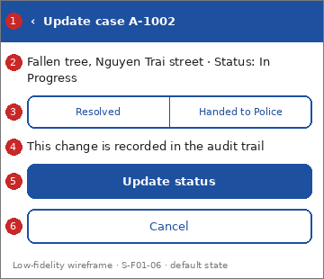

# Screen Spec: S-F01-06 Update case status

| Field | Value |
|---|---|
| Screen ID | `S-F01-06` |
| Screen name | Update case status |
| Actor | Police (ACT-P2); HPC & Government Agencies (ACT-G2) |
| Priority | Should |
| Feature | `F-01 Incident & Case Reporting` |
| Activity diagrams | AD-UC-06 (calls AD-UC-15 diagram B) |
| Mockup image | `img/S-F01-06.png` |
| Status | Draft |

## 1. Purpose

**Shown when:** An authorised user chooses to update the status of a case.

**The user leaves this screen when:** The status is updated or the user cancels.

## 2. Mockup

Low-fidelity wireframe of the default state, generated from the element inventory below; the numbers on the image are the numbers in the table. Elements marked with a state are not drawn.

## 3. Element inventory

| # | Element | Type | Content / data source | Required | Validation |
|---|---|---|---|---|---|
| 1 | `UpdateStatusHeader` | Header | "Update case A-1002" (static text; case ID; back arrow) | Yes | - |
| 2 | `CaseSummaryCard` | Text | "Fallen tree, Nguyen Trai street · Status: In Progress"; data: Incident Report / Missing Person / Pet / Asset Case: ID, description, location, current status | Yes | - |
| 3 | `NewStatusSelector` | Input | "Resolved \| Handed to Police"; data: Incident Report / Case: status (FR-01-04) | Yes | Exactly one outcome per update |
| 4 | `AuditNoteText` | Text | "This change is recorded in the audit trail" (static text (FR-04-03)) | Yes | - |
| 5 | `UpdateStatusButton` | Button | "Update status" | Yes | Enabled when an outcome is selected |
| 6 | `CancelButton` | Button | "Cancel" | No | - |
| 7 | `StatusUpdatedToast` | Text | "Status updated to Resolved"; data: Incident Report / Case: status [shown in state: Success] | No | - |

## 4. States

| State | What the user sees | Trigger |
|---|---|---|
| Default | Case summary, outcome selector (none selected), "Update status" disabled | The screen opens for a permitted user |
| Empty (no data) | Not applicable: the screen is always opened for one case | - |
| Loading | "UpdateStatusButton" shows a spinner | The user confirms in the modal |
| Error | Access denied: "You are not allowed to change this case." System error: banner "Could not update. Try again." | Role not permitted, or the request fails |
| Success / confirmation | "StatusUpdatedToast", then the previous screen | The status is updated and the audit entry is recorded |

## 5. Interactions and navigation

| # | Element | User action | System response | Goes to screen |
|---|---|---|---|---|
| 1 | NewStatusSelector | tap | Selects the outcome and enables the button | stays |
| 2 | UpdateStatusButton | tap | Opens the modal "Confirm status change"; on confirm the system updates the status and records the audit entry (AD-UC-15) | previous screen: `S-F03-02` or `S-F04-02` |
| 3 | CancelButton / back arrow | tap | Leaves without change | previous screen: `S-F03-02` or `S-F04-02` |

## 6. Screen-level rules

| Rule ID | Rule | Source |
|---|---|---|
| SR-001 | Only Police and HPC & Government Agencies staff may use this screen; other roles are denied | FR-05-02, BR-05, BR-07 |
| SR-002 | One outcome per update: Resolved or Handed to Police | FR-01-04; AD-UC-06 |
| SR-003 | Every update writes an audit entry | FR-04-03, BR-04 |
| SR-004 | "Handed to Police" is a proposed fifth status; citizens see it as In Progress until decided | AD-UC-06 question 1; AD-UC-03 question 2 |

## 7. Linked requirements

| FR ID | What this screen does for it |
|---|---|
| FR-01-04 | Lets an authorised user mark the case |
| FR-04-03 | Records the change in the audit trail |
| FR-05-02 | Role check |

## 8. Responsive and accessibility notes

- Smallest supported width: 360px
- What collapses or stacks on a narrow screen: Selector segments stack vertically; buttons keep full width.
- Information never carried by colour alone: statuses and markers use text and an icon next to the colour (ui-conventions.md section 5)
- Text contrast and minimum size: body text at least 4.5:1 and 14px; tap targets at least 24 by 24 CSS pixels

## 9. Open questions

| # | Question | Blocking? | Status |
|---|---|---|---|
| 1 | [NEEDS CLARIFICATION: "Handed to Police" is not in the FR-01-02 status list. Add it as a fifth status? (AD-UC-06 question 1)] | No | Open |
| 2 | [NEEDS CLARIFICATION: may both roles set both outcomes? (AD-UC-06 question 5)] | No | Open |

---

## Completion checklist

- [x] The mockup is a separate cropped image file, named with the Screen ID.
- [x] Every visible element in the mockup appears in the element inventory.
- [x] Every input element has a validation rule or an explicit "none".
- [x] All five states are filled in, or marked "not applicable" with a reason.
- [x] Every navigation target is a Screen ID that exists in the Screen List.
- [x] Every element that displays data names the field it displays.
- [x] Every linked FR exists in the Function List, and every action of this screen in an activity diagram is covered by an interaction row.

---

Template source: DBIZ3 Session 4 Screen Spec template (VJCBI College - FTU, 2026), adopted unchanged in structure for DBIZ2 Lesson 8, with Feature and Activity diagram fields added.
