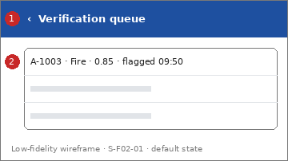

# Screen Spec: S-F02-01 Verification queue

| Field | Value |
|---|---|
| Screen ID | `S-F02-01` |
| Screen name | Verification queue |
| Actor | HPC & Government Agencies (ACT-G2), reviewer |
| Priority | Must |
| Feature | `F-02 AI Classification & Smart Routing` |
| Activity diagrams | AD-UC-17 |
| Mockup image | `img/S-F02-01.png` |
| Status | Draft |

## 1. Purpose

**Shown when:** A reviewer taps "Verification queue".

**The user leaves this screen when:** The reviewer opens a report or goes back.

## 2. Mockup

Low-fidelity wireframe of the default state, generated from the element inventory below; the numbers on the image are the numbers in the table. Elements marked with a state are not drawn.

## 3. Element inventory

| # | Element | Type | Content / data source | Required | Validation |
|---|---|---|---|---|---|
| 1 | `QueueHeader` | Header | "Verification queue" (static text, back arrow) | Yes | - |
| 2 | `FlaggedReportList` | List | "A-1003 · Fire · 0.85 · flagged 09:50"; data: Incident Report: alert ID, AI category, confidence score, flagged time (FR-02-05) | Yes | - |

## 4. States

| State | What the user sees | Trigger |
|---|---|---|
| Default | Flagged reports, oldest first (assumed), each with alert ID, AI category, score and flagged time | The screen opens |
| Empty (no data) | "No reports are waiting for verification." | No report is flagged |
| Loading | Skeleton rows | The list is being fetched |
| Error | Banner "Could not load the queue. Try again." with Retry; access denied for a non-reviewer: "You are not allowed to verify reports." | The request fails or the role is not permitted |
| Success / confirmation | Not applicable: the screen only reads data | - |

## 5. Interactions and navigation

| # | Element | User action | System response | Goes to screen |
|---|---|---|---|---|
| 1 | FlaggedReportList item | tap | Opens the report for review | `S-F02-02` |
| 2 | Back arrow | tap | Returns home | `S-F00-01` |

## 6. Screen-level rules

| Rule ID | Rule | Source |
|---|---|---|
| SR-001 | A report is listed when its score is 0.9 or below and LGSP did not confirm the category | FR-02-05, BR-02 |
| SR-002 | A flagged report keeps the status Submitted | AD-UC-17 decision 2 |
| SR-003 | Reviewer roles are not yet defined | AD-UC-17 question 2; FR-05-02 |

## 7. Linked requirements

| FR ID | What this screen does for it |
|---|---|
| FR-02-05 | Gives the reviewer access to the reports flagged for human verification |

## 8. Responsive and accessibility notes

- Smallest supported width: 360px
- What collapses or stacks on a narrow screen: Rows show two lines: alert ID and category, then score and time.
- Information never carried by colour alone: statuses and markers use text and an icon next to the colour (ui-conventions.md section 5)
- Text contrast and minimum size: body text at least 4.5:1 and 14px; tap targets at least 24 by 24 CSS pixels

## 9. Open questions

| # | Question | Blocking? | Status |
|---|---|---|---|
| 1 | [NEEDS CLARIFICATION: which HPC staff roles are reviewers, and are these two reviewer screens in scope? FR-02-05 has a BE row only (AD-UC-17 question 2, W5 question 3)] | Yes | Open |
| 2 | This screen has no FE work item in W1 (see screen-list.md, cost gap). | No | Open |

---

## Completion checklist

- [x] The mockup is a separate cropped image file, named with the Screen ID.
- [x] Every visible element in the mockup appears in the element inventory.
- [x] Every input element has a validation rule or an explicit "none".
- [x] All five states are filled in, or marked "not applicable" with a reason.
- [x] Every navigation target is a Screen ID that exists in the Screen List.
- [x] Every element that displays data names the field it displays.
- [x] Every linked FR exists in the Function List, and every action of this screen in an activity diagram is covered by an interaction row.

---

Template source: DBIZ3 Session 4 Screen Spec template (VJCBI College - FTU, 2026), adopted unchanged in structure for DBIZ2 Lesson 8, with Feature and Activity diagram fields added.
