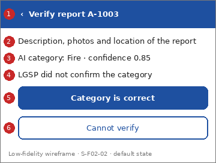

# Screen Spec: S-F02-02 Verify report category

| Field | Value |
|---|---|
| Screen ID | `S-F02-02` |
| Screen name | Verify report category |
| Actor | HPC & Government Agencies (ACT-G2), reviewer |
| Priority | Must |
| Feature | `F-02 AI Classification & Smart Routing` |
| Activity diagrams | AD-UC-17 |
| Mockup image | `img/S-F02-02.png` |
| Status | Draft |

## 1. Purpose

**Shown when:** A reviewer opens a flagged report.

**The user leaves this screen when:** The reviewer sends the result or goes back.

## 2. Mockup

Low-fidelity wireframe of the default state, generated from the element inventory below; the numbers on the image are the numbers in the table. Elements marked with a state are not drawn.

## 3. Element inventory

| # | Element | Type | Content / data source | Required | Validation |
|---|---|---|---|---|---|
| 1 | `ReviewHeader` | Header | "Verify report A-1003" (static text; alert ID; back arrow) | Yes | - |
| 2 | `ReportContentText` | Text | "Description, photos and location of the report"; data: Incident Report: description, media, location | Yes | - |
| 3 | `AiCategoryText` | Text | "AI category: Fire · confidence 0.85"; data: Incident Report: AI category and confidence score (FR-02-02) | Yes | - |
| 4 | `LgspResultText` | Text | "LGSP did not confirm the category"; data: LGSP Integrated Data: cross-check result (FR-02-04) | Yes | - |
| 5 | `CategoryCorrectButton` | Button | "Category is correct" | Yes | - |
| 6 | `CannotVerifyButton` | Button | "Cannot verify" | Yes | - |
| 7 | `ReviewSentPanel` | Text | "Review sent. The report goes to routing"; data: Incident Report: review result [shown in state: Success] | No | - |

## 4. States

| State | What the user sees | Trigger |
|---|---|---|
| Default | Report content, AI category with score, LGSP result and the two outcome buttons | The screen opens for a flagged report |
| Empty (no data) | Not applicable: the screen always shows one report | - |
| Loading | Skeleton in place of the content; buttons disabled | The report is being fetched |
| Error | "This report is not available for review." or a system-error banner with Retry | The report is no longer flagged, the role is not permitted, or the request fails |
| Success / confirmation | "ReviewSentPanel", then the queue | The reviewer taps "Category is correct" |

## 5. Interactions and navigation

| # | Element | User action | System response | Goes to screen |
|---|---|---|---|---|
| 1 | CategoryCorrectButton | tap | Returns the result to routing (UC-08), which routes the report to Hanoi Portal (SQ-16); shows the Success state | `S-F02-01` |
| 2 | CannotVerifyButton | tap | Outcome not defined (question 1): the screen stays and shows "This outcome is not available yet" until the question is answered | stays |
| 3 | Back arrow | tap | Returns to the queue | `S-F02-01` |

## 6. Screen-level rules

| Rule ID | Rule | Source |
|---|---|---|
| SR-001 | Verified: the result goes back to UC-08, which does the final routing under FR-02-03 | AD-UC-17 decision 1 |
| SR-002 | Not verified: next step undefined | AD-UC-17 question 1 |
| SR-003 | No time limit for the review | AD-UC-17 question 3 |

## 7. Linked requirements

| FR ID | What this screen does for it |
|---|---|
| FR-02-05 | Lets the reviewer verify the category before final routing |
| FR-02-03 | The verified result is routed by UC-08 |

## 8. Responsive and accessibility notes

- Smallest supported width: 360px
- What collapses or stacks on a narrow screen: Report content, AI result and LGSP result stack; the two buttons stay at the bottom.
- Information never carried by colour alone: statuses and markers use text and an icon next to the colour (ui-conventions.md section 5)
- Text contrast and minimum size: body text at least 4.5:1 and 14px; tap targets at least 24 by 24 CSS pixels

## 9. Open questions

| # | Question | Blocking? | Status |
|---|---|---|---|
| 1 | [NEEDS CLARIFICATION: what happens when the reviewer does not verify the category? (AD-UC-17 question 1)] | Yes | Open |
| 2 | [NEEDS CLARIFICATION: can the reviewer choose a different category? W1 gives no category list and AD-UC-17 models only verified / not verified] | No | Open |
| 3 | This screen has no FE work item in W1 (see screen-list.md, cost gap). | No | Open |

---

## Completion checklist

- [x] The mockup is a separate cropped image file, named with the Screen ID.
- [x] Every visible element in the mockup appears in the element inventory.
- [x] Every input element has a validation rule or an explicit "none".
- [x] All five states are filled in, or marked "not applicable" with a reason.
- [x] Every navigation target is a Screen ID that exists in the Screen List.
- [x] Every element that displays data names the field it displays.
- [x] Every linked FR exists in the Function List, and every action of this screen in an activity diagram is covered by an interaction row.

---

Template source: DBIZ3 Session 4 Screen Spec template (VJCBI College - FTU, 2026), adopted unchanged in structure for DBIZ2 Lesson 8, with Feature and Activity diagram fields added.
