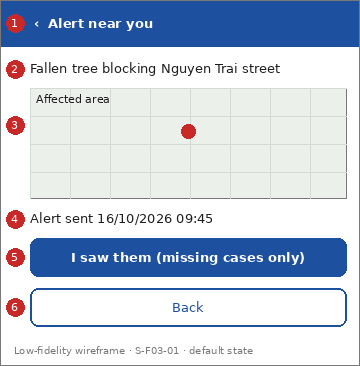

# Screen Spec: S-F03-01 Geofenced alert detail

| Field | Value |
|---|---|
| Screen ID | `S-F03-01` |
| Screen name | Geofenced alert detail |
| Actor | Citizens (ACT-E1) |
| Priority | Should |
| Feature | `F-03 Alerts & Notifications` |
| Activity diagrams | AD-UC-04 |
| Mockup image | `img/S-F03-01.png` |
| Status | Draft |

## 1. Purpose

**Shown when:** The citizen taps the push notification or an item in "RecentAlertsList".

**The user leaves this screen when:** The citizen goes back or reports a sighting.

## 2. Mockup

Low-fidelity wireframe of the default state, generated from the element inventory below; the numbers on the image are the numbers in the table. Elements marked with a state are not drawn.

## 3. Element inventory

| # | Element | Type | Content / data source | Required | Validation |
|---|---|---|---|---|---|
| 1 | `AlertHeader` | Header | "Alert near you" (static text, back arrow) | Yes | - |
| 2 | `AlertCategoryText` | Text | "Fallen tree blocking Nguyen Trai street"; data: Incident Report: category and description (routed for public attention) | Yes | - |
| 3 | `AlertAreaMap` | Map | "Affected area"; data: Incident Report: GPS location; geofenced area (FR-03-01) | Yes | - |
| 4 | `AlertTimeText` | Text | "Alert sent 16/10/2026 09:45"; data: Incident Report: routed time | Yes | - |
| 5 | `ReportSightingButton` | Button | "I saw them (missing cases only)" (static text; shown only for an active missing case) | No | - |
| 6 | `AlertBackButton` | Button | "Back" | No | - |

## 4. States

| State | What the user sees | Trigger |
|---|---|---|
| Default | Category and description, affected area on a map, alert time | The screen opens |
| Empty (no data) | Not applicable: an alert always has content | - |
| Loading | Skeleton in place of the content | The alert is being fetched |
| Error | "This alert is no longer available." | The alert was withdrawn or the request fails |
| Success / confirmation | Not applicable: the screen only reads data | - |

## 5. Interactions and navigation

| # | Element | User action | System response | Goes to screen |
|---|---|---|---|---|
| 1 | ReportSightingButton | tap | Opens the sighting form (runs the eligibility check first) | `S-F01-05` |
| 2 | AlertBackButton / back arrow | tap | Returns to the previous screen | `S-F00-01` |

## 6. Screen-level rules

| Rule ID | Rule | Source |
|---|---|---|
| SR-001 | Only citizens inside the affected geofenced area are notified | FR-03-01 |
| SR-002 | Only reports auto-routed by UC-09 trigger an alert | AD-UC-04 question 1 |
| SR-003 | The reporter's identity is never shown | assumption, privacy; question 2 |

## 7. Linked requirements

| FR ID | What this screen does for it |
|---|---|
| FR-03-01 | Shows the geofenced alert that the citizen was notified about |

## 8. Responsive and accessibility notes

- Smallest supported width: 360px
- What collapses or stacks on a narrow screen: Map above text on narrow screens; buttons keep full width.
- Information never carried by colour alone: statuses and markers use text and an icon next to the colour (ui-conventions.md section 5)
- Text contrast and minimum size: body text at least 4.5:1 and 14px; tap targets at least 24 by 24 CSS pixels

## 9. Open questions

| # | Question | Blocking? | Status |
|---|---|---|---|
| 1 | [NEEDS CLARIFICATION: FR-03-01 covers reports routed for public attention, not missing cases. Do missing cases also produce an alert, and is the sighting button shown here?] | No | Open |
| 2 | [NEEDS CLARIFICATION: what data about the incident may be shown to the public (privacy)?] | No | Open |
| 3 | This screen has no FE work item in W1 (see screen-list.md, cost gap). | No | Open |

---

## Completion checklist

- [x] The mockup is a separate cropped image file, named with the Screen ID.
- [x] Every visible element in the mockup appears in the element inventory.
- [x] Every input element has a validation rule or an explicit "none".
- [x] All five states are filled in, or marked "not applicable" with a reason.
- [x] Every navigation target is a Screen ID that exists in the Screen List.
- [x] Every element that displays data names the field it displays.
- [x] Every linked FR exists in the Function List, and every action of this screen in an activity diagram is covered by an interaction row.

---

Template source: DBIZ3 Session 4 Screen Spec template (VJCBI College - FTU, 2026), adopted unchanged in structure for DBIZ2 Lesson 8, with Feature and Activity diagram fields added.
