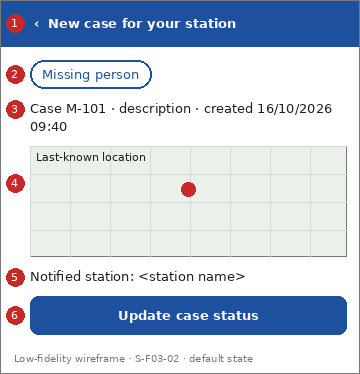

# Screen Spec: S-F03-02 Police case notification

| Field | Value |
|---|---|
| Screen ID | `S-F03-02` |
| Screen name | Police case notification |
| Actor | Police (ACT-P2) |
| Priority | Must |
| Feature | `F-03 Alerts & Notifications` |
| Activity diagrams | AD-UC-10 |
| Mockup image | `img/S-F03-02.png` |
| Status | Draft |

## 1. Purpose

**Shown when:** The police station is notified of a missing case or a routed report that requires police attention.

**The user leaves this screen when:** The officer updates the case status or goes back.

## 2. Mockup

Low-fidelity wireframe of the default state, generated from the element inventory below; the numbers on the image are the numbers in the table. Elements marked with a state are not drawn.

## 3. Element inventory

| # | Element | Type | Content / data source | Required | Validation |
|---|---|---|---|---|---|
| 1 | `PoliceNoticeHeader` | Header | "New case for your station" (static text, back arrow) | Yes | - |
| 2 | `CaseTypeChip` | Chip | "Missing person"; data: Missing Person / Pet / Asset Case or Incident Report: record type | Yes | - |
| 3 | `PoliceCaseSummary` | Text | "Case M-101 · description · created 16/10/2026 09:40"; data: Missing Person / Pet / Asset Case or Incident Report: ID, description, created time | Yes | - |
| 4 | `PoliceCaseMap` | Map | "Last-known location"; data: Missing Person / Pet / Asset Case or Incident Report: location | Yes | - |
| 5 | `NotifiedStationText` | Text | "Notified station: <station name>"; data: Government Agency & Routing Directory: nearest police station (assumed source, question 2) | Yes | - |
| 6 | `OpenUpdateStatusButton` | Button | "Update case status" | No | - |

## 4. States

| State | What the user sees | Trigger |
|---|---|---|
| Default | Record type, summary, map and the notified station | The screen opens |
| Empty (no data) | Not applicable: a notification always has content | - |
| Loading | Skeleton in place of the content | The record is being fetched |
| Error | "This case is not available." or a system-error banner with Retry | Record missing, role not permitted, or request fails |
| Success / confirmation | Not applicable: receipt is not acknowledged (FR-03-02 defines no acknowledgement) | - |

## 5. Interactions and navigation

| # | Element | User action | System response | Goes to screen |
|---|---|---|---|---|
| 1 | OpenUpdateStatusButton | tap | Opens the status screen (shown only if the role permits) | `S-F01-06` |
| 2 | Back arrow | tap | Returns home | `S-F00-01` |

## 6. Screen-level rules

| Rule ID | Rule | Source |
|---|---|---|
| SR-001 | The notification goes automatically to the nearest police station; receipt implies no response or acknowledgement | FR-03-02; AD-UC-10 reading notes |
| SR-002 | Only officers of the notified station see it (nearest-station rule open) | AD-UC-10 question 1 |
| SR-003 | Role check before "OpenUpdateStatusButton" is shown | FR-05-02 |

## 7. Linked requirements

| FR ID | What this screen does for it |
|---|---|
| FR-03-02 | Delivers the automatic notification to the police user |

## 8. Responsive and accessibility notes

- Smallest supported width: 360px
- What collapses or stacks on a narrow screen: Map moves below the summary on narrow screens.
- Information never carried by colour alone: statuses and markers use text and an icon next to the colour (ui-conventions.md section 5)
- Text contrast and minimum size: body text at least 4.5:1 and 14px; tap targets at least 24 by 24 CSS pixels

## 9. Open questions

| # | Question | Blocking? | Status |
|---|---|---|---|
| 1 | [NEEDS CLARIFICATION: which channel delivers the notification, and what happens when sending fails? In-app notification is assumed (AD-UC-10 question 3)] | No | Open |
| 2 | [NEEDS CLARIFICATION: which directory supplies police stations? (AD-UC-10 question 2)] | No | Open |
| 3 | This screen has no FE work item in W1 (see screen-list.md, cost gap). | No | Open |

---

## Completion checklist

- [x] The mockup is a separate cropped image file, named with the Screen ID.
- [x] Every visible element in the mockup appears in the element inventory.
- [x] Every input element has a validation rule or an explicit "none".
- [x] All five states are filled in, or marked "not applicable" with a reason.
- [x] Every navigation target is a Screen ID that exists in the Screen List.
- [x] Every element that displays data names the field it displays.
- [x] Every linked FR exists in the Function List, and every action of this screen in an activity diagram is covered by an interaction row.

---

Template source: DBIZ3 Session 4 Screen Spec template (VJCBI College - FTU, 2026), adopted unchanged in structure for DBIZ2 Lesson 8, with Feature and Activity diagram fields added.
