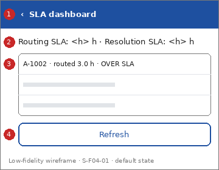

# Screen Spec: S-F04-01 SLA dashboard

| Field | Value |
|---|---|
| Screen ID | `S-F04-01` |
| Screen name | SLA dashboard |
| Actor | HPC & Government Agencies (ACT-G2) |
| Priority | Could |
| Feature | `F-04 Oversight & Analytics` |
| Activity diagrams | AD-UC-14 |
| Mockup image | `img/S-F04-01.png` |
| Status | Draft |

## 1. Purpose

**Shown when:** An authorised HPC user taps "SLA dashboard".

**The user leaves this screen when:** The user opens a case audit trail or goes back.

## 2. Mockup

Low-fidelity wireframe of the default state, generated from the element inventory below; the numbers on the image are the numbers in the table. Elements marked with a state are not drawn.

## 3. Element inventory

| # | Element | Type | Content / data source | Required | Validation |
|---|---|---|---|---|---|
| 1 | `SlaHeader` | Header | "SLA dashboard" (static text, back arrow) | Yes | - |
| 2 | `SlaThresholdText` | Text | "Routing SLA: <h> h · Resolution SLA: <h> h"; data: SLA & Routing Metrics: thresholds (values not defined, question 1) | Yes | - |
| 3 | `SlaReportList` | List | "A-1002 · routed 3.0 h · OVER SLA"; data: SLA & Routing Metrics: alert ID, routing time, resolution time, over/within marker (FR-04-02) | Yes | - |
| 4 | `RefreshButton` | Button | "Refresh" | No | - |

## 4. States

| State | What the user sees | Trigger |
|---|---|---|
| Default | Thresholds and one row per report with its times; over-threshold times carry the text "OVER SLA" and an icon | The screen opens (times calculated when opened) |
| Empty (no data) | "No reports to show yet." | No report exists |
| Loading | Skeleton rows | The times are being calculated |
| Error | "Could not load the dashboard. Try again." or access denied: "You are not allowed to view the dashboard." | The request fails or the role is not permitted |
| Success / confirmation | Not applicable: the screen only reads data | - |

## 5. Interactions and navigation

| # | Element | User action | System response | Goes to screen |
|---|---|---|---|---|
| 1 | SlaReportList item | tap | Opens the audit trail of that case | `S-F04-02` |
| 2 | RefreshButton | tap | Recalculates the times | stays |
| 3 | Back arrow | tap | Returns home | `S-F00-01` |

## 6. Screen-level rules

| Rule ID | Rule | Source |
|---|---|---|
| SR-001 | Only HPC & Government Agencies staff authorised by role may open the dashboard | FR-05-02; AD-UC-14 question 5 |
| SR-002 | A time strictly greater than its threshold is over the SLA | AD-UC-14 question 3 (default) |
| SR-003 | A breach changes the display only; no notification is sent | AD-UC-14 question 2 (default) |
| SR-004 | Over SLA is shown by text and icon, never by colour alone | ui-conventions.md section 5 |

## 7. Linked requirements

| FR ID | What this screen does for it |
|---|---|
| FR-04-02 | Displays routing and resolution times against SLA thresholds |

## 8. Responsive and accessibility notes

- Smallest supported width: 360px
- What collapses or stacks on a narrow screen: Each row shows two lines; thresholds wrap above the list.
- Information never carried by colour alone: statuses and markers use text and an icon next to the colour (ui-conventions.md section 5)
- Text contrast and minimum size: body text at least 4.5:1 and 14px; tap targets at least 24 by 24 CSS pixels

## 9. Open questions

| # | Question | Blocking? | Status |
|---|---|---|---|
| 1 | [NEEDS CLARIFICATION: what are the SLA thresholds for routing and resolution? (AD-UC-14 question 1)] | No for the screen; yes before acceptance tests | Open |

---

## Completion checklist

- [x] The mockup is a separate cropped image file, named with the Screen ID.
- [x] Every visible element in the mockup appears in the element inventory.
- [x] Every input element has a validation rule or an explicit "none".
- [x] All five states are filled in, or marked "not applicable" with a reason.
- [x] Every navigation target is a Screen ID that exists in the Screen List.
- [x] Every element that displays data names the field it displays.
- [x] Every linked FR exists in the Function List, and every action of this screen in an activity diagram is covered by an interaction row.

---

Template source: DBIZ3 Session 4 Screen Spec template (VJCBI College - FTU, 2026), adopted unchanged in structure for DBIZ2 Lesson 8, with Feature and Activity diagram fields added.
