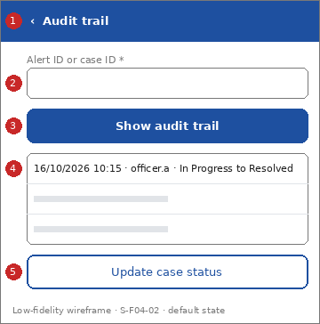

# Screen Spec: S-F04-02 Audit trail

| Field | Value |
|---|---|
| Screen ID | `S-F04-02` |
| Screen name | Audit trail |
| Actor | HPC & Government Agencies (ACT-G2) |
| Priority | Must |
| Feature | `F-04 Oversight & Analytics` |
| Activity diagrams | AD-UC-15 (diagram A) |
| Mockup image | `img/S-F04-02.png` |
| Status | Draft |

## 1. Purpose

**Shown when:** An authorised HPC user opens the audit trail, or taps a row on the SLA dashboard.

**The user leaves this screen when:** The user updates the case status or goes back.

## 2. Mockup

Low-fidelity wireframe of the default state, generated from the element inventory below; the numbers on the image are the numbers in the table. Elements marked with a state are not drawn.

## 3. Element inventory

| # | Element | Type | Content / data source | Required | Validation |
|---|---|---|---|---|---|
| 1 | `AuditHeader` | Header | "Audit trail" (static text, back arrow) | Yes | - |
| 2 | `CaseIdSearchInput` | Input | "Alert ID or case ID"; data: Incident Report / Missing Person / Pet / Asset Case: ID | Yes | Format A-nnnn or M-nnn (assumed from AD test data) |
| 3 | `SearchCaseButton` | Button | "Show audit trail" | Yes | Enabled when "CaseIdSearchInput" is valid |
| 4 | `AuditEntryList` | List | "16/10/2026 10:15 · officer.a · In Progress to Resolved"; data: Audit Trail: time, user, old status, new status (FR-04-03) | Yes | - |
| 5 | `OpenUpdateFromAuditButton` | Button | "Update case status" | No | - |

## 4. States

| State | What the user sees | Trigger |
|---|---|---|
| Default | Search box and, after a search, the read-only list of entries for the case (all entries, no edit or delete) | The screen opens, or a case was passed in from the dashboard |
| Empty (no data) | "No audit entries for this case." or "No case found with this ID." | The case has no entries or does not exist |
| Loading | Skeleton rows | The trail is being fetched |
| Error | "Could not load the audit trail. Try again." or access denied: "You are not allowed to view audit trails." | The request fails or the role is not permitted |
| Success / confirmation | Not applicable: the screen only reads data | - |

## 5. Interactions and navigation

| # | Element | User action | System response | Goes to screen |
|---|---|---|---|---|
| 1 | SearchCaseButton | tap | Loads the audit trail of the case | stays |
| 2 | OpenUpdateFromAuditButton | tap | Opens the status screen for this case (only if the role permits) | `S-F01-06` |
| 3 | Back arrow | tap | Returns home | `S-F00-01` |

## 6. Screen-level rules

| Rule ID | Rule | Source |
|---|---|---|
| SR-001 | The trail is read-only: no edit and no delete | AD-UC-15 question 2 (default), FR-04-03 |
| SR-002 | An entry holds time, user, old status and new status (default) | AD-UC-15 question 1 |
| SR-003 | Only HPC & Government Agencies staff may view the trail | AD-UC-15 question 3; FR-05-02 |

## 7. Linked requirements

| FR ID | What this screen does for it |
|---|---|
| FR-04-03 | Lets an authorised user view the full audit trail for a case |
| FR-05-02 | Role check |

## 8. Responsive and accessibility notes

- Smallest supported width: 360px
- What collapses or stacks on a narrow screen: Entries show two lines: time and user, then the status change.
- Information never carried by colour alone: statuses and markers use text and an icon next to the colour (ui-conventions.md section 5)
- Text contrast and minimum size: body text at least 4.5:1 and 14px; tap targets at least 24 by 24 CSS pixels

## 9. Open questions

| # | Question | Blocking? | Status |
|---|---|---|---|
| 1 | [NEEDS CLARIFICATION: which fields does an audit entry hold, and how long is the trail kept? (AD-UC-15 questions 1 and 2)] | No | Open |
| 2 | [NEEDS CLARIFICATION: may Police also view the audit trail of their own cases? (AD-UC-15 question 3)] | No | Open |
| 3 | [NEEDS CLARIFICATION: how does staff find a case without its ID? No FR defines a case list] | No | Open |

---

## Completion checklist

- [x] The mockup is a separate cropped image file, named with the Screen ID.
- [x] Every visible element in the mockup appears in the element inventory.
- [x] Every input element has a validation rule or an explicit "none".
- [x] All five states are filled in, or marked "not applicable" with a reason.
- [x] Every navigation target is a Screen ID that exists in the Screen List.
- [x] Every element that displays data names the field it displays.
- [x] Every linked FR exists in the Function List, and every action of this screen in an activity diagram is covered by an interaction row.

---

Template source: DBIZ3 Session 4 Screen Spec template (VJCBI College - FTU, 2026), adopted unchanged in structure for DBIZ2 Lesson 8, with Feature and Activity diagram fields added.
