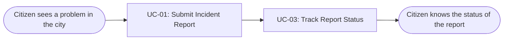
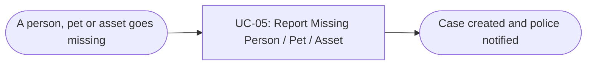
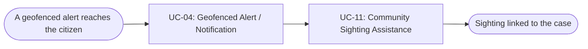
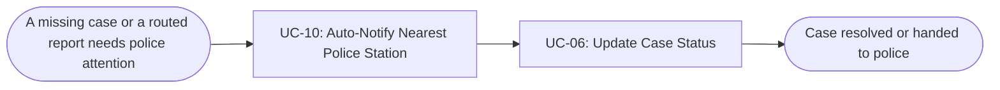
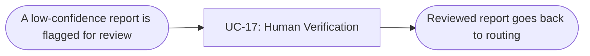
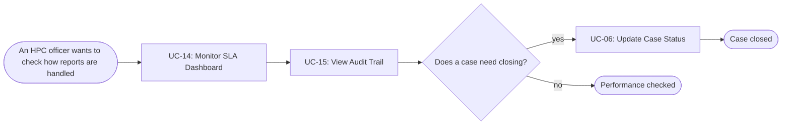

# Usage Flow: iHanoi Alert Module

| Field | Value |
|---|---|
| Product | iHanoi Alert Module |
| Version | v0.1 |
| Date | 2026-11-07 |
| Sources | W0 Table 1 (use case inventory); Use Case Diagram; `activity-diagrams/activity-index.md` |

## Before you draw: is Lesson 4 still true?

- [ ] Every row of the Inputs check table has Status "Done", or is logged as an open question.

Not complete. `activity-index.md` has no separate Inputs check table. Its findings are in section 6 ("Edits still needed in the source drawings": Use Case Diagram, Context Diagram, Sequence Diagram v3, workbook) and in section 5 (12 blocking questions). They are logged, but the drawings themselves have not been changed. Nothing in this file depends on them except the line UC-01 to UC-08, which is a system call and has no flow here.

## Citizens: report an incident and follow it

| Step | Use case | Activity diagram | Screens (fill in after Block 2) |
|---|---|---|---|
| 1 | UC-01 Submit Incident Report | `AD-UC-01.md` | S-F00-01, S-F01-01 |
| 2 | UC-03 Track Report Status | `AD-UC-03.md` | S-F01-02, S-F01-03 |

## Citizens: report a missing person, pet or asset

| Step | Use case | Activity diagram | Screens (fill in after Block 2) |
|---|---|---|---|
| 1 | UC-05 Report Missing Person / Pet / Asset | `AD-UC-05.md` | S-F00-01, S-F01-04 |

## Citizens: respond to a nearby alert

| Step | Use case | Activity diagram | Screens (fill in after Block 2) |
|---|---|---|---|
| 1 | UC-04 Geofenced Alert / Notification | `AD-UC-04.md` | S-F03-01 (from the push notification or the S-F00-01 list) |
| 2 | UC-11 Community Sighting Assistance | `AD-UC-11.md` | S-F01-05 |

## Police: handle a notified case

| Step | Use case | Activity diagram | Screens (fill in after Block 2) |
|---|---|---|---|
| 1 | UC-10 Auto-Notify Nearest Police Station | `AD-UC-10.md` | S-F03-02 (from the in-app notification or the S-F00-01 list) |
| 2 | UC-06 Update Case Status | `AD-UC-06.md` | S-F01-06 |

## HPC & Government Agencies: verify a flagged report

| Step | Use case | Activity diagram | Screens (fill in after Block 2) |
|---|---|---|---|
| 1 | UC-17 Human Verification (if needed) | `AD-UC-17.md` | S-F00-01, S-F02-01, S-F02-02 |

## HPC & Government Agencies: oversee performance and close a case

| Step | Use case | Activity diagram | Screens (fill in after Block 2) |
|---|---|---|---|
| 1 | UC-14 Monitor SLA Dashboard | `AD-UC-14.md` | S-F00-01, S-F04-01 |
| 2 | UC-15 View Audit Trail | `AD-UC-15.md` (diagram A) | S-F04-02 |
| 3 | UC-06 Update Case Status | `AD-UC-06.md` | S-F01-06 |

## Use cases without a flow

| Use case | Started by | Described in |
|---|---|---|
| UC-02 Duplicate Detection | System (called by UC-01) | `AD-UC-02.md` |
| UC-07 AI Classification & Confidence Scoring | System (called by UC-08) | `AD-UC-07.md` |
| UC-08 Smart Routing to Responsible Agency | System (called by UC-01) | `AD-UC-08.md` |
| UC-09 Auto-route report (confidence > 0.9) | System (called by UC-08) | `AD-UC-09.md` |
| UC-13 LGSP Cross-Verification (RAG-based) | System (called by UC-08) and a time event (LGSP sync) | `AD-UC-13.md` |
| UC-16 Manage System Integration & API Access | External system (the technology partner's system, through the API) | `AD-UC-16.md` |

UC-10 and UC-04 are started by the system, but a person reads their result, so they appear as the first box of a flow. UC-12 is a Won't-have use case and appears nowhere.

## Checks before you save

- [x] Every actor that starts a use case has at least one flow: Citizens (3), Police (1), HPC & Government Agencies (2). Technology Partners start nothing through a screen (API only).
- [x] An actor with clearly different goals has one flow per goal; no flow has more than about 9 boxes (the longest has 3).
- [x] Every actor name matches the Use Case Diagram and the Context Diagram (Citizens & Community Users, Police, HPC & Government Agencies).
- [x] Coverage: every in-scope use case of W0 Table 1 that a person starts appears in at least one flow (UC-01, 03, 04, 05, 06, 10, 11, 14, 15, 17), with the same ID and name; system-started use cases are listed above; UC-12 (Won't) appears nowhere.
- [x] No box is a click or a screen; no box tells two use cases.
- [ ] Every flow renders on mermaid.live. Syntax was parsed with Mermaid 12.3.0 in Node; mermaid.live was not run.
- [x] After Block 2: every step has at least one screen, and every screen in [screen-list.md](screen-list.md) appears in some step (S-F00-01 appears as the start screen of the first step of the Citizen, Police-list and HPC flows).

---
Template source: DBIZ2, VJCBI College - FTU, Lesson 8 (2026).
