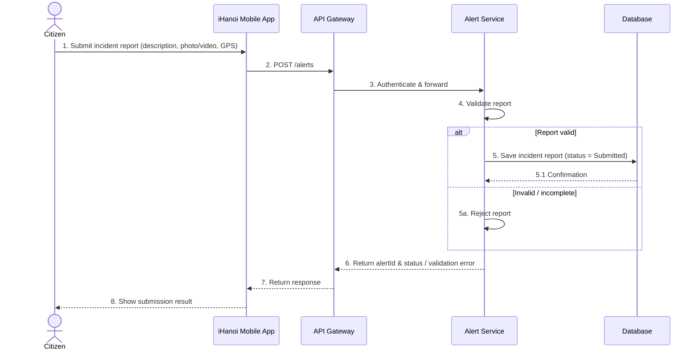
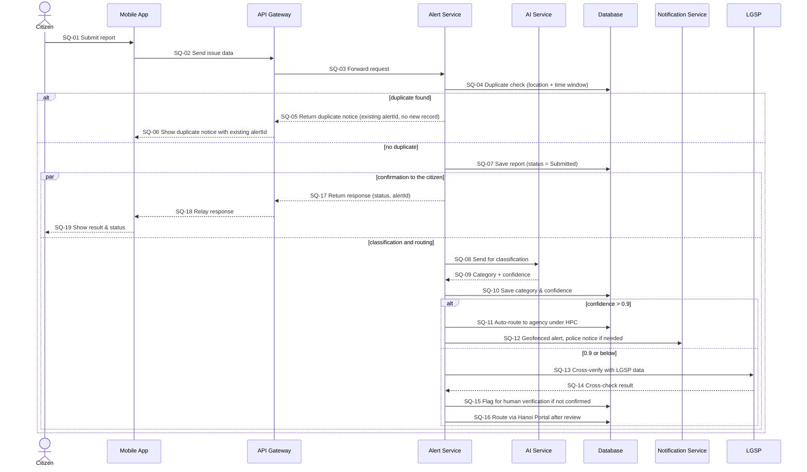

# SD-UC-01 — Submit Incident Report

> Lesson 4 · Sources: `UC-01_Submit_Incident_Report_Sequence_Diagram.drawio` (basic flow) and `iHanoi_Alert_Sequence_Diagram_v3.drawio` (full flow, SQ-01…SQ-19). Message senders and receivers were read from arrow positions.

## A. Basic flow (steps 1–8, alt valid / invalid)

Participants: Citizen, iHanoi Mobile App, API Gateway, Alert Service (Backend), Database.

## B. Full flow (SQ-01…SQ-19)

Participants add AI Service (Classification), Notification Service and LGSP (external).

### Message trace

| Step | From → To | Message | Function |
|---|---|---|---|
| SQ-01 | Citizen → App | Submit report | FR-01-01-FE |
| SQ-02 | App → Gateway | Send issue data | FR-01-01-BE |
| SQ-03 | Gateway → Alert Service | Forward request | FR-05-01-INT (gateway); no own FR |
| SQ-04 | Alert Service → DB | Duplicate check | FR-02-01-BE (NC) |
| SQ-05 | Alert Service → Gateway | Duplicate notice | FR-02-01-BE |
| SQ-06 | Gateway → App | Show notice | FR-01-01-FE |
| SQ-07 | Alert Service → DB | Save report (status = Submitted) | FR-01-01-BE |
| SQ-08 | Alert Service → AI | Classify | FR-02-02-BE |
| SQ-09 | AI → Alert Service | Category + confidence | FR-02-02-INT |
| SQ-10 | Alert Service → DB | Save category | FR-02-02-BE |
| SQ-11 | Alert Service → DB | Auto-route | FR-02-03-BE |
| SQ-12 | Alert Service → Notification | Alert / police notice | FR-03-01-BE, FR-03-01-INT, FR-03-02-BE |
| SQ-13 | Alert Service → LGSP | Cross-verify | FR-02-04-INT |
| SQ-14 | LGSP → Alert Service | Result | FR-02-04-INT |
| SQ-15 | Alert Service → DB | Flag for human review | FR-02-05-BE |
| SQ-16 | Alert Service → DB | Route via Hanoi Portal | FR-02-03-BE, FR-02-03-INT |
| SQ-17 | Alert Service → Gateway | Return response (right after SQ-07, parallel with SQ-08 to SQ-16) | FR-01-01-BE |
| SQ-18 | Gateway → App | Relay | no own FR |
| SQ-19 | App → Citizen | Show result | FR-01-01-FE |

## Resolved conventions
1. **Initial status = Submitted** in both flows (the drawing of the full flow still says "Received").
2. **Duplicates:** the notice at SQ-05/06 ends the submission: no new record is created and the citizen sees the existing alertId (FR-02-01). The "confirm or cancel" choice drawn at SQ-06 is dropped; update the drawing.
3. **Hanoi Portal** receives manually routed reports (SQ-16); it is a lifeline-less external entity on the context diagram (Flow-11).

4. **Response timing:** the confirmation (SQ-17 to SQ-19) is sent right after SQ-07, in parallel with classification and routing, so the citizen does not wait for human review. Numbering is unchanged. Basis: FR-01-01, [AD-UC-01](activity-diagrams/AD-UC-01.md).

## Still open
1. **Invalid reports:** flow A rejects invalid reports; flow B has no validation step and no FR beyond "validate submission".
2. **Nothing returns to the app after routing:** the citizen sees status only by polling (FR-01-02); no step updates the app when routing, review or resolution completes.
3. **Human reviewer and Hanoi Portal** (SQ-15, SQ-16) are not lifelines; both end in a database write.
