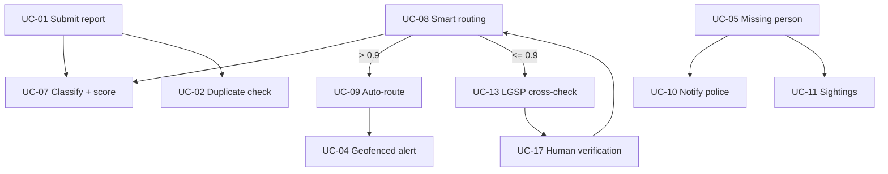

# Use case diagram

> Lesson 4 · Source: `iHanoi_Alert_Use_Case_Diagram_v3.drawio` (actor codes harmonised with the CVCA, see §Issues) ("Crowdsourcing Alert Module integrated into iHanoi"). 17 use cases, 5 actors. Colour code in the drawing: blue = reporting, green = missing person/asset, orange = AI/routing, yellow = external data, purple = monitoring.

## Who wants what

| Actor | Use cases |
|---|---|
| ACT-E1 Citizens | UC-01 Submit report, UC-03 Track status, UC-04 Geofenced alert, UC-05 Report missing person/pet/asset, UC-11 Sighting assistance |
| ACT-P2 Police | UC-06 Update case status, UC-10 Auto-notify nearest police station |
| ACT-G2 HPC & Government Agencies | UC-06 Update case status, UC-12 Reports & analytics, UC-14 SLA dashboard, UC-15 Audit trail, UC-17 Human verification |
| ACT-O3 LGSP | UC-13 LGSP cross-verification |
| ACT-P1 Technology Partners | UC-16 Manage integration & API access |

UC-02, UC-07, UC-08 and UC-09 have no external actor: they run inside the system and are reached from other use cases.

## Relations between use cases

| From | To | Condition |
|---|---|---|
| UC-01 Submit report | UC-07 AI classification | always |
| UC-01 | UC-02 Duplicate detection | always |
| UC-08 Smart routing | UC-07 | uses the score |
| UC-08 | UC-09 Auto-route | `[confidence > 0.9]` |
| UC-08 | UC-13 LGSP cross-verification | `[confidence ≤ 0.9]` |
| UC-13 | UC-17 Human verification | if not confirmed |
| UC-17 | UC-08 | back to routing after review |
| UC-09 | UC-04 Geofenced alert | after auto-route |
| UC-05 Missing person | UC-10 Auto-notify police | always |
| UC-05 | UC-11 Sighting assistance | while the case is active |

## Use cases → features → functions

| UC | Feature | Functions | Priority after W4 |
|---|---|---|---|
| UC-01 | F-01 | FR-01-01 | Must |
| UC-02 | F-02 | FR-02-01 | Should |
| UC-03 | F-01 | FR-01-02 | Should |
| UC-04 | F-03 | FR-03-01 | Should |
| UC-05 | F-01 | FR-01-03 | Must |
| UC-06 | F-01 | FR-01-04 | Should |
| UC-07 | F-02 | FR-02-02 | Must |
| UC-08, UC-09 | F-02 | FR-02-03 | Must |
| UC-10 | F-03 | FR-03-02 | Must |
| UC-11 | F-01 | FR-01-05 | Could |
| UC-12 | F-04 | FR-04-01 | Won't |
| UC-13 | F-02 | FR-02-04 | Could |
| UC-14 | F-04 | FR-04-02 | Could |
| UC-15 | F-04 | FR-04-03 | Must |
| UC-16 | F-05 | FR-05-01, FR-05-02 | Must |
| UC-17 | F-02 | FR-02-05 | Must |

Not tied to any use case: FR-03-03 (Won't) and FR-05-03 (Should).

## List of sequence diagrams

| Diagram | Covers | Status |
|---|---|---|
| **SD-UC-01** | UC-01 submit report, with UC-02, 07, 08, 09, 13, 17, 04, 10 as the extended flow SQ-01…SQ-19 | Drawn (two versions) → [SD-UC-01.md](SD-UC-01.md) |
| SD-UC-03 | Track report status | Not drawn (activity diagram AD-UC-03 exists) |
| SD-UC-05 | Report missing person/pet/asset (+ UC-10, UC-11) | Not drawn |
| SD-UC-06 | Update case status | Not drawn |
| SD-UC-12 / 14 / 15 | HPC oversight | Not drawn |
| SD-UC-16 | Partner API access | Not drawn |

Recommended next: SD-UC-05 and SD-UC-06, because they have Must/Should functions (FR-01-03, FR-03-02, FR-01-04) that no sequence step traces to yet.

## List of activity diagrams

All 17 use cases have an activity diagram in [activity-diagrams/](activity-diagrams/activity-index.md): one file per use case (AD-UC-01 to AD-UC-17), with a shared index, conventions, call map and state table. AD-UC-15 holds two diagrams (view and record).

## Issues
- The diagram has no actor for UC-04's recipients beyond Citizens, and UC-04 is reached from UC-09 only; the missing-person flow (UC-05 → UC-10) notifies police but has no path to a citizen alert.
- UC-12 is deferred (Won't) but remains in the diagram; mark it as out of release.
- **Actor IDs** in this write-up follow the CVCA (HPC = ACT-G2, LGSP = ACT-O3); the drawing still uses ACT-G1 for HPC and ACT-G2 for LGSP and needs the same relabel. Register: [w0-scope.md](w0-scope.md) §6.
- **Hanoi Portal** (CVCA O2) is a target of manual routing (UC-08 → FR-02-03-INT) but is not drawn as an actor; treat it as an external system, as in [context-diagram.md](context-diagram.md) Flow-11.
